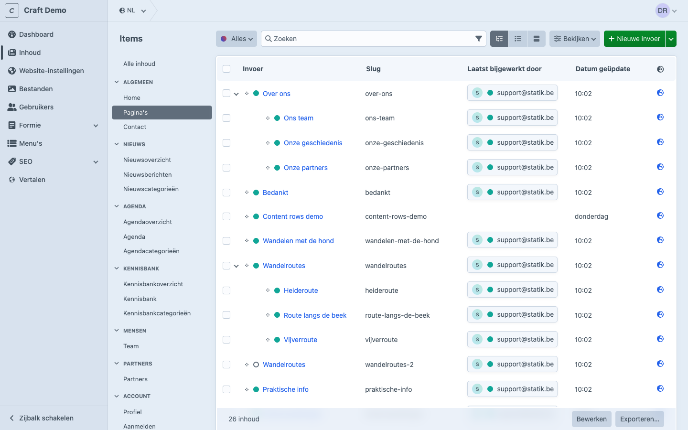
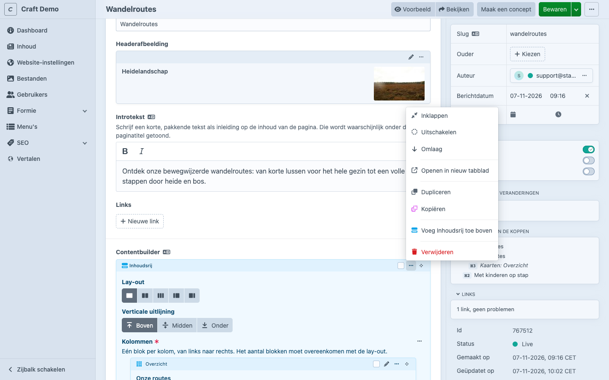
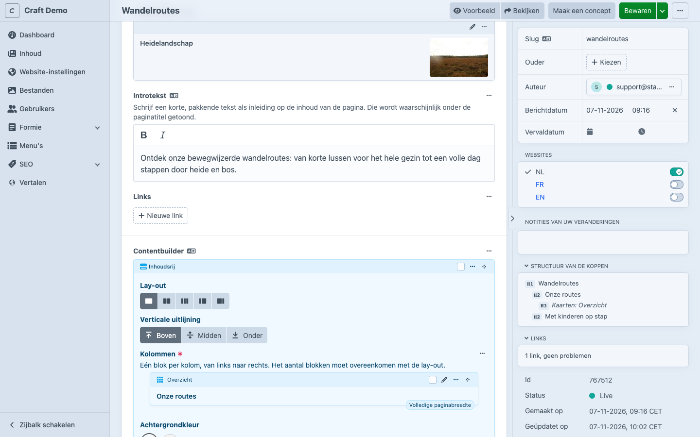

# Welkom: hoe deze reeks werkt en waar je hulp vindt

Deze reeks leert je de inhoud van je website zelf beheren: pagina's maken, tekst en links invullen, afbeeldingen toevoegen en publiceren. Lees dit eerst als je net toegang kreeg tot het control panel, of als je wil weten waar je terechtkan met vragen.

## Hoe de reeks werkt

Elke video en elke uitleg gaat over één onderwerp en duurt één tot drie minuten. Ze volgen een logische volgorde (aan de slag, een pagina maken, tekst en links, de contentbuilder, afbeeldingen, publiceren …), maar je kan ook meteen naar het onderwerp springen dat je nodig hebt.

De reeks behandelt wat op elke site hetzelfde werkt. Jouw site heeft daarnaast eigen onderdelen, zoals specifieke secties of instellingen. Die bespreken we samen in de opleiding over jouw site. Het is dus geen probleem als je in je eigen control panel iets ziet dat hier niet aan bod komt.

<!-- screenshot: Inhoud > Pagina's met de demopagina's (Wandelroutes, Over ons, Praktische info); niets markeren -->

## Je kan bijna niets kapotmaken

Probeer gerust dingen uit. Het control panel vangt veel fouten voor je op:

- Een rij in de contentbuilder kan je uitschakelen in plaats van verwijderen. Ze blijft dan bewaard, maar bezoekers zien ze niet.
- Je kan een vorige versie van een pagina terugzetten. Per pagina bewaart de site de laatste tien versies (zie *Iets ongedaan maken: revisies en de prullenbak*).
- Wijzigingen die je nog niet bewaarde, kan je weggooien.

Oefen het liefst op de testsite, zeker vóór je site live gaat. Testinhoud mag je achteraf gewoon verwijderen.

<!-- screenshot: bewerkscherm van een pagina, menu met de drie puntjes van een rij open; het menu markeren -->

## Overal dezelfde patronen

Na een paar keer werken wordt het vertrouwd, omdat dezelfde knoppen overal terugkomen:

- **Drie puntjes**: extra opties. Vind je iets niet, kijk dan eerst daar.
- **Slepen**: rijen, pagina's en links verplaats je door ze te slepen.
- **Schermen die van rechts openschuiven**: daarin bewerk je bijvoorbeeld een kolom of een afbeelding zonder je pagina te verlaten.

## Lees de uitleg bij de velden

Onder veel velden staat een korte uitleg in grijze tekst. Daar staan de regels van jouw site, zoals een aanbevolen afmeting voor een afbeelding of wat er gebeurt als je het veld leeg laat. Een belangrijke algemene regel: een veld dat je leeg laat, wordt op de site niet getoond.

<!-- screenshot: veld Introtekst met de grijze uitleg eronder; de uitleg markeren -->

## Waar vind je hulp?

1. **De helpsite**: video's en dezelfde uitleg in tekst over het werken met het control panel. Begin daar als je vastzit.
2. **De uitleg bij de velden**, in het control panel zelf.
3. **Ons**: vind je het antwoord niet, laat het ons dan weten.

## Veelgestelde vragen

- **Kan ik iets stukmaken door te oefenen?** Op de testsite zeker niet. Op de live site zie je meestal pas iets na bewaren, en ook dan kan je een vorige versie terugzetten.

## Zie ook

- Inloggen en je weg vinden in het control panel
- Inhoud terugvinden: secties, zoeken en het potloodje
- Iets ongedaan maken: revisies en de prullenbak
