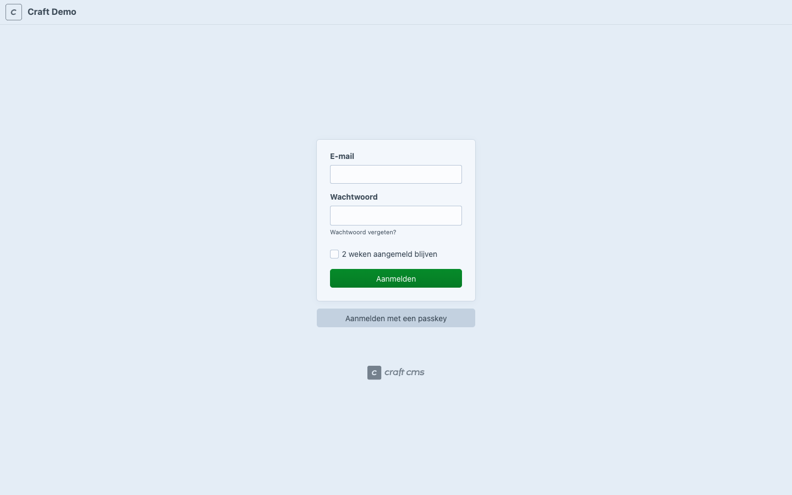
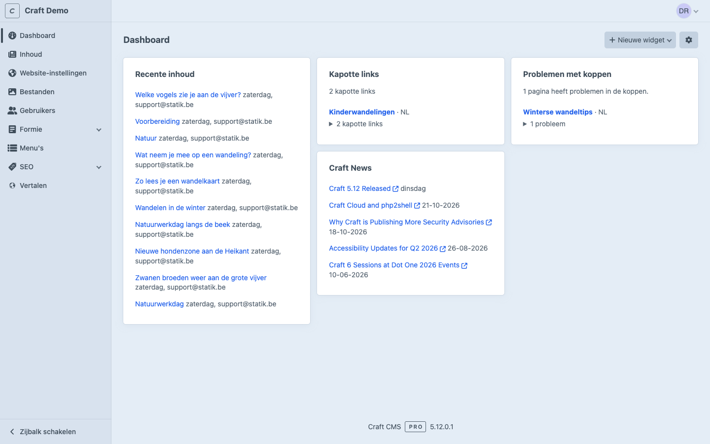

# Inloggen en je weg vinden in het control panel

In het control panel beheer je je website: daar pas je alles aan wat bezoekers te zien krijgen. Hier lees je hoe je inlogt, wat er in de zijbalk staat en welke knoppen je overal terugziet.

## Je account activeren

Wanneer we een account voor je aanmaken, krijg je een activatiemail.

1. Open de mail en klik op de knop om je wachtwoord in te stellen.
2. Kies een wachtwoord dat aan de eisen op het scherm voldoet.
3. Je komt daarna meteen in het control panel terecht.

> **Let op:** De activatielink is maar een beperkte tijd geldig. Vind je de mail niet, kijk dan in je map met spam of ongewenste mail. Is hij er niet of is de link verlopen, laat het ons weten: we sturen een nieuwe (zie *Een account beheren*).

## Inloggen

1. Ga naar de loginpagina van het control panel. Het adres staat in je activatiemail; bewaar het als bladwijzer.
2. Vul bij **E-mail** je e-mailadres in en bij **Wachtwoord** je wachtwoord.
3. Klik op **Aanmelden**.

Wachtwoord vergeten? Klik op **Wachtwoord vergeten?** onder het wachtwoordveld om een nieuw in te stellen. Wil je extra beveiliging, zoals tweestapsverificatie of een passkey, kijk dan op de helpsite.

<!-- screenshot: loginpagina control panel, leeg formulier -->

## Het wachtwoordscherm van de testsite

Zolang je site nog niet live staat, draait ze op een testadres. Dat zit achter een extra wachtwoordscherm, zodat zoekmachines en buitenstaanders ze nog niet zien. Dat wachtwoord krijg je van ons; het is hetzelfde voor iedereen en staat los van je eigen login. Na de livegang verdwijnt dat scherm op de echte site.

## De zijbalk

Links staat de zijbalk met de onderdelen van het control panel. Welke je ziet, hangt af van je rechten.

| Onderdeel | Wat je er doet |
|---|---|
| **Dashboard** | Startpagina met widgets |
| **Inhoud** | Alle pagina's, nieuwsberichten, events en andere items. Hier werk je het meest |
| **Bestanden** | Afbeeldingen, PDF's en andere documenten (zie *Bestanden uploaden en ordenen in mappen*) |
| **Menu's** | De menu's van je site (zie *De menu's aanpassen*) |
| **Formie** | Formulieren en inzendingen (zie *Een formulier aanpassen en instellen wie een mail krijgt*) |
| **SEO** | Redirects, 404's en algemene SEO-instellingen |
| **Vertalen** | De vaste teksten van je site (zie *Vaste teksten aanpassen*) |
| **Gebruikers** | Accounts van collega's, als je die mag beheren |

<!-- screenshot: volledige zijbalk; elk onderdeel kort markeren -->

## Het dashboard

Het dashboard is je startpagina. De widgets erop helpen je de site in orde te houden:

- **Kapotte links** toont de pagina's met een link die niet meer werkt (zie *Gebroken links opsporen*).
- **Problemen met koppen** toont de pagina's waar de tussentitels niet in de juiste volgorde staan (zie *Tussentitels gebruiken: de kopstructuur*).
- **Recente inhoud** toont de pagina's en items die het laatst aangepast zijn. Zo vind je snel terug waar je gisteren mee bezig was, of zie je wat een collega veranderde.

Klik op een pagina in een widget en het bewerkscherm opent. Mis je een widget, klik dan op **Nieuwe widget** en kies hem in de lijst.

<!-- screenshot: Dashboard met de widgets Recente inhoud, Kapotte links en Problemen met koppen -->

## Knoppen die overal terugkomen

- **Drie puntjes**: een menu met extra opties, bijvoorbeeld bij een pagina of een rij. Vind je een functie niet, kijk dan eerst hier.
- **Sleepicoontje**: houd het vast om een rij, link of pagina te verplaatsen.
- **Schuifpanelen**: sommige onderdelen, zoals een kolom of een afbeelding, openen in een paneel dat van rechts openschuift. Je pagina blijft erachter openstaan.

> **Tip:** Hoe je een overzicht toont (tabel of structuur, welke kolommen, met of zonder afbeeldingen) is een persoonlijke instelling. Je verandert er niets mee voor je collega's.

## Veelgestelde vragen

- **Ik heb geen activatiemail gekregen.** Kijk in je spam. Staat hij er niet, laat het ons weten, dan sturen we hem opnieuw.
- **Hoe vaak kijk ik naar het dashboard?** Kijk de widgets **Kapotte links** en **Problemen met koppen** geregeld na, bijvoorbeeld elke maand. Voor het gewone werk ga je na het inloggen meteen naar **Inhoud**.

## Zie ook

- Inhoud terugvinden: secties, zoeken en het potloodje
- Een account beheren
- Gebroken links opsporen
- Tussentitels gebruiken: de kopstructuur
