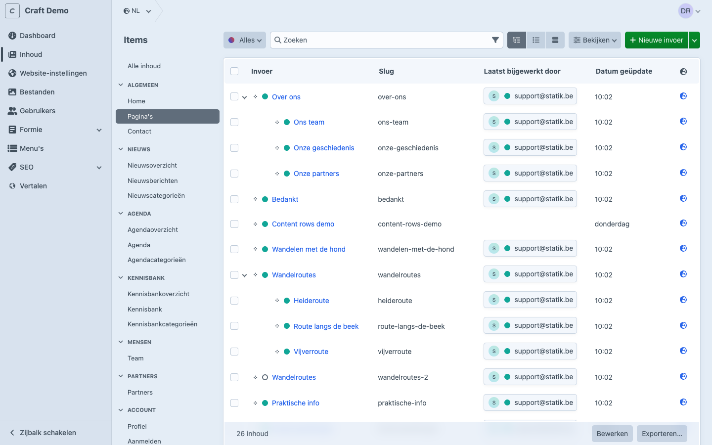
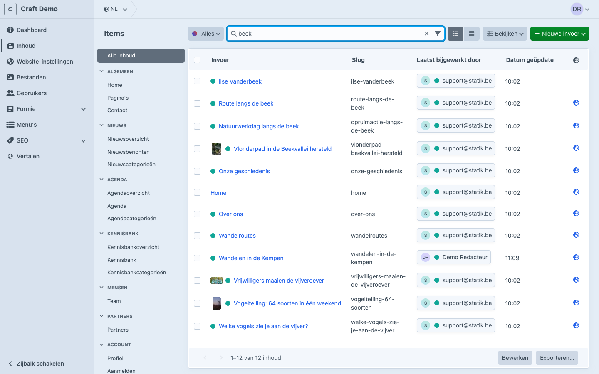
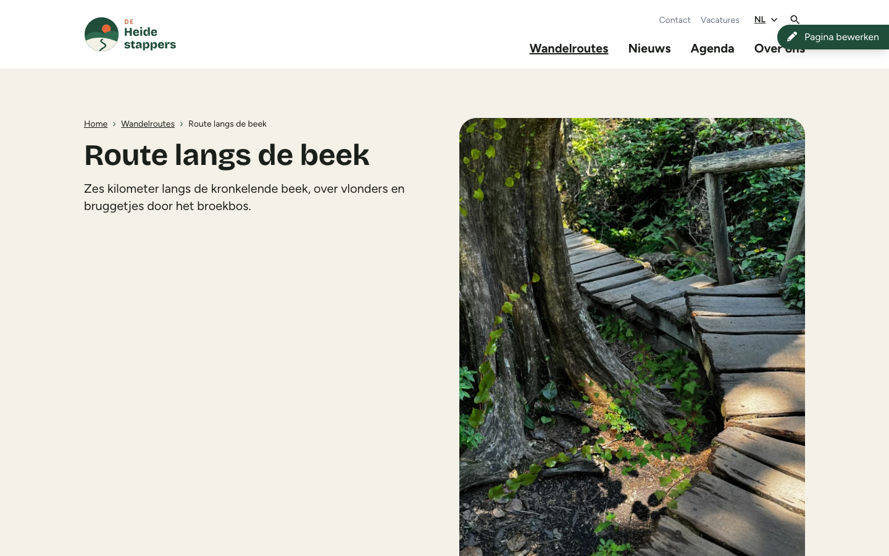

# Inhoud terugvinden: secties, zoeken en het potloodje

Hoe groter je site, hoe belangrijker het is om snel de juiste pagina te vinden. Je leest hier hoe je inhoud vindt via de secties, de lijst met alle inhoud, de zoekfunctie en de statusfilter, en hoe je vanaf de site meteen in het control panel belandt.

## Secties

Klik in de zijbalk op **Inhoud**. Links zie je een lijst met secties. Elke sectie bevat één soort inhoud en toont enkel haar eigen items:

- **Pagina's**: de gewone pagina's van je site, die je volledig zelf opbouwt.
- **Nieuwsberichten**, **Agenda**, **Kennisbank**: items die in overzichten verschijnen.
- Vaste pagina's die maar één keer bestaan, zoals **Home**, **Contact**, het cookiebeleid of de 404-pagina. Klik je erop, dan opent meteen het bewerkscherm.
- **Website-instellingen**: algemene inhoud die op veel plaatsen terugkomt (zie *Algemene inhoud op één plek*).

Welke secties je ziet, hangt af van je site en je rechten.

<!-- screenshot: Inhoud > Pagina's; de lijst met secties links markeren -->

## Alle inhoud

Bovenaan de lijst staat **Alle inhoud**. Daar zie je alles door elkaar, met het laatst aangepaste bovenaan. Handig als je niet meer weet of iets een nieuwsbericht of een event was, of als je wil zien wat er recent veranderde.

## Zoeken

1. Klik in het zoekveld boven de lijst.
2. Typ een woord uit de titel, bijvoorbeeld "beek".
3. De lijst filtert meteen. Zoek je in een sectie, dan zoek je enkel in die sectie; zoek in **Alle inhoud** om overal te zoeken.

<!-- screenshot: Alle inhoud met zoekterm "beek"; zoekveld en resultaat markeren -->

## Filteren op status

Boven de lijst kan je filteren op status. Elke pagina heeft een gekleurd bolletje:

| Status | Betekenis |
|---|---|
| **Live** (groen) | Iedereen kan de pagina zien |
| **Wachtend** | Ingeschakeld, maar de publicatiedatum ligt in de toekomst |
| **Verlopen** | De vervaldatum is voorbij |
| **Uitgeschakeld** | Staat niet online |

Daarnaast kan je ook concepten en verwijderde items tonen. Meer over statussen lees je bij *Online, offline en ingepland*, over verwijderde items bij *Iets ongedaan maken: revisies en de prullenbak*.

## Een pagina op de site openen

In de lijst staat bij elke pagina een wereldbolletje. Klik erop en de pagina opent in een nieuw tabblad, zoals bezoekers ze zien.

## Het potloodje op de site

Ben je ingelogd in het control panel en surf je in dezelfde browser naar je site, dan zie je rechtsboven op elke pagina een knop met een potloodje. Beweeg erover en hij schuift open tot **Pagina bewerken**. Klik erop, en het bewerkscherm van die pagina opent in een nieuw tabblad.

<!-- screenshot: demopagina op de site, knop Pagina bewerken opengeschoven; knop markeren -->

De knop verschijnt alleen:

- voor wie ingelogd is en die pagina mag bewerken;
- op een breed scherm, niet op een smartphone;
- buiten de voorbeeldweergave.

> **Tip:** Weet je hoe je op de site bij een pagina komt, maar niet waar ze in het control panel zit? Gebruik het potloodje. Dat is vaak sneller dan zoeken.

## Veelgestelde vragen

- **Zien bezoekers dat potloodje ook?** Nee. Enkel wie ingelogd is en de pagina mag bewerken, ziet de knop.
- **Ik zie het potloodje niet.** Dan ben je in die browser niet ingelogd, gebruik je een privévenster, of is je venster te smal.
- **Ik vind een pagina niet in Pagina's.** Kijk in **Alle inhoud**; misschien is het een nieuwsbericht of een vaste pagina. Staat de statusfilter niet op alles?

## Zie ook

- Een nieuwe pagina aanmaken
- Online, offline en ingepland
- Iets ongedaan maken: revisies en de prullenbak
