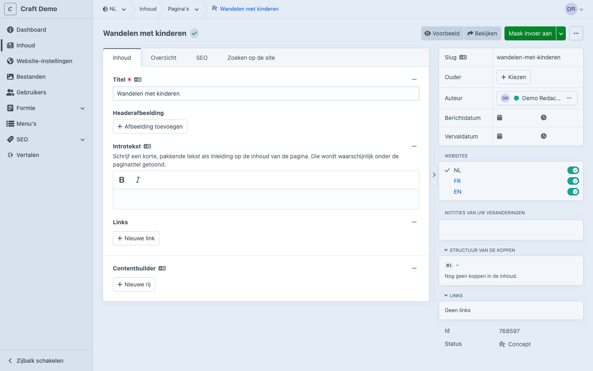
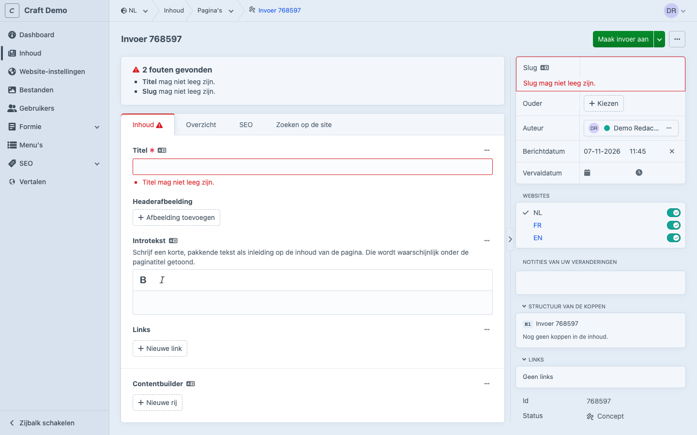
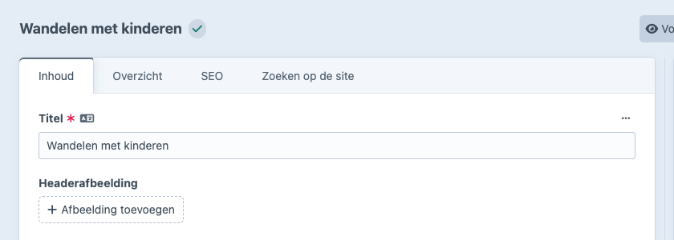

# Een nieuwe pagina aanmaken

Een pagina aanmaken gaat snel: enkel de titel is verplicht, de rest vul je aan wanneer je wil. Hier lees je hoe je begint, wat de sterretjes en rode velden betekenen, en wat de tabs van een pagina doen.

## Een pagina aanmaken

1. Ga naar **Inhoud** en kies links de sectie **Pagina's**.
2. Klik rechtsboven op **Nieuwe invoer**.
3. Typ een **Titel**, bijvoorbeeld "Wandelen met kinderen".
4. Klik op **Maak invoer aan** om de pagina te bewaren.

Een nieuwe pagina in **Pagina's** bewaar je met die knop. Of ze meteen live staat, hangt af van de status rechts in de zijbalk (zie *Online, offline en ingepland*). Wil je eerst rustig verder werken, zet ze dan uit of werk met een concept (zie *Werken met een concept*).

<!-- screenshot: bewerkscherm nieuwe pagina, titel "Wandelen met kinderen"; titelveld en de knop rechtsboven markeren -->

## Verplichte velden

Een **rood sterretje** naast een veld betekent dat het verplicht is, zoals bij de meeste formulieren. Bij een gewone pagina geldt dat enkel voor de titel, maar in rijen en kolommen kunnen ook verplichte velden zitten.

Laat je een verplicht veld leeg en bewaar je, dan slaat de site niets op. Het veld kleurt rood met een korte foutmelding, en bovenaan zie je een melding dat bewaren niet lukte. Vul het veld in en bewaar opnieuw.

<!-- screenshot: titel leeg na bewaren; rode rand en foutmelding markeren -->

## Optionele velden: leeg is niet getoond

Velden zonder sterretje mag je leeg laten. De regel is eenvoudig: **wat leeg is, toont de site niet**. Laat je de **Headerafbeelding** leeg, dan heeft de header geen afbeelding; laat je de **Introtekst** leeg, dan staat er geen intro.

Vraag je je af hoe je iets van een pagina weghaalt? Meestal maak je het veld leeg en bewaar je.

## Velden die pas later verschijnen

Sommige velden verschijnen pas wanneer je een ander veld invult of een keuze maakt. Een voorbeeld: in een overzichtskolom krijg je andere velden naargelang je kiest voor nieuws, agenda of eigen items. Zo zie je enkel wat voor jouw keuze nodig is. Lijkt een veld te ontbreken, kijk dan of het afhangt van een keuze erboven.

## De uitleg bij de velden

Onder veel velden staat een korte uitleg in grijze tekst. Lees ze: daar staan de regels van jouw site, zoals een aanbevolen afmeting voor een afbeelding of waar de site een tekst gebruikt.

## De tabs van een pagina

Bovenaan het bewerkscherm staan tabs:

| Tab | Wat je er doet |
|---|---|
| **Inhoud** | Titel, header en de contentbuilder: de eigenlijke pagina |
| **Overzicht** | Hoe de pagina als kaartje in een overzicht verschijnt (zie *Bepalen hoe je pagina als kaartje verschijnt*) |
| **SEO** | Titel en beschrijving voor zoekmachines en sociale media (zie *De SEO-tab: titel, beschrijving en delen op sociale media*) |
| **Zoeken op de site** | Extra zoekwoorden voor de zoekfunctie op je eigen site (zie *Zoekwoorden toevoegen voor de zoekfunctie op de site*) |

Een tab met een fout erin krijgt een rood teken, zodat je weet waar je moet kijken.

<!-- screenshot: tabs Inhoud, Overzicht, SEO, Zoeken op de site; tabs markeren -->

## Een pagina dupliceren

Lijkt een nieuwe pagina sterk op een bestaande, dan kan je die kopiëren. Open de bestaande pagina, klik rechtsboven op het pijltje naast **Bewaren** en kies **Bewaren als een nieuwe invoer**.

> **Let op:** Een kopie krijgt een slug met een cijfer erachter, zoals `wandelroutes-2`. Pas de titel én de slug aan voor je de pagina publiceert (zie *De slug aanpassen*).

## Veelgestelde vragen

- **Waarom staat een veld niet op de site?** Waarschijnlijk is het leeg, of hangt het af van een ander veld. Leeg betekent: niet getoond.
- **Moet ik alles meteen invullen?** Nee. Enkel de titel is nodig om te bewaren. Zet de pagina uit of werk in een concept zolang ze niet klaar is.
- **Waarom ziet mijn scherm er anders uit dan bij een collega die een nieuwsbericht maakt?** Elke sectie heeft eigen velden. Een nieuwsbericht heeft bijvoorbeeld een datum en een categorie.

## Zie ook

- De paginaheader invullen: titel, afbeelding, intro en links
- De slug aanpassen
- Online, offline en ingepland
- Werken met een concept
