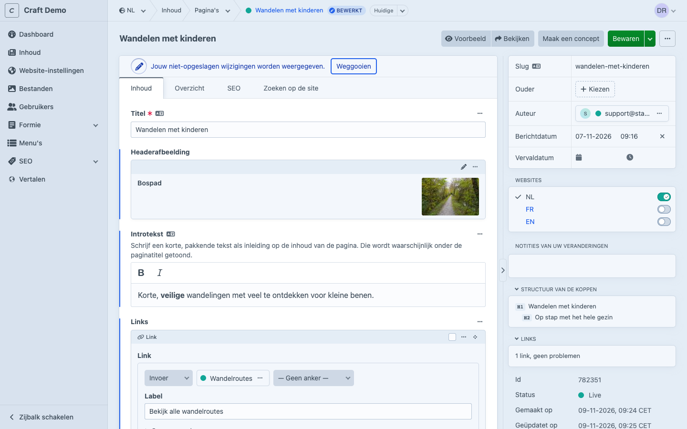
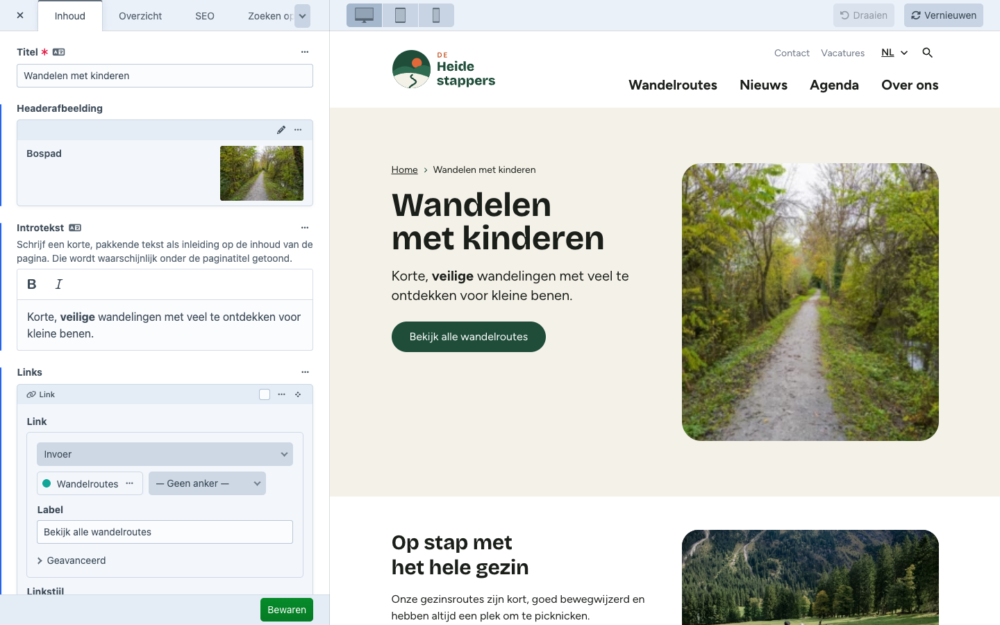
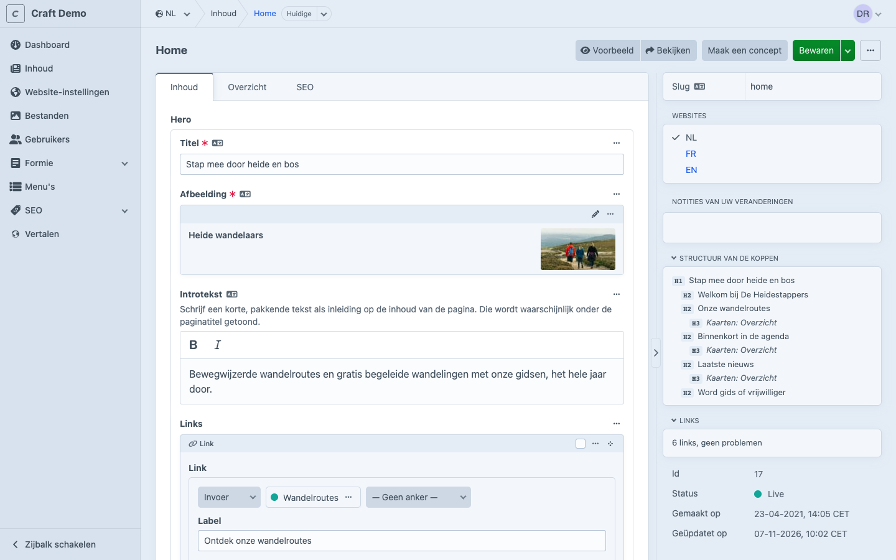

# De paginaheader invullen: titel, afbeelding, intro en links

De header is het eerste wat een bezoeker van je pagina ziet: de titel, een korte intro, een afbeelding en eventueel een knop. Je leest hier hoe je die invult op een gewone pagina, en hoe het werkt op de homepage, waar de header een eigen blok heeft.

## Op een gewone pagina

Bovenaan de tab **Inhoud** staan vier velden:

| Veld | Verplicht | Wat |
|---|---|---|
| **Titel** | ja | De grote titel bovenaan de pagina |
| **Headerafbeelding** | nee | Eén afbeelding naast of bij de titel |
| **Introtekst** | nee | Een korte inleiding onder de titel |
| **Links** | nee, maximaal vijf | Knoppen onder de intro |

Boven de titel toont de site automatisch het kruimelpad (bijvoorbeeld Home > Wandelroutes > Wandelen met kinderen). Dat volgt de structuur van je pagina's (zie *Een pagina onder een andere zetten*).

<!-- screenshot: bewerkscherm "Wandelen met kinderen" met de vier velden ingevuld -->

### De titel

De titel is de belangrijkste kop van je pagina, de H1. Er is er maar één per pagina; de titels verderop zijn ondergeschikt (zie *Tussentitels gebruiken: de kopstructuur*). Hou hem kort en concreet: de titel komt ook terug in je browsertabblad, op kaartjes en in zoekmachines.

### De headerafbeelding

1. Klik bij **Headerafbeelding** op de knop om een bestand toe te voegen.
2. Het venster met je bestanden opent. Kies links een map.
3. Klik een afbeelding aan en klik op **Selecteren**. Nog niet geüpload? Upload ze in hetzelfde venster (zie *Bestanden uploaden en ordenen in mappen*).

Wil je een andere afbeelding, open dan het menu van de foto in het veld en kies **Vervangen**. Het venster met je bestanden opent en de nieuwe foto komt in de plaats van de oude. Kies je **Verwijder** en laat je het veld leeg, dan toont de header enkel tekst.

> **Tip:** Kies een afbeelding met het onderwerp in het midden, of zet het focal point (zie *Focuspunt en afbeelding bewerken*). Zo blijft het belangrijkste zichtbaar, ook op een smartphone.

### De introtekst

Twee of drie zinnen die zeggen waar de pagina over gaat. Je kan **vet** en *cursief* gebruiken, verder niets: geen links, geen lijstjes, geen tussentitels. Een knop zet je in het veld **Links**.

### Links

Met **Links** zet je een of meer knoppen in de header, onder de intro.

1. Klik bij **Links** op **Nieuwe link**.
2. Kies het soort link: **Invoer** voor een pagina van je site (klik op **Kiezen** en selecteer de pagina), of bijvoorbeeld **URL/Anker** voor een andere website.
3. Typ bij **Label** de tekst op de knop. Zeg waar de knop naartoe gaat, bijvoorbeeld "Bekijk alle wandelroutes" in plaats van "Lees meer" (zie *Goede linkteksten schrijven*).
4. Kies bij **Linkstijl** hoe de knop eruitziet.

Je kan tot vijf links toevoegen, maar hou het liefst bij één of twee: zo is meteen duidelijk wat de bezoeker kan doen. Meer over de soorten links en stijlen lees je in *Een knop of link toevoegen*.

<!-- screenshot: Voorbeeld van "Wandelen met kinderen" met een knop in de header, header rechts in beeld -->

## Op de homepage: het blok Hero

De homepage heeft een opvallendere header, de **Hero**. Je vult hem in het blok **Hero** bovenaan de homepage:

| Veld | Verplicht |
|---|---|
| **Titel** | ja |
| **Afbeelding** | ja |
| **Introtekst** | nee |
| **Links** | nee, maximaal vijf |

Zonder titel toont de homepage geen hero. Knoppen voeg je toe in **Links**, net als op een gewone pagina (zie *Een knop of link toevoegen*). Hou het bij één of twee knoppen: de hero moet in één oogopslag duidelijk zijn.

> **Let op:** de homepage is vaak het meest eigen deel van een site. Op jouw site kan de hero andere velden hebben, of kan de homepage anders opgebouwd zijn. Dat bekijken we samen in de opleiding over jouw site.

<!-- screenshot: Home, blok Hero ingevuld; de vier velden markeren -->

## Het design bepaalt de vorm

Hoe de header eruitziet (afbeelding naast of achter de tekst, kleuren, hoogte) ligt vast in het design van je site. Jij kiest de inhoud, de site zorgt voor de vormgeving. Op sommige sites zijn er extra opties, zoals een kleur of een variant; dan staat er uitleg bij het veld.

> **Tip:** De site gebruikt je intro en headerafbeelding ook op het kaartje van je pagina in overzichten, tenzij je in de tab **Overzicht** iets anders invult (zie *Bepalen hoe je pagina als kaartje verschijnt*).

## Veelgestelde vragen

- **Hoe haal ik de intro weg?** Maak het veld leeg en bewaar. Leeg wordt niet getoond.
- **Waarom kan ik geen link in de intro zetten?** De intro is bewust eenvoudig. Een knop in de header zet je bij **Links**; een link in een tekst zet je in een kolom van de contentbuilder.
- **Kan ik de header een andere kleur of vorm geven?** Dat bepaalt het design. Heeft je site die opties, dan staan ze bij de header met uitleg. Mis je iets, laat het ons weten.
- **Wat valt onder een bestand?** Alles wat je uploadt: afbeeldingen, PDF's, Word-documenten, enzovoort. In de headerafbeelding kies je enkel afbeeldingen.

## Zie ook

- Bekijken terwijl je werkt: Voorbeeld en Bekijken
- Een knop of link toevoegen
- Bestanden uploaden en ordenen in mappen
- Bepalen hoe je pagina als kaartje verschijnt
