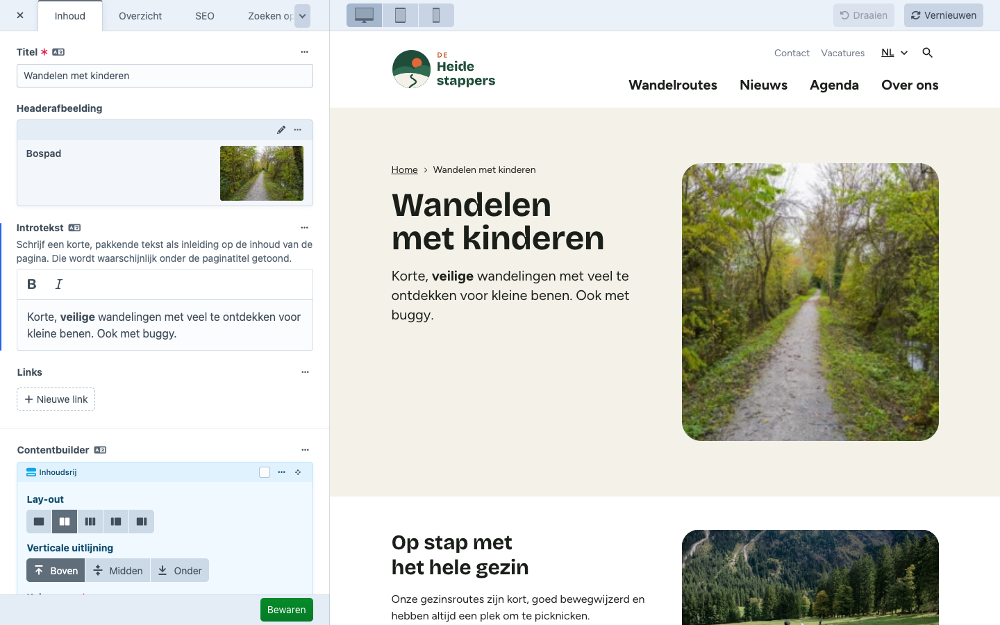
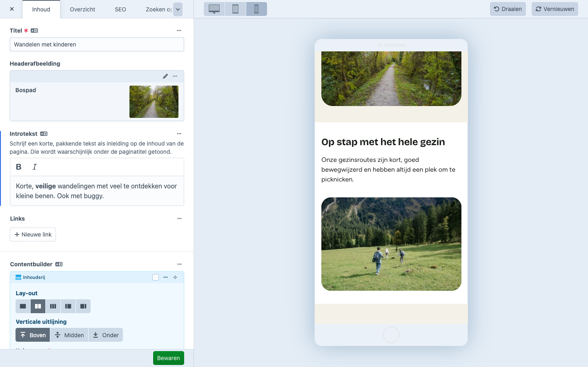

# Bekijken terwijl je werkt: Voorbeeld en Bekijken

Je ziet een pagina het best zoals een bezoeker ze ziet. Het control panel heeft daarvoor twee knoppen: **Voorbeeld** en **Bekijken**. Hier lees je wat het verschil is, hoe je de weergave op een smartphone controleert en wanneer je welke knop gebruikt.

## Voorbeeld: naast je velden

1. Klik rechtsboven op **Voorbeeld**.
2. Het scherm splitst: links je velden, rechts de pagina.
3. Pas links iets aan. Na een ogenblik ververst de pagina rechts met je wijziging.
4. Sluit het voorbeeld om in het gewone scherm verder te werken.

Het voorbeeld is ideaal terwijl je een pagina opbouwt. Je ziet meteen wat een keuze doet, bijvoorbeeld een andere lay-out van een rij of een andere achtergrondkleur, zonder tussen tabbladen te wisselen.

<!-- screenshot: Voorbeeld open op "Wandelen met kinderen"; de splitsing tussen velden en pagina markeren -->

Wat je in het voorbeeld ziet, is **niet gepubliceerd**. Enkel jij ziet het. Pas wanneer je bewaart, zien bezoekers je wijzigingen (zie *Opslaan, en wat autosave wel en niet doet*).

## Smartphone en tablet

Bovenaan het voorbeeld staan iconen om te wisselen tussen desktop, tablet en smartphone. Controleer je pagina geregeld op een smal scherm:

- kolommen die naast elkaar staan, komen op een smartphone onder elkaar;
- de volgorde waarin ze dan staan, kan je per kolom instellen (**Volgorde op mobiel**, zie *Rijen instellen*);
- lange titels lopen sneller over meerdere regels.

<!-- screenshot: Voorbeeld in mobiele weergave; het icoon voor mobiel en de gestapelde kolommen markeren -->

> **Tip:** Je browser kan ook een toestel nabootsen. Klik rechts op de pagina, kies **Inspecteren** en zet de werkbalk voor toestellen aan. Daar kan je een bepaald toestel kiezen of de breedte zelf slepen.

## Bekijken: in een nieuw tabblad

Klik op **Bekijken** en de pagina opent in een nieuw tabblad, op volle breedte, zoals op de site. Dat werkt ook voor een pagina die je nog niet bewaarde of publiceerde: je krijgt dan een speciale link die alleen de site herkent.

Gebruik **Bekijken** om:

- de pagina in haar geheel te zien, op je volledige scherm;
- door te klikken naar andere pagina's of een ankerlink uit te proberen;
- de pagina op een ander toestel te openen.

## Welke kies je?

| | Voorbeeld | Bekijken |
|---|---|---|
| Waar | Naast je velden | Nieuw tabblad |
| Ververst bij wijziging | Ja, meteen | Nee, herlaad het tabblad |
| Toestel wisselen | Ingebouwd | Via je browser |
| Gepubliceerd? | Nee | Nee, tot je bewaart |

> **Tip:** Het voorbeeld werkt het best op een groot scherm of een tweede scherm. Op een kleine laptop wordt het krap; gebruik dan **Bekijken**.

## Veelgestelde vragen

- **Ziet iemand anders mijn wijzigingen als ik ze in het voorbeeld zie?** Nee. Pas na bewaren staan ze online.
- **Kan ik iemand zonder account laten meekijken?** Ja, met een speciale link die tien dagen geldig is. Zie *Een previewlink delen met iemand zonder account*.
- **Waarom staat mijn pagina op een smartphone anders dan op mijn computer?** De site is gemaakt voor kleine schermen: kolommen komen onder elkaar en afbeeldingen worden anders uitgesneden. Kijk met het voorbeeld na of de volgorde klopt.

## Zie ook

- Opslaan, en wat autosave wel en niet doet
- Naar een blok linken met ankers
- Een previewlink delen met iemand zonder account
