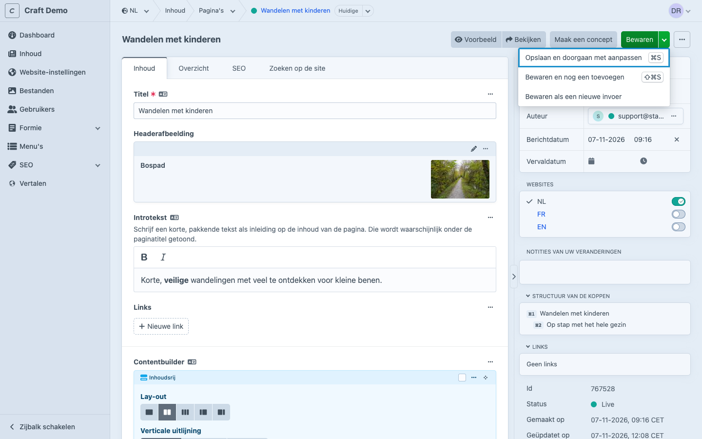
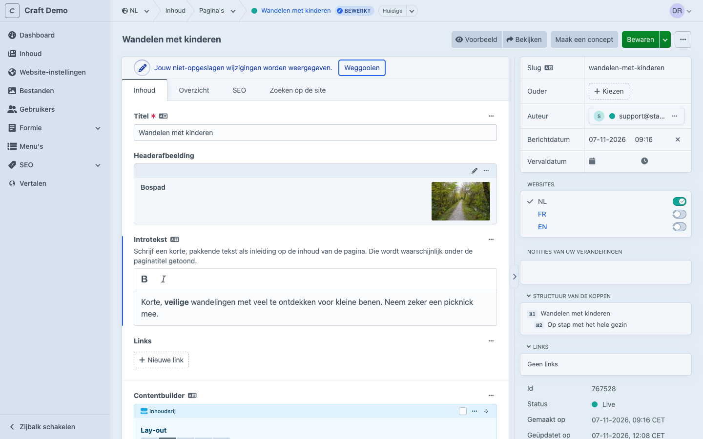

# Opslaan, en wat autosave wel en niet doet

Bewaren is de stap die je wijzigingen online zet. Daarnaast houdt de site automatisch bij wat je typt, maar dat is niet hetzelfde als publiceren. Hier lees je het verschil, zodat je nooit werk kwijt bent en nooit per ongeluk iets publiceert.

## Bewaren

Rechtsboven in het bewerkscherm staat **Bewaren**.

- Klik erop: je wijzigingen zijn opgeslagen en je gaat terug naar het overzicht.
- Staat de pagina live (groen bolletje), dan zien bezoekers je wijziging **meteen**.
- Staat ze uitgeschakeld, dan is je werk bewaard maar staat het niet online.

Bij een pagina die je nog nooit bewaarde, heet de knop **Maak invoer aan**.

<!-- screenshot: knop Bewaren met menu open, optie Opslaan en doorgaan met aanpassen zichtbaar; menu markeren -->

## Bewaren en verder werken

Wil je bewaren maar op de pagina blijven?

1. Klik op het pijltje naast **Bewaren**.
2. Kies **Opslaan en doorgaan met aanpassen**.

Sneller: gebruik **Cmd+S** (Mac) of **Ctrl+S** (Windows), zoals in Word. Handig om tussendoor even op te slaan.

## Autosave: bijgehouden, niet gepubliceerd

Terwijl je typt in een bestaande pagina, houdt de site je wijzigingen automatisch bij. Je ziet dat aan:

- de melding **Jouw niet-opgeslagen wijzigingen worden weergegeven.** bovenaan;
- de status **Bewerkt** naast de titel;
- in het overzicht: een teken dat de pagina niet-opgeslagen wijzigingen heeft.

Die wijzigingen zijn **niet bewaard en niet live**. Bezoekers zien de laatst bewaarde versie. Maar je bent ze ook niet kwijt: klik je weg, sluit je je browser of valt je laptop stil, dan staan ze er nog wanneer je de pagina opnieuw opent.

<!-- screenshot: bewerkscherm met de melding "Jouw niet-opgeslagen wijzigingen worden weergegeven." en status Bewerkt; beide markeren -->

> **Let op:** Je niet-opgeslagen wijzigingen zijn van jou. Een collega die dezelfde pagina opent, ziet ze niet. Bewaar dus voor je het werk aan iemand anders overlaat.

## Wijzigingen weggooien

Wil je terug naar de bewaarde versie?

1. Klik in de melding bovenaan ("Jouw niet-opgeslagen wijzigingen worden weergegeven.") op **Weggooien**.
2. Bevestig.

De pagina staat weer zoals je ze laatst bewaarde.

## Autosave of concept?

Autosave is een vangnet, geen werkmethode. Gebruik een **concept** (knop **Maak een concept**, zie *Werken met een concept*) als je:

- over meerdere dagen aan een pagina werkt;
- een collega wil laten meelezen of goedkeuren;
- veel wijzigingen in één keer online wil zetten.

Een concept heeft een naam, je collega's zien het, en je publiceert het bewust met **Concept toepassen**.

## Met meerdere mensen

Bovenaan het bewerkscherm zie je wie de pagina nog openheeft. Bewaren twee mensen dezelfde pagina, dan wint wie het laatst bewaart. De versie van de ander gaat niet verloren: ze zit in de revisies (zie *Iets ongedaan maken: revisies en de prullenbak*). Maak afspraken en bewaar regelmatig.

## Veelgestelde vragen

- **Wordt er niets automatisch opgeslagen?** Toch wel: de site houdt je wijzigingen bij. Maar ze gaan pas online als je bewaart.
- **Als ik wegklik, ben ik het dan kwijt?** Nee, open de pagina opnieuw en je wijzigingen staan er nog. Bewaar ze wel voor ze online moeten.
- **Moet ik na bewaren nog iets doen om te publiceren?** Nee, als de pagina ingeschakeld is. Bewaren is publiceren.

## Zie ook

- Bekijken terwijl je werkt: Voorbeeld en Bekijken
- Werken met een concept
- Iets ongedaan maken: revisies en de prullenbak
- Met meerdere mensen aan de site werken
