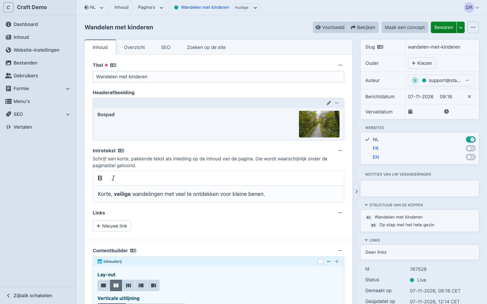
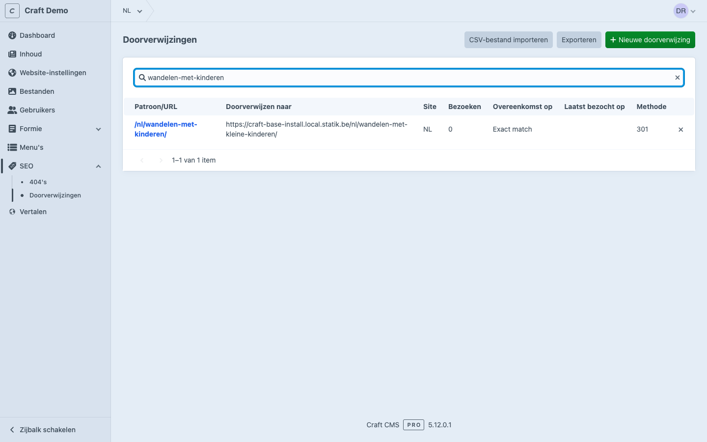

# De slug aanpassen

De slug is het laatste stukje van het adres van je pagina, bijvoorbeeld `kinderwandelingen` in `…/nl/wandelroutes/kinderwandelingen`. Hier lees je hoe hij ontstaat, waarom hij niet meeverandert met de titel, hoe je hem aanpast en wat er met het oude adres gebeurt.

## Hoe de slug ontstaat

Bij de **eerste keer bewaren** maakt de site de slug uit de titel:

- spaties worden streepjes;
- hoofdletters worden kleine letters;
- leestekens en speciale tekens verdwijnen of worden vervangen.

"Wandelen met kinderen!" wordt zo `wandelen-met-kinderen`. Je vindt de slug rechts in de zijbalk van het bewerkscherm, in het veld **Slug**.

<!-- screenshot: zijbalk met het veld Slug "wandelen-met-kinderen"; veld markeren -->

## De titel wijzigen verandert de slug niet

Pas je later de titel aan, dan blijft de slug zoals hij was. Dat is bewust: links in mails, folders, bladwijzers en zoekmachines blijven zo werken. Het betekent wel dat je de slug zelf moet aanpassen als de titel echt iets anders zegt.

## De slug aanpassen

Je hebt twee manieren:

1. **Zelf typen**: klik in **Slug** en typ een nieuwe. Je hoeft geen streepjes of kleine letters te typen: de site zet dat zelf goed.
2. **Opnieuw uit de titel**: maak het veld leeg en bewaar. De site maakt een nieuwe slug uit de huidige titel.

Bewaar daarna de pagina.

> **Tip:** Hou de slug kort, met het woord waarop mensen zoeken. Een titel van zeventien woorden mag een slug van twee woorden hebben, zoals `kinderwandelingen`.

## Kijk hem na

De site maakt van elk teken een geldige versie, dus je kan niets fout typen. Toch loont het om de slug na te kijken, zeker als je het adres gebruikt in een folder, op een affiche of in een mail. Staat er een tikfout in, of viel er bij een naam met accenten iets weg?

## Wat er met het oude adres gebeurt

Wijzig je de slug van een pagina die **al live staat**, dan maakt de site automatisch een doorverwijzing (een redirect) van het oude naar het nieuwe adres. Wie de oude link gebruikt, komt gewoon op de juiste pagina terecht.

Je vindt die doorverwijzingen bij **SEO** > **Doorverwijzingen**. Zoek er op de oude slug om te controleren of hij er is.

<!-- screenshot: SEO > Doorverwijzingen, gefilterd op "wandelen-met-kinderen"; de regel markeren -->

> **Let op:** Verwijder geen doorverwijzingen van een live site zonder goede reden. Mensen hebben het oude adres misschien nog als bladwijzer, en zoekmachines kennen het nog. Meer over redirects lees je bij *404's opvolgen en redirects maken*.

Pas de slug bij voorkeur aan **voor** een pagina live gaat. Dan zijn er nog geen oude adressen in omloop.

## Na een kopie

Kopieer je een pagina, dan krijgt de kopie de slug van het origineel met een cijfer erachter, zoals `wandelroutes-2`. Dat is niet proper en zegt niets. Pas zowel de titel als de slug aan voor je de kopie publiceert.

## Veelgestelde vragen

- **Waarom verandert het adres niet als ik de titel aanpas?** Zodat bestaande links blijven werken. Pas de slug zelf aan, of maak het veld leeg en bewaar.
- **Mag ik bepaalde tekens niet gebruiken?** Je mag typen wat je wil: de site maakt er een geldige versie van. Kijk het resultaat wel na.
- **Is de slug belangrijk voor zoekmachines?** Een korte, duidelijke slug helpt bezoekers en zoekmachines te begrijpen waar de pagina over gaat. Maar de inhoud van je pagina telt veel zwaarder.
- **Gebeurt die doorverwijzing altijd automatisch?** Ja, bij een gewijzigde slug van een bestaande pagina. Verplaats je een pagina in de structuur, kijk dan na of hij er is (zie *Een pagina onder een andere zetten*).

## Zie ook

- Een pagina onder een andere zetten
- 404's opvolgen en redirects maken
