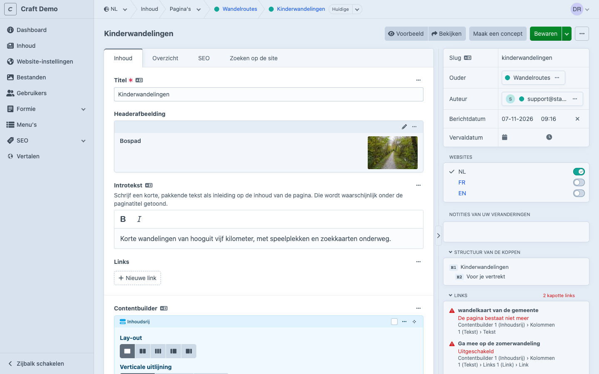
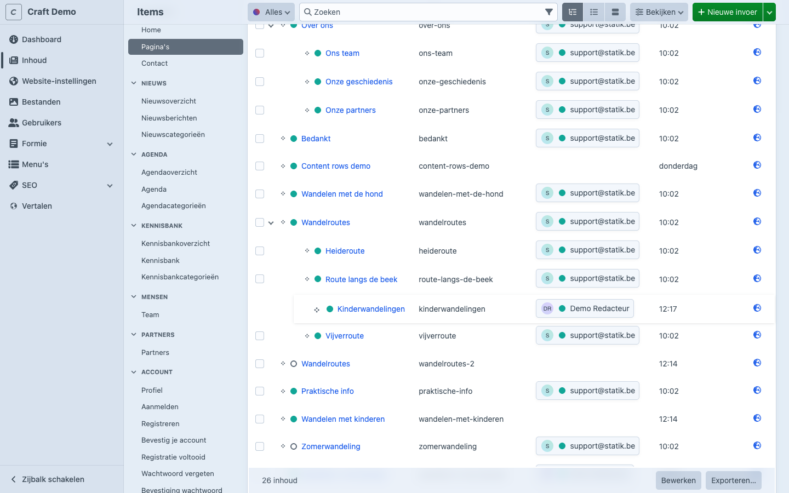

# Een pagina onder een andere zetten

De sectie **Pagina's** is een structuur: pagina's kunnen onder andere pagina's staan, zoals hoofdstukken en paragrafen in een boek. Hier lees je hoe je een pagina verplaatst, wat er dan verandert aan het adres en het kruimelpad, en wat er niet automatisch gebeurt.

## Waarom een structuur?

Een structuur helpt bezoekers en zoekmachines te begrijpen hoe je inhoud samenhangt. "Ons team" hoort bij "Over ons", "Kinderwandelingen" bij "Wandelroutes". Zo blijven pagina's kort en overzichtelijk: liever een paar korte subpagina's dan één heel lange pagina.

## Methode 1: het veld Ouder

1. Open de pagina die je wil verplaatsen.
2. Rechts in de zijbalk staat **Ouder**. Klik op de knop om een pagina te kiezen.
3. Selecteer de pagina waaronder ze moet komen en klik op **Selecteren**.
4. Klik op **Bewaren**.

Wil je een pagina terug op het hoogste niveau, verwijder dan de ouder en bewaar.

<!-- screenshot: zijbalk van "Kinderwandelingen" met Ouder = Wandelroutes; veld markeren -->

## Methode 2: slepen in het overzicht

1. Ga naar **Inhoud** > **Pagina's**. Het overzicht toont de pagina's als structuur, met subpagina's iets ingesprongen.
2. Neem een pagina vast bij het sleepicoontje.
3. Sleep ze onder de gewenste pagina. Sleep je iets naar rechts, dan komt ze een niveau dieper; naar links weer hoger.
4. Laat los. De site bewaart je wijziging meteen.

Met slepen bepaal je ook de volgorde van pagina's op hetzelfde niveau.

<!-- screenshot: Pagina's tijdens het slepen van "Kinderwandelingen" onder "Wandelroutes"; sleepicoontje markeren -->

## Wat er verandert

**Het adres.** Het adres volgt de structuur. "Kinderwandelingen" onder "Wandelroutes" krijgt `…/wandelroutes/kinderwandelingen`.

**Het kruimelpad.** Boven de titel toont de site het pad: Home > Wandelroutes > Kinderwandelingen. Bezoekers klikken zo makkelijk een niveau terug.

**De oude link.** De site maakt automatisch een doorverwijzing van het oude naar het nieuwe adres. Na een verplaatsing kan het even duren voor alles bijgewerkt is. Controleer bij **SEO** > **Doorverwijzingen** of de doorverwijzing er is. Staat ze er niet, open de pagina dan en bewaar ze nog een keer.

> **Let op:** Ook de subpagina's van een verplaatste pagina krijgen een nieuw adres, want het adres van hun ouder verandert mee.

## Wat er niet verandert

Een subpagina verschijnt **niet** vanzelf in een uitklapmenu of in het hoofdmenu. De menu's beheer je apart (zie *De menu's aanpassen*). Wil je dat bezoekers een subpagina vinden, link er dan naar vanaf de bovenliggende pagina: met een link in de tekst, een knop, of een overzichtskolom met kaartjes.

## Hoe diep mag het?

Technisch zo diep als je wil. In de praktijk volstaan twee of drie niveaus bijna altijd. Denk eerst na over de structuur van je inhoud voor je pagina's aanmaakt; achteraf verplaatsen kan, maar levert telkens nieuwe adressen op.

> **Tip:** Liever meerdere korte pagina's onder een duidelijke hoofdpagina dan één lange pagina waar bezoekers in moeten zoeken.

## Veelgestelde vragen

- **Krijg je bij "Over ons" dan een uitklapmenu?** Nee, dat gebeurt niet automatisch. Link zelf naar de subpagina's, of laat ze in het menu zetten (zie *De menu's aanpassen*).
- **Kan ik meerdere subpagina's onder één pagina zetten?** Ja, zoveel je wil, en ook subpagina's onder subpagina's.
- **Na het verplaatsen klopt het adres niet. Wat is er fout gegaan?** Kijk na of je de juiste pagina verplaatste. Bewaar de pagina daarna nog een keer en controleer de doorverwijzing bij SEO > Doorverwijzingen.
- **Speelt de volgorde in het overzicht een rol?** Ze bepaalt de volgorde van de pagina's in de structuur, niet die in je menu's.

## Zie ook

- De slug aanpassen
- De menu's aanpassen
- 404's opvolgen en redirects maken
