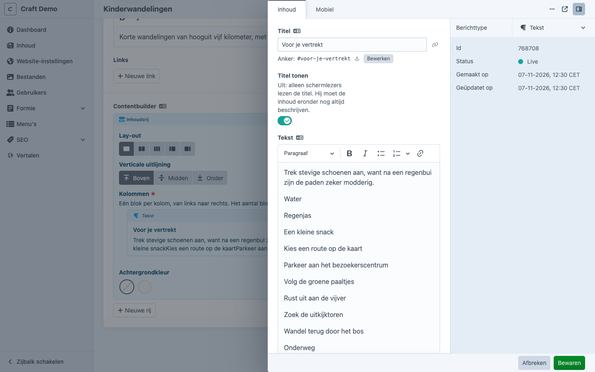
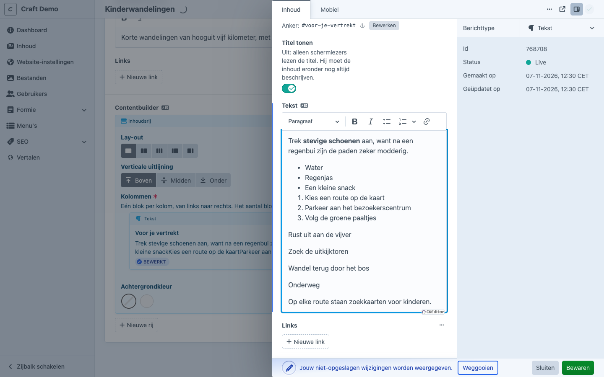

# Tekst opmaken

Het tekstveld in een tekstkolom werkt zoals een eenvoudige tekstverwerker. De opmaakopties zijn bewust beperkt: zo blijft je site overal in dezelfde stijl. Hier lees je welke opties er zijn en wanneer je ze gebruikt.

## Het tekstveld openen

Tekst staat in een **tekstkolom** in de contentbuilder (meer over rijen en kolommen bij *Rijen en kolommen: het principe*).

1. Scroll in je pagina naar de **Contentbuilder**.
2. Klik op het potloodje van het kaartje van de tekstkolom. Er schuift een paneel van rechts open.
3. In het veld **Tekst** zie je bovenaan de werkbalk.

<!-- screenshot: paneel van een tekstkolom open, werkbalk met Koppen, Vet, Cursief, lijsten en Link; werkbalk markeren -->

## De werkbalk

| Knop | Wat |
|---|---|
| **Koppen** | Kies tussen **Paragraaf** (gewone tekst) en **Kop 3**, **Kop 4**, **Kop 5** voor tussentitels (zie *Tussentitels gebruiken: de kopstructuur*) |
| **Vet** | Dikgedrukt, voor een woord dat echt moet opvallen |
| **Cursief** | Schuin, bijvoorbeeld voor een titel van een boek of een vreemd woord |
| **Ongenummerde lijst** | Opsomming met bolletjes |
| **Genummerde lijst** | Opsomming met nummers |
| **Link** | Een link in de tekst (zie *Een knop of link toevoegen*) |

## Vet en cursief

Selecteer de tekst en klik op **Vet** of **Cursief**. Gebruik ze spaarzaam: als alles opvalt, valt niets meer op.

> **Let op:** Een vette regel is geen tussentitel. Wie een schermlezer gebruikt of een zoekmachine "ziet" een vette regel als gewone tekst. Gebruik voor een tussentitel altijd een kop uit het menu **Koppen**.

## Lijstjes

1. Zet elk punt op een eigen regel.
2. Selecteer die regels.
3. Klik op **Ongenummerde lijst** of **Genummerde lijst**.

Kies een **ongenummerde lijst** als de volgorde geen rol speelt (wat neem je mee), en een **genummerde lijst** als ze dat wel doet (stappen, een rangorde). Nog een keer klikken haalt de lijst weer weg. Met de Tab-toets maak je een punt ondergeschikt aan het punt erboven.

<!-- screenshot: veld Tekst met lijstje Water/Regenjas/Een kleine snack en een genummerde lijst; beide markeren -->

## Een genummerde lijst laten verder tellen

Onderbreek je een genummerde lijst met een stukje tekst, dan begint de volgende lijst weer bij 1. Wil je verder tellen:

1. Zet de cursor in de tweede lijst.
2. Klik op het pijltje naast **Genummerde lijst**.
3. Vul bij **Begin op** het juiste getal in, bijvoorbeeld 4. Met **Omgekeerde volgorde** tel je af.

Kijk na of de nummering mooi doorloopt, zonder gaten of dubbele nummers.

## Tekst plakken

Plak je tekst uit Word of een mail, dan neemt het veld enkel de opmaak over die het kent. Kijk daarna altijd na of koppen en lijstjes goed overgekomen zijn, en of er geen lege regels te veel staan.

## Hou het behapbaar

- Schrijf korte alinea's: op een smartphone wordt een lange alinea al snel een muur van tekst.
- Deel een lange tekst op met tussentitels (zie *Tussentitels gebruiken: de kopstructuur*).
- Zet niet alles in één kolom: wissel af met een afbeelding of een nieuwe rij, of verdeel de inhoud over meerdere pagina's.

## Veelgestelde vragen

- **Kan ik tekst onderlijnen of een kleur geven?** Nee. Onderlijnde tekst lijkt op een link, en kleuren komen uit het design van je site.
- **Waarom zie ik maar Kop 3 tot Kop 5?** De titel van de pagina en de titel van een kolom zijn al de hogere niveaus. Zie *Tussentitels gebruiken: de kopstructuur*.
- **Moet de volgorde van een lijstje kloppen?** Bij een ongenummerde lijst niet, bij een genummerde wel: kies het type dat bij je inhoud past.

## Zie ook

- Tussentitels gebruiken: de kopstructuur
- Een knop of link toevoegen
- Rijen en kolommen: het principe
