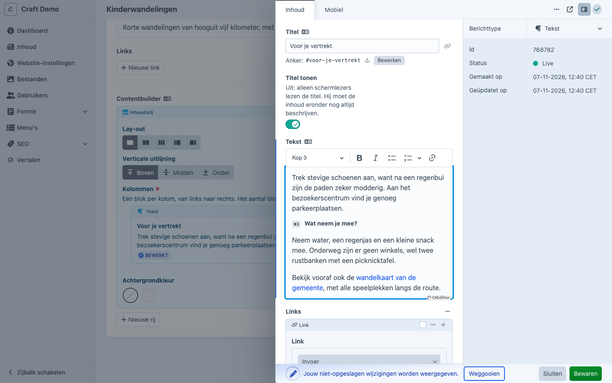
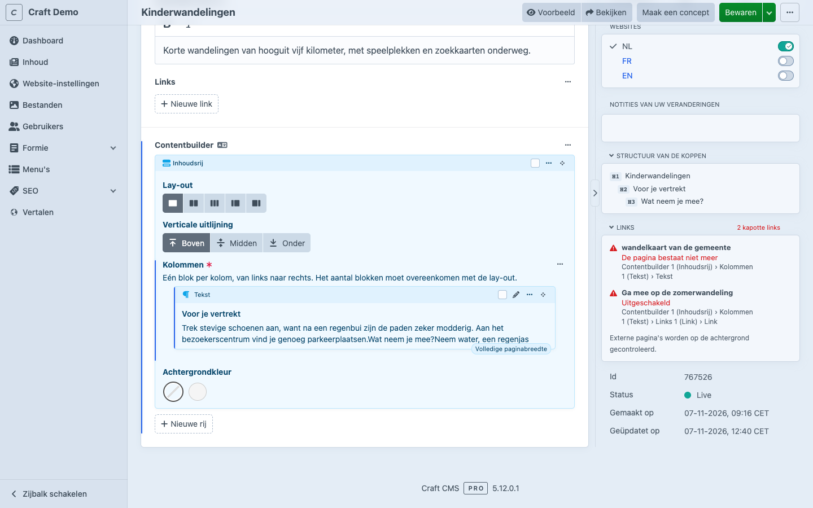
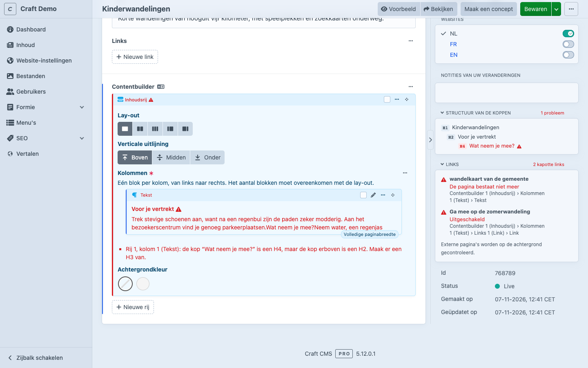

# Tussentitels gebruiken: de kopstructuur

Koppen (of headings) geven je pagina een structuur, zoals hoofdstukken en paragrafen in een boek. Je leest hier welke koppen de site zelf maakt, welke je in je tekst kiest, en hoe de site controleert of je structuur klopt.

## Waarom koppen belangrijk zijn

- **Toegankelijkheid**: wie een schermlezer gebruikt, laat zich vaak een lijst van alle koppen voorlezen en springt zo meteen naar het juiste deel. Klopt de structuur niet, dan loopt die lezer verloren.
- **Zoekmachines** lezen je pagina op dezelfde manier: koppen vertellen waar de pagina over gaat en hoe ze opgebouwd is.
- **Leesbaarheid**: ook wie de pagina snel scant, vindt zo meteen het juiste stuk.

Kies een kop dus om de **structuur**, niet om hoe groot de letters zijn.

## De niveaus op een pagina

| Kop | Wat | Wie maakt hem |
|---|---|---|
| **H1** | De titel van de pagina (op de homepage: de titel in de Hero). Er is er maar één | De site, uit het veld **Titel** |
| **H2** | De titel van een kolom, bijvoorbeeld van een tekstkolom of veelgestelde vragen | De site, uit de titel van de kolom |
| **H3** | De titels van kaartjes in een overzicht, team of kolom Kaartje | De site |
| **H3–H5** | Tussentitels in je tekst | Jij, via **Koppen** |

In de tekst gebruik je vooral **Kop 3**, soms **Kop 4** als onderdeel van een Kop 3. **Kop 5** heb je zelden nodig.

## Een tussentitel maken

1. Open de tekstkolom en zet de cursor in de regel die een tussentitel moet worden.
2. Klik op het menu **Koppen** in de werkbalk.
3. Kies **Kop 3** (of **Paragraaf** om er weer gewone tekst van te maken).

Links van elke kop verschijnt een label met zijn niveau: H3, H4, H5. Zo zie je meteen wat je koos.

<!-- screenshot: paneel tekstkolom, kop "Wat neem je mee?" met label H3; label en menu Koppen markeren -->

## De structuur van de koppen

Rechts in de zijbalk van een pagina staat het paneel **Structuur van de koppen**. Het toont alle koppen van de pagina in volgorde, ingesprongen per niveau, van de paginatitel tot de koppen in je teksten. Een kop die enkel voor schermlezers is, staat er als verborgen bij. Een kop die een niveau overslaat, krijgt een markering. Het paneel werkt zich even na het typen bij.

<!-- screenshot: zijbalk met Structuur van de koppen: paginatitel, "Voor je vertrekt", "Wat neem je mee?" ingesprongen -->

## Geen niveau overslaan

Een kop mag hoogstens één niveau dieper gaan dan de kop erboven. Een H4 direct onder een H2 slaat de H3 over, en dat klopt niet.

Bewaar je een pagina waarin een kop een niveau overslaat, dan **publiceert de site ze niet**:

- je krijgt de melding **Kon invoer niet opslaan.**;
- bovenaan staat **1 fout gevonden**, met de plaats (bijvoorbeeld rij 1, kolom 1) en wat je moet doen, zoals "Maak er een H3 van.";
- de rij en het kaartje van de kolom met het probleem kleuren rood, en dezelfde uitleg staat onder de kolom;
- in **Structuur van de koppen** staat de kop in het rood, met het aantal problemen naast de titel.

Pas de kop aan en bewaar opnieuw. Werk je in een concept, dan gebeurt de controle pas wanneer je het concept toepast.

<!-- screenshot: na Bewaren met H4 onder H2: melding bovenaan, rode rij en rood kolomkaartje; alle drie markeren -->

## Een kop in de tekst vraagt een kolomtitel

Gebruik je Kop 3 in een tekstkolom zonder titel, dan staat die H3 niet onder een H2 en krijg je de melding "Geef deze kolom een titel". Twee oplossingen:

- vul de titel van de kolom in;
- past een zichtbare titel niet in je ontwerp, zet dan **Titel tonen** uit. De titel blijft een H2, maar enkel schermlezers lezen hem voor. Hij moet de inhoud eronder nog altijd beschrijven.

## Het overzicht voor de hele site

Op je dashboard staat de widget **Problemen met koppen**. Staat hij er niet, voeg hem dan toe met **Nieuwe widget**. Hij toont de pagina's van de site met problemen in hun koppen, met een link om elke pagina te bewerken. Handig na een import of als je oudere inhoud nakijkt.

> **Tip:** Heb je vaak Kop 4 of dieper nodig, dan staat er waarschijnlijk te veel op één pagina. Verdeel de inhoud over meerdere pagina's en link ernaar. Daar begint de structuur weer bij H1.

## Veelgestelde vragen

- **Kan ik een kop gebruiken om tekst groter te maken?** Nee, kies een kop om de structuur. Wil je iets laten opvallen, overweeg dan een citaat of cijfers.
- **Hoe diep mag ik gaan?** H3 is je gewone tussentitel, H4 kan als onderdeel ervan. H5 bijna nooit.
- **Waarom kan ik mijn pagina niet bewaren?** Waarschijnlijk slaat een kop een niveau over of mist een kolom een titel. Lees de melding bovenaan (**1 fout gevonden**) en kijk naar de rode rij.
- **Mag vette tekst een tussentitel zijn?** Nee. Vette tekst is voor schermlezers en zoekmachines gewone tekst.

## Zie ook

- Tekst opmaken
- Naar een blok linken met ankers
- Rijen en kolommen: het principe
