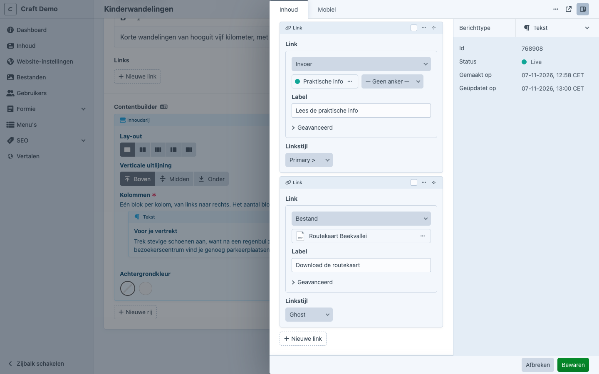
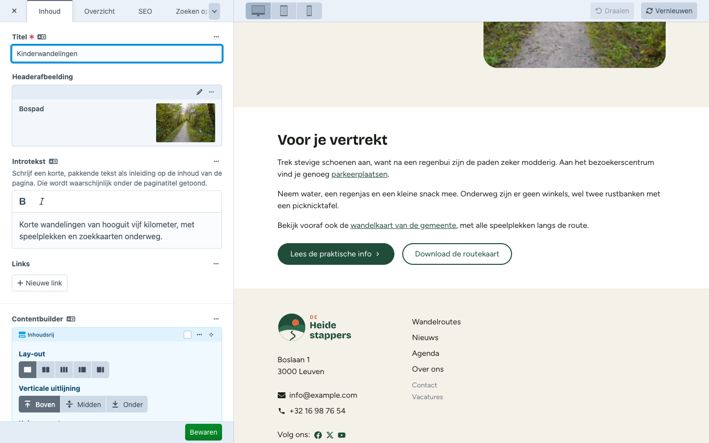
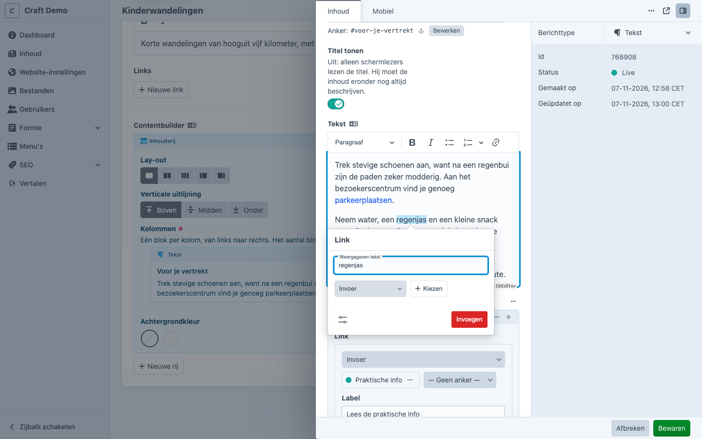

# Een knop of link toevoegen

Knoppen en links brengen je bezoekers naar een volgende stap: een andere pagina, een document, een mailadres. Overal op de site werken ze op dezelfde manier: met het veld **Links**. Hier lees je hoe je een knop toevoegt, welke soorten links er zijn, hoe je een stijl kiest en wanneer een link in een nieuw tabblad opent.

## Waar je knoppen vindt

Het veld **Links** komt op verschillende plaatsen terug: in de tekstkolom, de call to action, de cijfers, de veelgestelde vragen en de Hero op de homepage. In de cijferkolom heet het **Knoppen**, maar het werkt hetzelfde. Je kan er tot vijf links in zetten. Op sommige plaatsen, zoals bij een citaat of een overzicht, kan er maar één: dat veld heet **Link**.

## Een knop toevoegen

1. Klik in het veld **Links** op **Nieuwe link**.
2. Kies in het veld **Link** het soort link (zie hieronder) en vul het doel in.
3. Typ bij **Label** de tekst van de knop, of laat het leeg (zie "De linktekst").
4. Kies een **Linkstijl**.
5. Bewaar de pagina.

Je kan links slepen om de volgorde te veranderen, en via hun menu met drie puntjes verwijderen.

<!-- screenshot: veld Links in een tekstkolom met één link (Invoer: Praktische info, Label, Linkstijl Primary >); de onderdelen markeren -->

## Soorten links

| Type | Waarvoor | Hoe |
|---|---|---|
| **Invoer** | Een pagina of item op je eigen site. Het meest gebruikt | **Kiezen**, links **Pagina's** (of een andere sectie), pagina aanklikken, **Selecteren** |
| **URL/Anker** | Een andere website, of een blok op dezelfde pagina | Plak het volledige webadres (of kies een anker, zie *Naar een blok linken met ankers*) |
| **Bestand** | Een PDF, Word-document, afbeelding … | **Kiezen**, open de map (bijvoorbeeld **Documenten**) en kies of upload het bestand |
| **E-mail** | Opent het mailprogramma van de bezoeker | Typ het e-mailadres |
| **Telefoon** | Belt het nummer op een smartphone | Typ het telefoonnummer |

> **Tip:** Link naar een pagina van je eigen site altijd met **Invoer**, niet met een gekopieerd webadres. Verander je later de slug of de plaats van die pagina, dan blijft de link werken.

## De linktekst

Laat je **Label** leeg, dan gebruikt de site:

- bij **Invoer**: de titel van de pagina waarnaar je linkt;
- bij een bestand, webadres of e-mailadres: iets technisch, zoals de bestandsnaam of het adres. Vul het label hier dus altijd in.

Een paginatitel is vaak te lang of te vaag voor een knop. Schrijf liever een korte tekst die zegt wat er gebeurt, zoals "Lees de praktische info". Hoe je een goede linktekst schrijft, lees je bij *Goede linkteksten schrijven*.

## De linkstijl

Van opvallend naar subtiel:

| Stijl | Hoe het eruitziet |
|---|---|
| **Primary** | Een volle knop in de hoofdkleur. Valt het meest op |
| **Secondary** | Een knop in een rustigere kleur |
| **Ghost** | Enkel een rand, met een doorzichtige achtergrond |
| **Link** | Gewone, onderlijnde tekst |

Elke stijl bestaat ook met een pijltje (**Primary >**, **Ghost >** …). Hoe de stijlen er precies uitzien, hangt af van het design van je site.

Kies volgens het belang: de belangrijkste actie krijgt de opvallendste stijl. Twee knoppen naast elkaar? Geef de tweede een rustigere stijl, zodat duidelijk is welke de hoofdactie is.

<!-- screenshot: Voorbeeld van de tekstkolom met twee knoppen naast elkaar -->

## Openen in een nieuw tabblad

Klik in een link op **Geavanceerd** en zet **Openen in nieuw tabblad** aan.

- **Wel** bij een link naar een andere website of naar een PDF: sluit de bezoeker dat tabblad, dan staat je site er nog.
- **Niet** bij een link binnen je eigen site: daar verwacht een bezoeker dat de pagina gewoon verandert.

> **Let op:** Een link naar een bestand opent niet vanzelf in een nieuw tabblad. Zet het zelf aan.

## Hoeveel knoppen?

Op een groot scherm staan knoppen naast elkaar, op een smartphone onder elkaar. Hou het bij één of twee per kolom: hoe meer knoppen, hoe minder er nog opvalt. Heb je meer links nodig, zet ze dan in de tekst.

## Een link in de tekst

1. Selecteer in het veld **Tekst** de woorden die de link moeten worden.
2. Klik op **Link** in de werkbalk. Er opent een venstertje met de **Weergegeven tekst** en het soort link.
3. Kies het soort link, net als bij een knop: **Invoer** voor een pagina (klik op **Kiezen** en selecteer de pagina), **Bestand**, of **URL/Anker** voor een webadres. Bij een pagina of bestand staat de link er meteen; bij een webadres klik je op **Invoegen**.
4. Moet de link in een nieuw tabblad openen? Klik op de link, daarna op **Linkeigenschappen** (het icoontje met de schuifjes) en zet **Open een nieuw tabblad** aan.

Klik later op de link om hem te bewerken of te verwijderen.

<!-- screenshot: veld Tekst met geselecteerd woord en het venstertje van Link open; venstertje markeren -->

## Veelgestelde vragen

- **Hoe ziet het eruit met twee knoppen?** Naast elkaar op een groot scherm, onder elkaar op een smartphone. Bekijk het in het voorbeeld.
- **Opent een link naar een PDF vanzelf in een nieuw tabblad?** Nee, zet **Openen in nieuw tabblad** zelf aan.
- **Wat valt onder een bestand?** Alles wat je uploadt: PDF's, Word, PowerPoint, afbeeldingen.
- **Waarom heet het "nieuw venster" soms?** Dat is een oude term; in de praktijk opent het een nieuw tabblad.

## Zie ook

- Goede linkteksten schrijven
- Naar een blok linken met ankers
- Gebroken links opsporen
- Een PDF of ander bestand aanbieden
