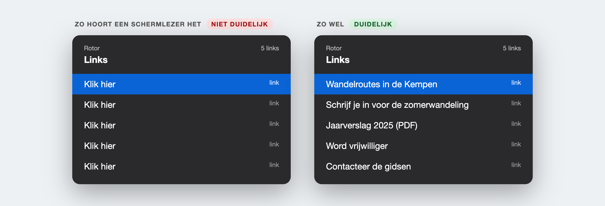
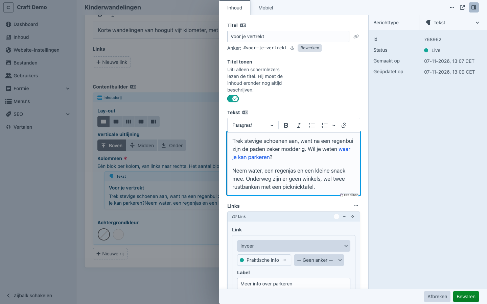
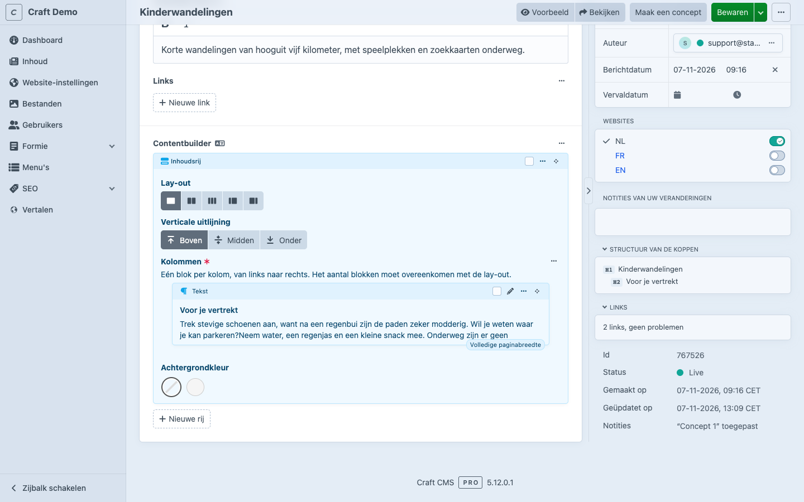
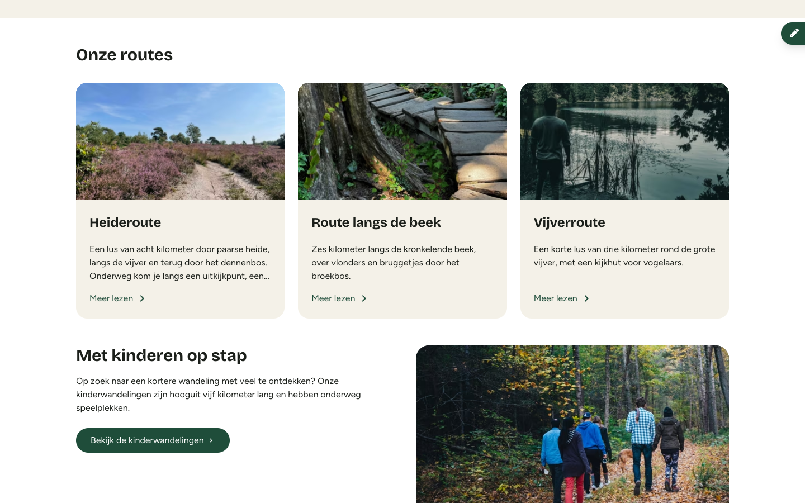

# Goede linkteksten schrijven

"Klik hier", "lees meer", "meer info": je ziet ze overal, maar ze zeggen niets over waar de link naartoe gaat. Hier lees je waarom een duidelijke linktekst belangrijk is en hoe je er een schrijft, in je tekst en op knoppen.

## Waarom "klik hier" niet werkt

**Schermlezers.** Wie blind of slechtziend is, gebruikt vaak een schermlezer. Die kan alle links van een pagina in een lijst voorlezen, los van de tekst eromheen. Staat er twintig keer "klik hier" in die lijst, dan weet de bezoeker niet welke link waarheen gaat.

**Zoekmachines en AI.** Zoekmachines en AI-assistenten lezen links op dezelfde manier. De linktekst vertelt hen waar de pagina achter de link over gaat.

**Wie snel scant.** Ook bezoekers die vlug over een pagina kijken, lezen vooral de onderlijnde woorden en de knoppen.

Sinds de zomer van 2025 moeten de meeste websites in de EU toegankelijk zijn (de European Accessibility Act). Duidelijke linkteksten horen daar bij.

## De test

Lees enkel de onderlijnde tekst en de tekst op de knoppen. Weet je dan waar elke link naartoe gaat? Zo niet, herschrijf.

## Zo herschrijf je een link in de tekst

Vaak staat de beste linktekst al in je zin.

| In plaats van | Schrijf |
|---|---|
| Wil je weten waar je kan parkeren? [Klik hier](#). | Bekijk [waar je kan parkeren](#). |
| Voor de routekaart, [zie hier](#). | Download [de routekaart van de Beekvallei (PDF)](#). |
| Meer weten? [Lees meer](#). | Lees meer over [wandelen met kinderen](#). |

Je hoeft "klik hier" ook niet te schrijven: iedereen weet dat je op onderlijnde tekst kan klikken.

1. Verwijder de link van "klik hier" en die woorden zelf.
2. Selecteer de woorden die zeggen waar de link naartoe gaat.
3. Zet daar de link op (zie *Een knop of link toevoegen*).

<!-- screenshot: veld Tekst met de herschreven zin, link op "waar je kan parkeren"; link markeren -->

> **Tip:** Link je naar een bestand, zeg dat dan in de linktekst, bijvoorbeeld "(PDF)". Zo weet de bezoeker dat er een download volgt.

## Ook op knoppen

Voor knoppen geldt hetzelfde. "Meer info" of "Lees meer" alleen zegt niets. Beter:

- "Meer info over parkeren"
- "Schrijf je in voor de herfstwandeling"
- "Download de routekaart"

Een knoptekst mag wat langer zijn, zolang hij bondig en duidelijk blijft. Begin liefst met een werkwoord: wat gebeurt er als je klikt?

<!-- screenshot: veld Links met label "Meer info over parkeren"; label markeren -->

## En de kaartjes met "Meer lezen"?

In overzichten staat onder elk kaartje "Meer lezen". Dat is in orde: op een kaartje is de **titel** de eigenlijke link, en je kan op het hele kaartje klikken. "Meer lezen" is enkel een hint voor het oog en staat niet als aparte link in de lijst van een schermlezer. Bij je eigen links en knoppen schrijf je wel altijd een volledige tekst.

<!-- screenshot: overzichtskolom op de site met drie kaartjes; titel en "Meer lezen" van één kaartje markeren -->

## Veelgestelde vragen

- **Jullie zeggen geen "meer info", maar de kaartjes doen het wel?** Op kaartjes is de titel de link; "Meer lezen" is daar geen aparte link. Bij zelfgemaakte links en knoppen gebruik je nooit "meer info" of "lees meer" alleen.
- **Mag een linktekst lang zijn?** Ja, als hij daardoor duidelijker wordt. Een hele zin onderlijnen is wel te veel: kies de woorden die het doel beschrijven.
- **Moet ik de webadressen zelf als linktekst tonen?** Liever niet. Een adres is moeilijk voor te lezen en zegt weinig. Uitzondering: een kort, bekend adres dat mensen moeten onthouden.

## Zie ook

- Een knop of link toevoegen
- Tussentitels gebruiken: de kopstructuur
- De verplichte pagina's
