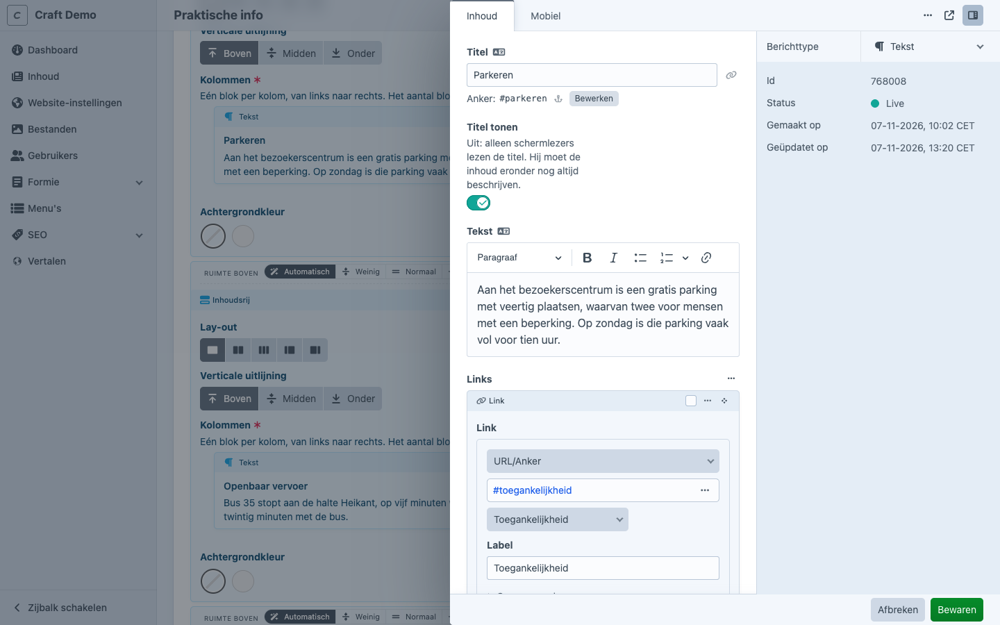
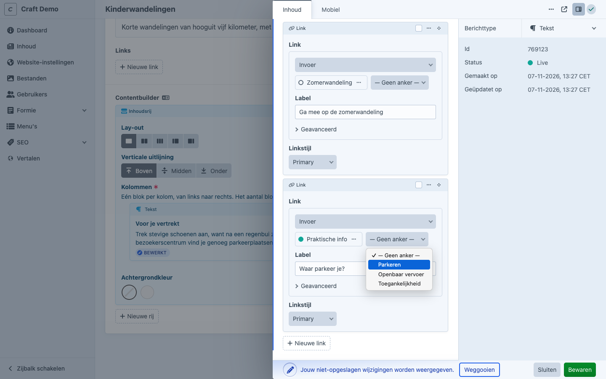

# Naar een blok linken met ankers

Met een anker link je niet naar het begin van een pagina, maar rechtstreeks naar één blok erop, bijvoorbeeld naar "Parkeren" op de pagina "Praktische info". Hier lees je hoe een blok een anker krijgt, hoe je ernaar linkt en waar je op moet letten.

## Wat is een anker?

Een anker is een stukje achter het adres van een pagina, met een hekje ervoor: `…/praktische-info#parkeren`. Klikt een bezoeker op zo'n link, dan opent de pagina en scrolt ze meteen naar dat blok.

Elke kolom met een titel, zoals een tekstkolom, veelgestelde vragen of een call to action, krijgt automatisch een anker op basis van die titel.

## Het anker van een kolom

Open een kolom. Onder het veld **Titel** staat het anker, bijvoorbeeld **Anker: #parkeren**, met daarnaast **Bewerken**.

<!-- screenshot: paneel kolom "Parkeren", titel en ankerregel met de twee kopieerknoppen; ankerregel en knoppen markeren -->

Hoe het anker zich gedraagt:

- **Zolang het blok nieuw is** (nog nooit online, of enkel in een concept), volgt het anker de titel. Pas je de titel aan, dan past het anker zich aan.
- **Zodra het blok online staat**, blijft het anker hetzelfde, ook als je de titel later wijzigt. Zo blijven links naar dit blok werken.

## Het anker zelf aanpassen

1. Klik naast het anker op **Bewerken**.
2. Typ een nieuw anker, bijvoorbeeld een kortere versie.
3. Klik op **Toepassen**, of op **Afbreken** om het te laten zoals het was.

Een leeg anker valt terug op de titel.

> **Let op:** Pas je het anker aan van een blok dat al online staat, dan werken links die het oude anker gebruiken niet meer. Pas het daarom aan voor je ernaar linkt.

## Linken vanaf een andere pagina

1. Voeg een link toe (zie *Een knop of link toevoegen*) en kies het type **Invoer**.
2. Klik op **Kiezen**, selecteer de pagina en klik op **Selecteren**.
3. Naast de gekozen pagina verschijnt een keuzelijst met **— Geen anker —** en alle ankers op die pagina, in volgorde.
4. Kies het blok.

Kies je later een andere pagina, dan valt het gekozen anker weg. Bestaat een gekozen anker niet meer op de pagina, dan staat het in de lijst gemarkeerd als **niet gevonden**.

<!-- screenshot: veld Link, type Invoer, pagina Praktische info gekozen, ankerlijst open met Parkeren, Openbaar vervoer, Toegankelijkheid -->

## Linken naar een blok op dezelfde pagina

1. Voeg een link toe en kies het type **URL/Anker**.
2. Onder het veld staat een keuzelijst **— Anker op deze pagina —**.
3. Kies het blok. Het adres wordt `#toegankelijkheid`, en het label krijgt de titel van het blok, tenzij je zelf een label typte.

De lijst toont de pagina zoals ze bewaard was toen je ze opende. Een blok dat je net toevoegde, verschijnt pas nadat je de pagina bewaard en opnieuw geopend hebt.

## De kopieerknoppen

Naast de titel en het anker van een kolom staan twee kleine knoppen:

| Knop | Kopieert | Handig voor |
|---|---|---|
| **Linkicoon** achter de titel | De volledige link: adres van de pagina + anker | Een mail, nieuwsbrief of bericht op sociale media |
| **Ankericoon** op de ankerregel | Enkel `#anker` | Een link in de tekst op dezelfde pagina |

Je ziet een melding zoals **Link gekopieerd naar het klembord.**

## Testen

Bewaar de pagina en klik op **Bekijken**. Klik op je link: de pagina moet openen bij het juiste blok. Test liefst via **Bekijken**, op de volledige pagina.

> **Tip:** Verdwijnt een blok waar je naar linkt, of verandert het anker, dan meldt de linkcontrole een waarschuwing "Anker niet gevonden op de pagina" (zie *Gebroken links opsporen*).

> **Tip:** Link je vaak naar ankers omdat een pagina zo lang is? Verdeel de inhoud dan liever over een paar kortere pagina's.

## Veelgestelde vragen

- **Wat doen die icoontjes bij de titel?** Ze kopiëren de link naar dit blok of enkel het anker. Op de site zie je ze niet.
- **Kan ik vanuit een knop of een kaartje naar een stukje van een pagina linken?** Vanuit een knop wel: kies de pagina en daarna het anker. Een kaartje linkt altijd naar de pagina zelf.
- **Is dit hetzelfde als een paginanavigatie?** Nee. Op sommige sites staat bovenaan een lijst met links naar de blokken van de pagina; die werkt met dezelfde ankers, maar is niet standaard.
- **Ik heb de titel aangepast, waarom blijft het anker oud?** Omdat het blok al online stond: zo breken bestaande links niet. Pas het anker zelf aan als het echt moet.

## Zie ook

- Een knop of link toevoegen
- Gebroken links opsporen
- Bekijken terwijl je werkt: Voorbeeld en Bekijken
