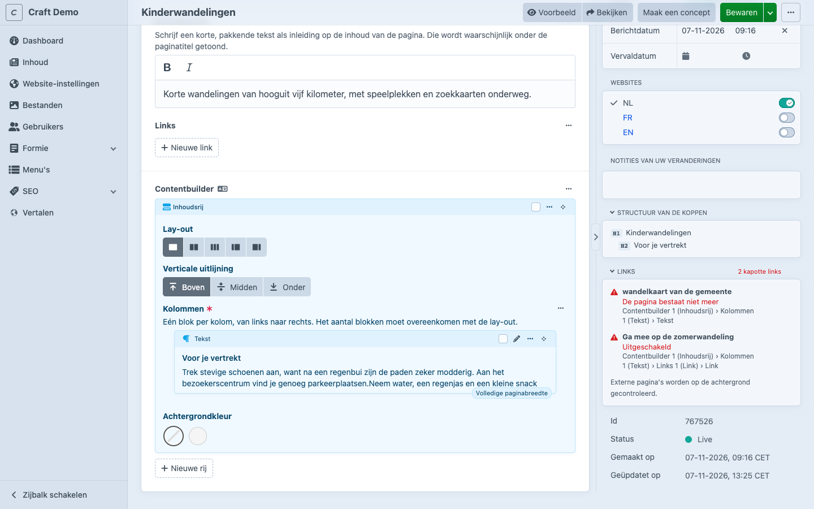
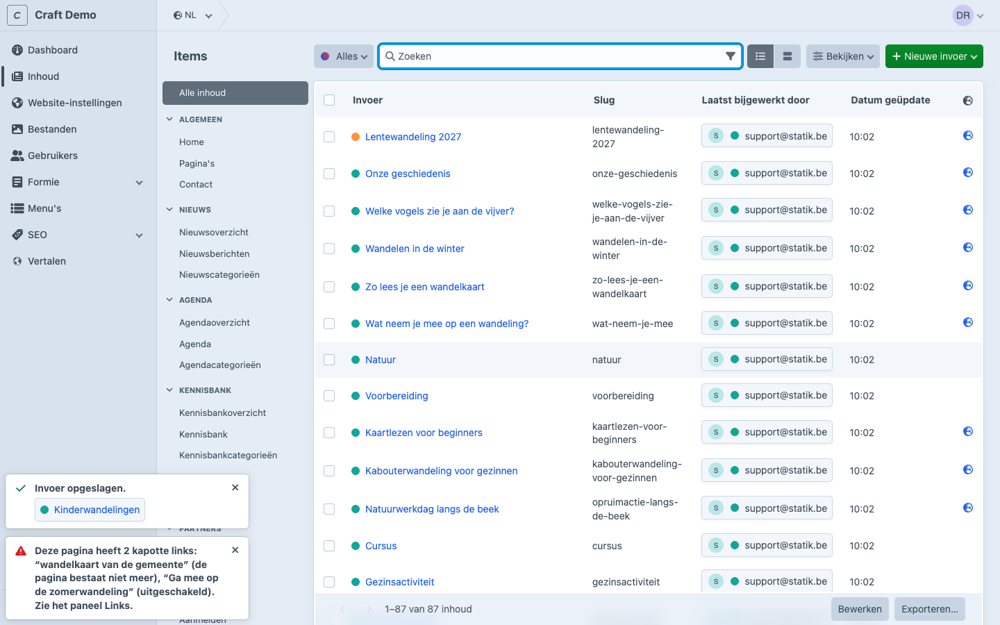
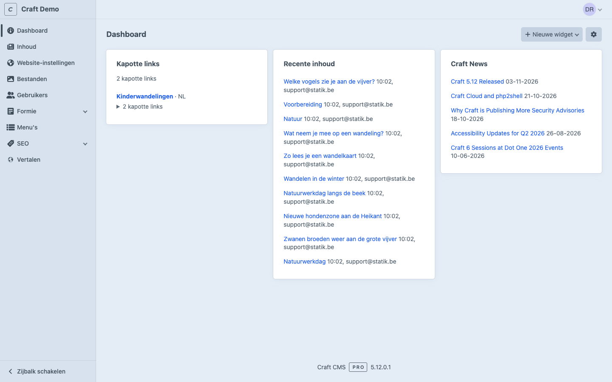

# Gebroken links opsporen

Een link kan kapotgaan zonder dat je iets aan je eigen pagina verandert: een collega schakelt een pagina uit, een bestand wordt verwijderd, een andere website verhuist. De site controleert alle links in je inhoud en meldt wat niet meer werkt. Hier lees je waar je die meldingen vindt en wat je ermee doet.

## Wat wordt gecontroleerd?

Alle links in je inhoud: knoppen in **Links**, links in teksten, in rijen en kolommen, in de Hero en in de algemene inhoud zoals de footer. Er zijn twee soorten meldingen.

**Kapot**: de link werkt niet meer.

- naar een pagina die verwijderd, uitgeschakeld of verlopen is, of in de prullenbak zit;
- naar een verwijderd bestand;
- naar een adres op je eigen site dat niet meer bestaat;
- naar een website waarvan het domein niet bestaat, of een pagina die niet meer bestaat.

**Waarschuwing**: de link werkt, maar kan beter.

- naar een pagina die nog niet gepubliceerd is;
- naar een adres dat doorverwijst: link liever naar de pagina zelf;
- naar een pagina die permanent verhuisd is: werk de link bij;
- naar een anker dat niet (meer) op de pagina staat (zie *Naar een blok linken met ankers*);
- een ongeldig e-mailadres of telefoonnummer.

Links naar pagina's van je eigen site die je met **Invoer** kiest, blijven werken als je de titel of de slug van die pagina aanpast.

## Het paneel Links

In de zijbalk van een pagina staat het paneel **Links**. Het toont de kapotte links en waarschuwingen van die pagina, met de reden en de plaats: de rij, de kolom en het veld waarin de link staat. Naast de titel staat het aantal kapotte links, ook als je het paneel inklapt.

Het paneel kijkt naar de pagina zoals je ze bewerkt, ook naar wijzigingen die je nog niet bewaarde. Een paar seconden nadat je typt, werkt het zich bij.

<!-- screenshot: zijbalk met paneel Links, één kapotte link (reden Uitgeschakeld) met plaats; aantal naast de titel markeren -->

### Een kapotte link herstellen

1. Lees in het paneel waar de link staat.
2. Open die kolom en kies een ander doel, of verwijder de link.
3. De regel verdwijnt even later uit het paneel. Bewaar de pagina.

## De waarschuwing bij bewaren

Bewaar je een pagina met kapotte links, dan verschijnt een melding zoals "Deze pagina heeft 1 kapotte link: … Zie het paneel Links." De pagina **wordt wel bewaard**: een link kan immers kapotgaan zonder dat jij iets fout deed. Kijk ze wel meteen na. Waarschuwingen geven geen melding bij bewaren.

<!-- screenshot: melding na Bewaren met "Deze pagina heeft 1 kapotte link"; melding markeren -->

## De widget Kapotte links

Voor een overzicht van de hele site staat op je dashboard de widget **Kapotte links**. Staat hij er niet (meer)? Voeg hem toe:

1. Ga naar **Dashboard** en klik op **Nieuwe widget**.
2. Kies **Kapotte links**.
3. In de instellingen kies je hoeveel pagina's hij toont, en of hij ook de pagina's met enkel waarschuwingen toont.

De widget toont elke pagina met kapotte links, met de reden en de plaats, en een link om de pagina te bewerken. Je ziet enkel de pagina's die je zelf mag bewerken.

<!-- screenshot: Dashboard met widget Kapotte links, twee pagina's; widget markeren -->

## Een link negeren

Soms klopt een melding niet. Sommige websites blokkeren automatische controles, of een link is bewust zo. Dan kan je hem negeren:

- in het paneel **Links** met **Negeren** bij die link;
- of bij **Hulpprogramma's** > **Link Checker**, als je daar toegang toe hebt. Daar zie je alle problemen van de site, kan je filteren en een CSV exporteren, en zie je onderaan de genegeerde links met **Niet meer negeren**.

Een genegeerde link meldt de site nergens meer, ook niet op andere pagina's.

> **Let op:** Negeer enkel links waarvan je zeker bent dat ze werken. Een genegeerde link die later echt kapotgaat, meldt de site niet meer.

## Goed om te weten

- De site controleert een nieuwe of gewijzigde pagina kort nadat je bewaart. Het kan even duren voor ze in de widget staat.
- Links naar andere websites controleert de site op de achtergrond, een paar keer met wat tijd ertussen. Pas wanneer een pagina meermaals niet bestaat, is de link kapot.
- Een link in een uitgeschakelde rij telt niet mee: die staat niet op de site.

> **Tip:** Kijk de widget geregeld na, bijvoorbeeld elke maand, en zeker nadat je pagina's uitschakelde of verwijderde.

## Veelgestelde vragen

- **Ik heb niets veranderd, waarom is mijn link kapot?** Iemand heeft de pagina of het bestand erachter verwijderd of uitgeschakeld, of een andere website is veranderd.
- **Moet ik elke waarschuwing oplossen?** Niet per se, maar het is wel beter. Een link naar een doorverwijzing werkt, maar is trager; een link naar een verdwenen anker opent bovenaan de pagina.
- **Waarom staat een pagina nog in de widget terwijl ik de link al herstelde?** De lijst wordt na het bewaren bijgewerkt. Vernieuw de pagina na een paar minuten.

## Zie ook

- Een knop of link toevoegen
- Naar een blok linken met ankers
- Online, offline en ingepland
- 404's opvolgen en redirects maken
