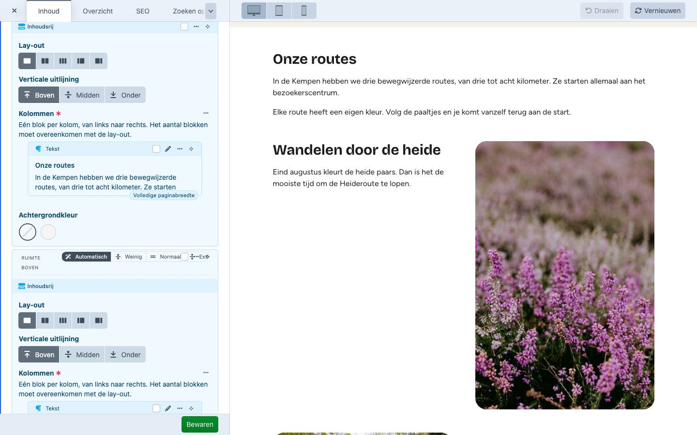
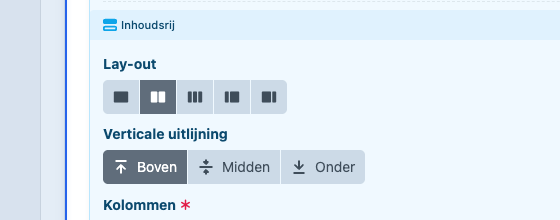
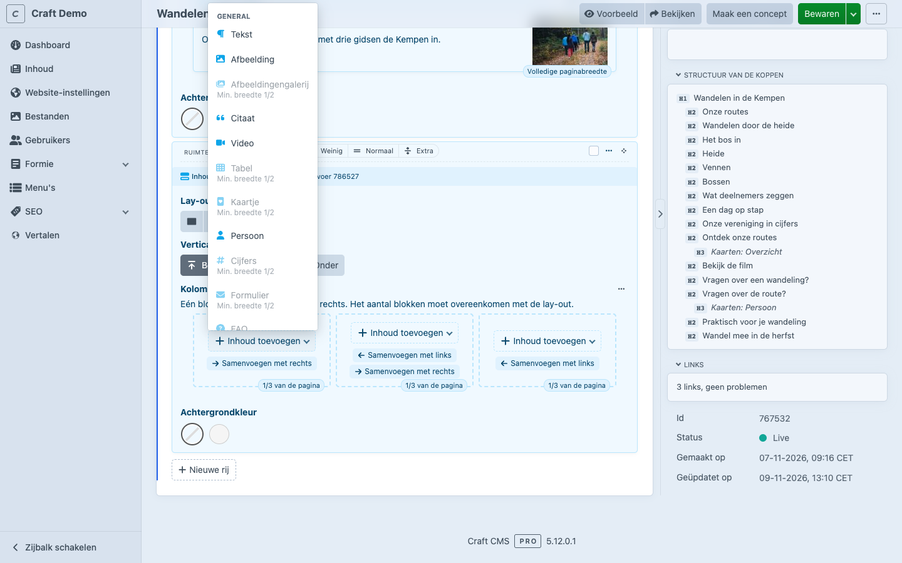

# Rijen en kolommen: het principe

Bijna alle inhoud van een pagina zet je in de **Contentbuilder**, het veld onder de paginaheader. Hier lees je hoe die is opgebouwd: rijen, lay-outs en kolommen. Lees dit eerst, dan zijn de andere stukken over de contentbuilder veel makkelijker.

## Een pagina is een stapel rijen

De contentbuilder is een stapel **inhoudsrijen** (in het control panel heet een rij **Inhoudsrij**). De volgorde van boven naar onder is ook de volgorde op de site. Je vindt de contentbuilder op gewone pagina's, maar ook op de homepage, de contactpagina, nieuwsberichten, events en kennisbankitems.

<!-- screenshot: pagina "Wandelen in de Kempen" met live preview open; markeer de vier rijen links en de overeenkomstige stukken rechts -->

## Elke rij heeft een lay-out

Bovenaan elke rij kies je bij **Lay-out** hoeveel kolommen de rij heeft. Er zijn vijf lay-outs:

| Lay-out | Kolommen |
|---|---|
| 1 | één kolom over de volle breedte |
| 1/2 + 1/2 | twee even brede kolommen |
| 1/3 + 1/3 + 1/3 | drie even brede kolommen |
| 1/3 + 2/3 | een smalle kolom links, een brede rechts |
| 2/3 + 1/3 | een brede kolom links, een smalle rechts |

<!-- screenshot: close-up van de Lay-out-knoppen van één rij; 1/2 + 1/2 geselecteerd -->

## In elke kolom één kolomtype

In elke kolom zet je precies één **kolomtype**: Tekst, Afbeelding, Afbeeldingengalerij, Citaat, Video, Tabel, Kaartje, Persoon, Cijfers, Formulier, FAQ, Embed, Call-to-action, Overzicht, Team of Partners. Een tekst naast een foto is dus een rij 1/2 + 1/2 met een kolom **Tekst** en een kolom **Afbeelding**.

## Alleen wat past

Niet elk kolomtype past in elke kolom. Het control panel toont alleen wat past; de rest staat grijs, met de reden erbij.

- **Minstens de helft van de pagina**: Kaartje, Tabel, FAQ, Embed, Formulier, Afbeeldingengalerij, Overzicht, Partners en Cijfers.
- **Altijd de volle breedte**: Call-to-action en Team.
- **Hoogstens de helft**: Kaartje en Persoon.
- **Niet samen in één rij**: twee keer Partners, of Citaat met FAQ.

<!-- screenshot: lege kolom in een rij 1/3 × 3, menu Inhoud toevoegen open; markeer een grijs type met zijn reden -->

## Waarom werkt het zo?

- **Het werkt op elk scherm.** Op een gsm schuiven de kolommen onder elkaar. Omdat elke combinatie vooraf getest is, blijft alles leesbaar.
- **Je site blijft één geheel.** Het ontwerp bepaalt de mogelijkheden, jij kiest daarbinnen. Zo ziet elke pagina er verzorgd uit, wie ze ook maakt.

> **Tip:** Voeg gerust een rij toe, kijk in de preview en verwijder ze als het niet goed is. Zolang je niet bewaart, gaat er niets online.

## Veelgestelde vragen

- **Waarom kan ik geen tabel in een smalle kolom zetten?** Een tabel in een derde van de pagina wordt onleesbaar. Kies een lay-out met bredere kolommen.
- **Moet ik alle velden invullen?** Nee, alleen de velden met een sterretje. Lege velden worden niet getoond.

## Zie ook

- Een rij toevoegen en een indeling kiezen
- Rijen instellen
- Bekijken terwijl je werkt: Voorbeeld en Bekijken
