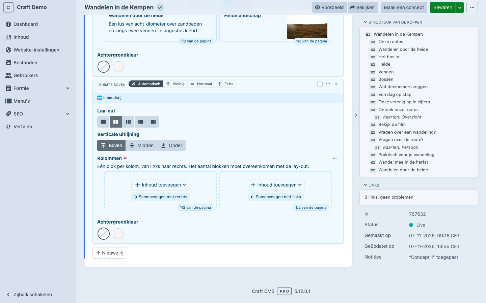
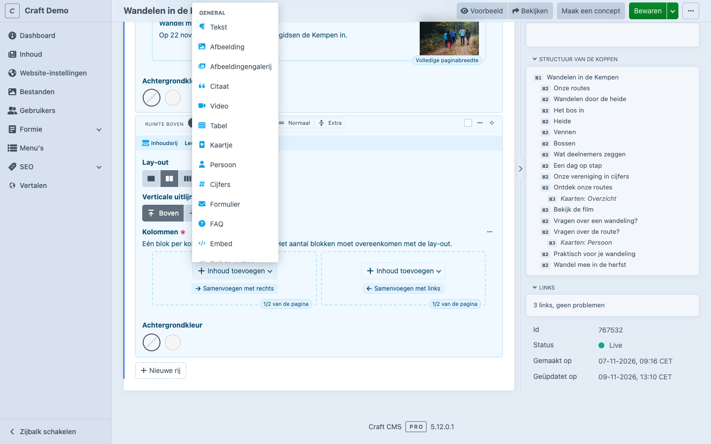
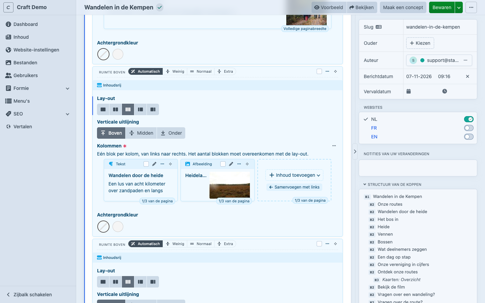

# Een rij toevoegen en een indeling kiezen

Hier lees je hoe je een nieuwe rij aan je pagina toevoegt, de lay-out kiest en de kolommen vult. Je leert ook hoe je achteraf een kolom bijmaakt of twee kolommen samenvoegt. Lees eerst *Rijen en kolommen: het principe* als je het principe van rijen en kolommen nog niet kent.

## Een rij toevoegen

1. Open de pagina en scroll naar de onderkant van de **Contentbuilder**.
2. Klik **Nieuwe rij**. Er verschijnt onderaan een nieuwe rij met één lege kolom.
3. Kies bij **Lay-out** de indeling. De pictogrammen tonen de kolommen; beweeg er met je muis over om de naam te zien (bv. "1/2 + 1/2").
4. Elke lege kolom toont haar breedte op de pagina, bv. **1/2 van de pagina**.

<!-- screenshot: nieuwe rij onderaan de contentbuilder, lay-out 1/2 + 1/2, twee lege kolommen; markeer Lay-out en de knoppen Inhoud toevoegen -->

> **Tip:** Een nieuwe rij komt altijd onderaan. Wil je ze ergens tussen, gebruik dan **Voeg Inhoudsrij toe boven** in het menu van de rij eronder (zie *Rijen en kolommen beheren*). Dan hoef je niet te slepen.

## De kolommen vullen

1. Klik in een lege kolom op **Inhoud toevoegen**.
2. Het menu toont de kolomtypes, gegroepeerd (bv. **Algemeen** en **Dynamische gegevens**). Types die niet in deze kolom passen, staan grijs met de reden: **Min. breedte 1/2**, **Max. breedte 1/2** of **Niet met …** als het type niet samen met een ander type in de rij mag.
3. Kies een type. De kolom krijgt de velden van dat type; vul ze in. Verplichte velden hebben een sterretje.
4. Doe hetzelfde voor de andere kolommen.

<!-- screenshot: menu Inhoud toevoegen open in een kolom van 1/2; markeer de groepskoppen en een grijs type met zijn reden -->

De kolommen staan in het formulier naast elkaar, zoals op de site. Zo zie je meteen welke inhoud links en welke rechts komt.

## Een kolom bijmaken

Naast de kolommen staan knoppen **Kolom links toevoegen** en **Kolom rechts toevoegen**. Daarmee maak je van een rij met één of twee kolommen een rij met twee of drie. De lay-out past zich aan. Meer dan drie kolommen kan niet.

## Kolommen samenvoegen

In een lege kolom staan **Samenvoegen met links** en/of **Samenvoegen met rechts**. De lege kolom verdwijnt en de kolom ernaast wordt breder. Samenvoegen kan alleen met een lege kolom, dus je verliest nooit inhoud.

<!-- screenshot: rij 1/3 × 3 met rechts een lege kolom; markeer Samenvoegen met links -->

## Voor je bewaart

Lege kolommen bestaan alleen in het formulier. Bewaar je een rij met een lege kolom, dan krijg je een foutmelding, bv. "Deze lay-out heeft 2 kolommen, maar er is 1 blok". Vul de kolom of voeg ze samen. Een concept of een automatisch bewaarde versie mag wel nog onvolledig zijn.

> **Let op:** Kies je een lay-out met smallere kolommen terwijl er al inhoud in staat die daar niet past, dan krijg je ook een melding. Kies dan een bredere lay-out of een ander kolomtype.

## Veelgestelde vragen

- **Kan ik meerdere rijen van hetzelfde type maken?** Ja, zoveel je wil.
- **Kan ik iets kapotmaken?** Nee. Probeer, kijk in de preview, en verwijder wat niet goed is. Zolang je niet bewaart, staat niets online.

## Zie ook

- Rijen en kolommen: het principe
- Rijen instellen
- Rijen en kolommen beheren
- Tekst en afbeelding
