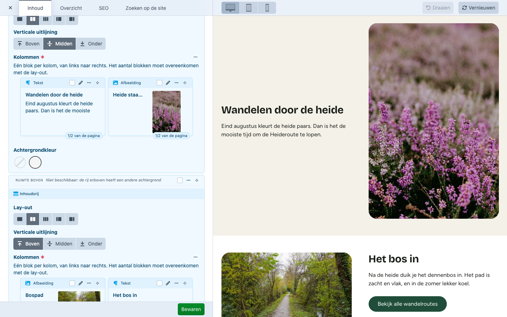
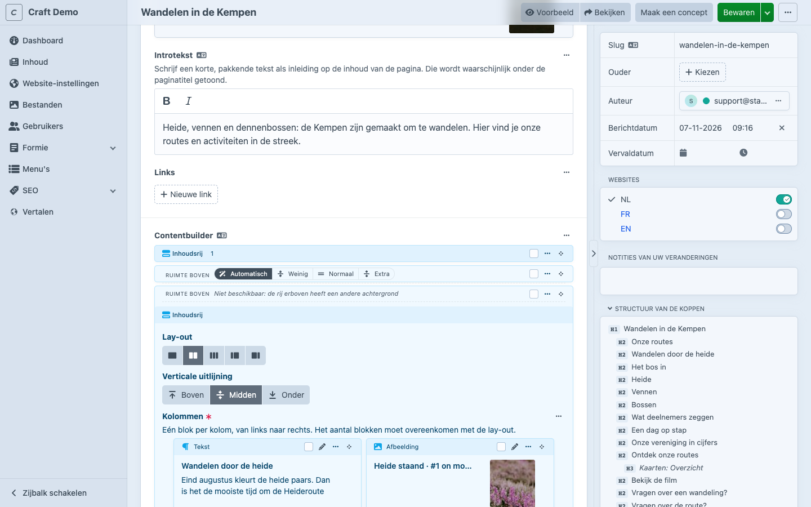
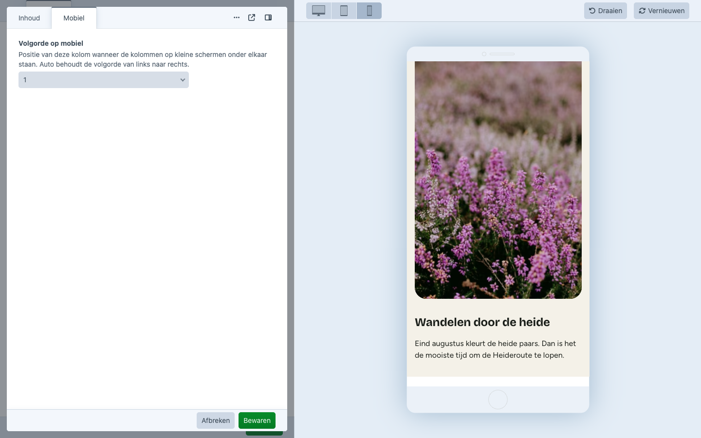

# Rijen instellen

Elke rij in de contentbuilder heeft een paar instellingen die bepalen hoe ze eruitziet: de achtergrondkleur, de ruimte boven de rij en de verticale uitlijning. Per kolom stel je daarnaast de volgorde op mobiel in. Hier lees je wat elke instelling doet en wanneer je ze gebruikt.

## Achtergrondkleur

Bij **Achtergrondkleur** kies je een kleurstaaltje. Het gestreepte staaltje betekent: geen achtergrond (de standaard). Welke kleuren er zijn, hangt af van het ontwerp van je site.

<!-- screenshot: rij opengeklapt, Achtergrondkleur met staaltjes; lichtgrijs geselecteerd, preview rechts met de grijze band -->

Waarom een achtergrond?

- Een lange pagina wordt luchtiger als je ze in stukken breekt.
- Rijen die bij elkaar horen, geef je dezelfde kleur: zo groepeer je een thema.

> **Tip:** Wissel af, maar "maak er geen kleurboek van". Een of twee gekleurde banden per pagina is vaak genoeg.

Een rij met een **FAQ**-kolom heeft geen achtergrondkleur: de instelling verdwijnt zodra je een FAQ in de rij zet.

## Ruimte boven

Tussen twee rijen staat een smalle balk **Ruimte boven**, met de opties **Automatisch**, **Weinig**, **Normaal** en **Extra**. Bij de eerste rij staat hij niet.

- **Automatisch** (standaard): de site kiest. Heeft geen enkele kolom van de rij een titel, dan is de rij een vervolg op de rij erboven en schuift ze dichter aan. Heeft ze een titel, dan begint er een nieuw stuk en krijgt ze de normale ruimte. Een verborgen titel (zie **Titel tonen** in *Tekst en afbeelding*) telt niet.
- **Weinig**: dicht bij de rij erboven.
- **Normaal**: de gewone ruimte.
- **Extra**: meer ruimte, bv. om een nieuw hoofdstuk te laten beginnen.

<!-- screenshot: twee ingeklapte rijen met de balk Ruimte boven ertussen; markeer Automatisch -->

De ruimte geldt alleen tussen rijen met **dezelfde achtergrond**. Heeft de rij erboven een andere kleur, dan heeft elke rij al haar eigen marge en toont de balk **Niet beschikbaar: de rij erboven heeft een andere achtergrond**. Dat past zich meteen aan als je een kleur wijzigt of een rij verplaatst.

## Verticale uitlijning

Hebben de kolommen van een rij een verschillende hoogte, bv. een korte tekst naast een hoge staande foto, dan bepaal je met **Verticale uitlijning** waar de kortere kolom staat: **Boven**, **Midden** of **Onder**.

## Volgorde op mobiel

Op een gsm staan de kolommen onder elkaar, standaard van links naar rechts. Wil je een andere volgorde:

1. Open de kolom die je wil verplaatsen.
2. Ga naar het tabblad **Mobiel**.
3. Kies bij **Volgorde op mobiel** een positie: **1**, **2** of **3**. **Automatisch** houdt de volgorde van links naar rechts.

<!-- screenshot: afbeeldingskolom open, tabblad Mobiel, Volgorde op mobiel = 1; preview in mobiele weergave met de foto boven de tekst -->

Een voorbeeld: staat de foto rechts op de computer maar wil je ze op de gsm boven de tekst, zet de afbeeldingskolom op **1**. De Team-kolom heeft deze instelling niet: die staat altijd alleen in haar rij.

> **Tip:** Controleer je aanpassingen in de live preview, ook in de mobiele weergave.

## Veelgestelde vragen

- **Moeten we alle kleuren zelf kiezen?** Nee. Zonder keuze krijgt de rij de standaardachtergrond. Kleur is een keuze per rij, geen verplichting.
- **Kan ik de ruimte tussen twee gekleurde rijen kleiner maken?** Niet als de kleuren verschillen: dan heeft elke rij haar eigen marge.

## Zie ook

- Een rij toevoegen en een indeling kiezen
- Rijen en kolommen beheren
- Tekst en afbeelding (Titel tonen)
