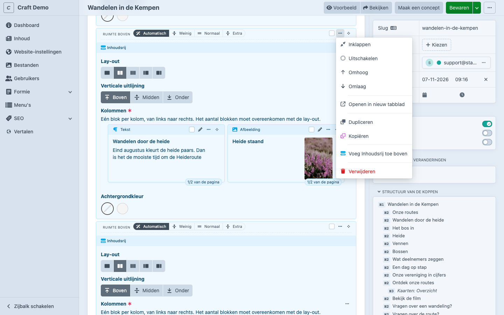
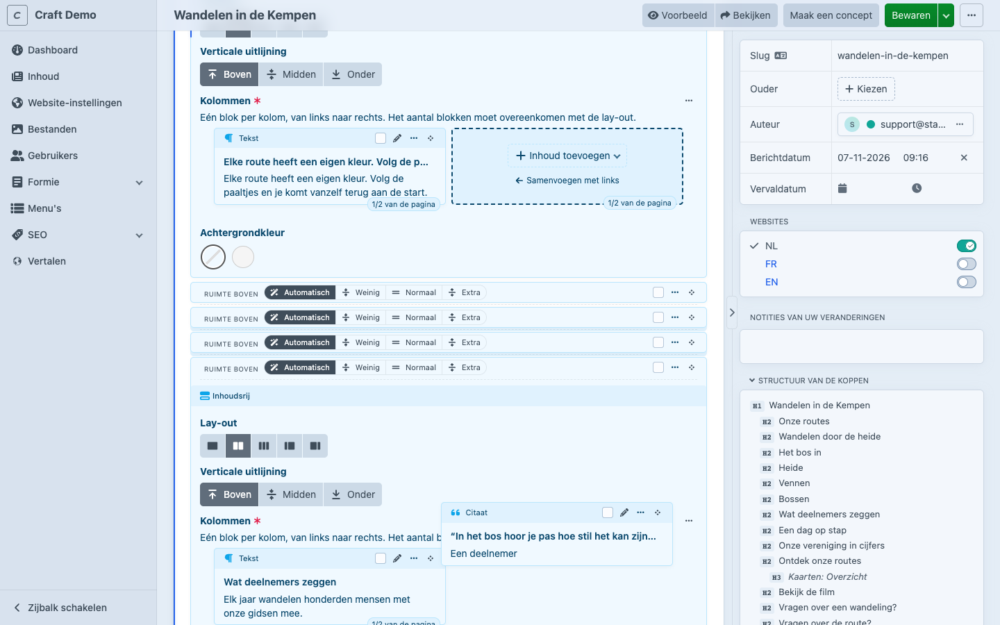

# Rijen en kolommen beheren

Op een lange pagina verlies je snel het overzicht. Hier lees je hoe je rijen inklapt, verplaatst, tijdelijk verbergt, dupliceert en verwijdert, hoe je een rij tussen twee andere zet, en hoe je een kolom naar een andere rij verhuist.

## Het menu van een rij

Rechtsboven elke rij staan drie puntjes (**Acties**). Daar vind je:

| Actie | Wat het doet |
|---|---|
| **Inklappen** / **Uitklappen** | De rij wordt een smal balkje, of weer volledig zichtbaar. Alleen in het formulier, niet op de site. |
| **Uitschakelen** / **Inschakelen** | De rij blijft bewaard, maar staat niet op de site. |
| **Omhoog** / **Omlaag** | De rij schuift één plaats op. |
| **Dupliceren** | Een kopie komt direct onder de rij. |
| **Kopiëren** | Kopieert de rij om ze elders te plakken (zie *Kopiëren naar een andere pagina*). |
| **Voeg Inhoudsrij toe boven** | Een nieuwe, lege rij boven deze rij. |
| **Verwijderen** | De rij verdwijnt. |

<!-- screenshot: drie puntjes van een rij geklikt, menu open met alle acties -->

## Alles inklappen

Naast het label **Contentbuilder** staat ook een menu met drie puntjes. Kies **Alle blokken samenvouwen** om alle rijen tegelijk in te klappen, of **Alle blokken uitvouwen** om ze weer te openen.

## Verplaatsen

- Met **Omhoog** en **Omlaag** in het menu: veilig, ook op een klein scherm.
- Door te slepen aan het pictogram met de vier pijltjes (**Herorden**): handig voor grotere verplaatsingen.

> **Let op:** Slepen in een lange, uitgeklapte pagina is lastig: je rij schiet makkelijk voorbij. Klap eerst alles in, sleep, en klap dan weer uit.

## Een rij ergens tussen zetten

**Nieuwe rij** onderaan zet een rij altijd helemaal onderaan. Kies daarom **Voeg Inhoudsrij toe boven** in het menu van de rij waar de nieuwe rij boven moet komen. Dan hoef je niet te slepen.

## Uitschakelen in plaats van verwijderen

Een uitgeschakelde rij klapt in en krijgt een rood bolletje in de titelbalk. Zodra je bewaart, verdwijnt ze van de site. De inhoud blijft bewaard. Gebruik het voor:

- een actie die tijdelijk niet geldt, maar later terugkomt;
- een rij waaraan je nog werkt.

## Dupliceren

**Dupliceren** zet een exacte kopie onder de rij. Vervang daarna enkel de tekst of de foto. Zo hou je dezelfde lay-out en instellingen.

## Verwijderen en terughalen

Een verwijderde rij is weg uit de pagina. Bewaarde je de pagina daarna al, dan haal je een vorige versie terug via de revisies van de pagina: open bovenaan het menu **Huidige** naast de paginanaam, onder **Recente revisies**. De site bewaart tien revisies per pagina. Zie *Iets ongedaan maken: revisies en de prullenbak*.

## Een kolom naar een andere rij verhuizen

1. Zorg dat de rij waar de kolom naartoe moet een **lege kolom** heeft (voeg er een toe met **Kolom rechts toevoegen**, zie *Een rij toevoegen en een indeling kiezen*).
2. Sleep het kolomkaartje naar die lege kolom.
3. De kolom staat nu in de nieuwe rij en is weg uit de oude.

<!-- screenshot: twee rijen open, kolomkaartje Citaat halverwege het slepen naar de lege kolom van de onderste rij -->

De oude rij heeft daarna een lege kolom: vul ze of voeg ze samen voor je bewaart. Tot je bewaart, staan je wijzigingen in een concept. Gooi je dat concept weg, dan staat alles weer zoals het was.

## Veelgestelde vragen

- **Waar is mijn rij naartoe?** Je hebt ze waarschijnlijk ver gesleept in een uitgeklapte pagina. Klap alles in en zoek ze terug.
- **Kan ik een verwijderde rij terughalen?** Ja, via een revisie van de pagina (zie *Iets ongedaan maken: revisies en de prullenbak*). Liever niet nodig? Schakel uit in plaats van te verwijderen.
- **Staat een uitgeschakelde rij nog online tot ik bewaar?** Ja. Wat je in het formulier doet, gaat pas live als je bewaart.

## Zie ook

- Een rij toevoegen en een indeling kiezen
- Kopiëren naar een andere pagina
- Iets ongedaan maken: revisies en de prullenbak
