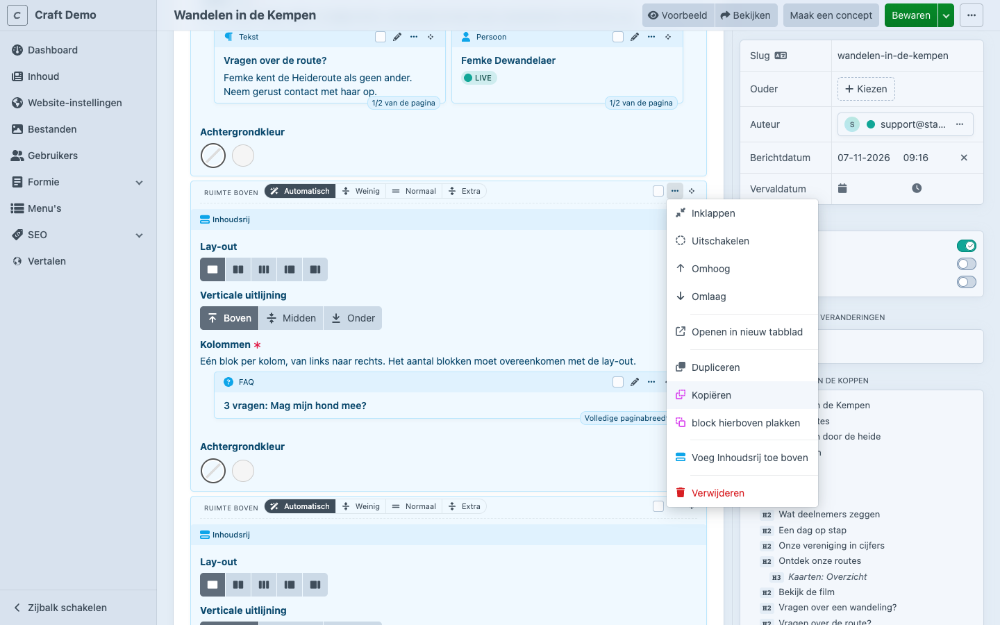
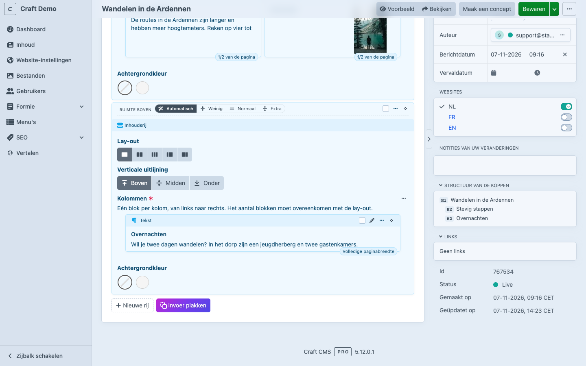

# Kopiëren naar een andere pagina

Staat er op een pagina een rij die je ook elders nodig hebt, bv. een blok praktische vragen of een call to action, dan kopieer je ze in plaats van ze opnieuw te maken. Hier lees je hoe je één rij of alle rijen kopieert en op een andere pagina plakt.

## Eén rij kopiëren

1. Klik op de drie puntjes (**Acties**) van de rij.
2. Kies **Kopiëren**. Onderaan het scherm verschijnt een melding dat de rij gekopieerd is.
3. Open de pagina waar de rij moet komen.
4. Scroll naar de onderkant van de **Contentbuilder**. Naast **Nieuwe rij** staat nu een knop om te plakken (**Invoer plakken**). Klik erop.
5. De rij staat onderaan, met al haar kolommen, inhoud en instellingen. Verplaats ze waar nodig (zie *Rijen en kolommen beheren*) en bewaar.

<!-- screenshot: menu Acties open met Kopiëren gemarkeerd; melding "… gekopieerd." zichtbaar -->

<!-- screenshot: onderkant contentbuilder op de tweede pagina, plakknop naast Nieuwe rij gemarkeerd -->

In het menu van een bestaande rij kan je de gekopieerde rij ook meteen **boven** die rij plakken. Dan hoef je ze achteraf niet te verplaatsen.

## Alle rijen kopiëren

1. Klik op de drie puntjes naast het label **Contentbuilder**.
2. Kies **Alle blokken kopiëren**.
3. Plak op de andere pagina zoals hierboven.

Dat is handig om een pagina als vertrekpunt voor een nieuwe pagina te gebruiken.

## Ook naar een ander soort pagina

Plakken werkt op elke pagina met een contentbuilder: gewone pagina's, nieuwsberichten, events en kennisbankitems. Kan je een rij ergens niet plakken, dan toont het control panel de plakknop niet.

> **Tip:** Exact dezelfde tekst op veel pagina's is niet ideaal voor zoekmachines. Gebruik kopiëren als vertrekpunt en pas de tekst aan de pagina aan. Komt iets echt overal terug, vraag ons dan of het beter op één centrale plek staat.

## Veelgestelde vragen

- **Bewaart hij de kopie tot ik plak?** Plak het best meteen nadat je gekopieerd hebt, en kijk na het plakken of alles er staat.
- **Kan ik één vraag uit een FAQ kopiëren?** De eenvoudigste manier: kopieer de hele rij, plak ze en verwijder in de kopie de vragen die je niet nodig hebt.
- **Wat is het verschil met dupliceren?** **Dupliceren** maakt een kopie op dezelfde pagina, direct onder de rij. **Kopiëren** en plakken werkt ook naar een andere pagina.

## Zie ook

- Rijen en kolommen beheren
- Tabel en veelgestelde vragen
- Nieuwe inhoud naar de andere taal kopiëren
