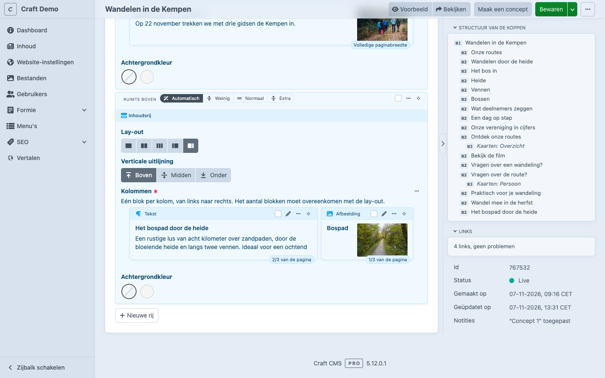

# Tekst en afbeelding

Een tekst met een foto ernaast is de bouwsteen die je het vaakst gebruikt. Je maakt hem met een rij van twee kolommen: een kolom **Tekst** en een kolom **Afbeelding**. Hier lees je hoe, welke velden er zijn en welke indeling je wanneer kiest.

## Tekst naast een afbeelding

1. Klik **Nieuwe rij** onderaan de **Contentbuilder**.
2. Kies bij **Lay-out** 1/2 + 1/2 (of een indeling in derden, zie verder).
3. Klik in de linkerkolom **Inhoud toevoegen** > **Tekst** en vul de velden in.
4. Klik in de rechterkolom **Inhoud toevoegen** > **Afbeelding** en kies een foto.
5. Bekijk het resultaat in de live preview en bewaar.

<!-- screenshot: rij opengeklapt met ingevulde Tekst- en Afbeelding-kolom; preview rechts met tekst naast de bosfoto -->

## De kolom Tekst

| Veld | Wat |
|---|---|
| **Titel** | De tussentitel boven de tekst. Op de pagina is dat een H2. |
| **Titel tonen** | Uit: de titel is onzichtbaar, maar schermlezers lezen hem nog. Hij moet de inhoud dus nog altijd beschrijven. |
| **Tekst** | De tekst zelf, met opmaak, lijstjes, links en tussentitels (H3 en dieper). Zie *Tekst opmaken* en *Tussentitels gebruiken: de kopstructuur*. |
| **Links** | Tot vijf knoppen of links onder de tekst, elk met een linkstijl. Zie *Een knop of link toevoegen*. |

Onder de titel zie je ook het anker van de kolom ("Anker: #…"), waarmee je naar dit stuk van de pagina kan linken (zie *Naar een blok linken met ankers*).

> **Let op:** De titel van een kolom is een H2. Zet je in de tekst een tussentitel, begin dan bij H3. Slaat je pagina een niveau over, dan kan je ze niet publiceren en kleuren de rij en de kolom rood. Zie *Tussentitels gebruiken: de kopstructuur*.

## De kolom Afbeelding

- **Afbeelding**: de foto (verplicht). Heeft de foto een inhoudelijke meerwaarde, vul dan ook de alternatieve tekst in: beschrijf wat de foto naast deze tekst betekent, niet wat erop staat. Is ze puur decoratief of zorgt ze enkel voor sfeer, dan laat je dat veld leeg (zie *Alt-tekst, bijschrift en copyright*).
- **Grotere versie in pop-up tonen**: bezoekers klikken op de foto en zien ze groot.

## Links of rechts

De kolommen staan op de site zoals in het formulier. Moet de foto links, zet de afbeeldingskolom dan links. Op een lange pagina wissel je best af: foto rechts, dan links. Dat breekt een lange kolom tekst. Op de gsm komen de kolommen onder elkaar; met **Volgorde op mobiel** kies je wat eerst komt (zie *Rijen instellen*).

## Helften of derden?

| Lay-out | Wanneer |
|---|---|
| 1/2 + 1/2 | Tekst en foto even belangrijk. |
| 2/3 + 1/3 of 1/3 + 2/3 | Langere tekst, de foto is ondersteunend. |
| 1 | Alleen tekst, zonder foto. |
| 1/3 × 3 | Drie korte teksten naast elkaar, bv. drie troeven. |

> **Tip:** Hou teksten in smalle kolommen kort. Een derde van de pagina is geen plek voor een lange uitleg.

## Meer dan één foto

Combineer een tekst met één foto. Heb je er meer, gebruik dan een **Afbeeldingengalerij**-kolom (zie *Afbeeldingengalerij en video*), bv. naast de tekst in een rij 1/2 + 1/2, of in een eigen rij eronder.

## Veelgestelde vragen

- **Ik wil een tekst met meerdere foto's. Moet ik een nieuwe rij starten?** Kneed je inhoud een beetje naar de mogelijkheden: één foto naast de tekst, en de andere in een galerij. Afwisselen oogt vaak mooier.
- **Is een tekstkolom zonder titel een probleem?** Nee. Maar zet je tussentitels in de tekst, vul dan ook de kolomtitel in, anders klopt de kopstructuur niet.
- **Kan ik een vetgedrukte zin als tussentitel gebruiken?** Liever niet: gebruik een echte kop (H3). Vet is geen tussentitel voor zoekmachines en schermlezers.

## Zie ook

- Tekst opmaken
- Tussentitels gebruiken: de kopstructuur
- Een knop of link toevoegen
- Rijen instellen (volgorde op mobiel)
- Afbeeldingengalerij en video
- Alt-tekst, bijschrift en copyright
