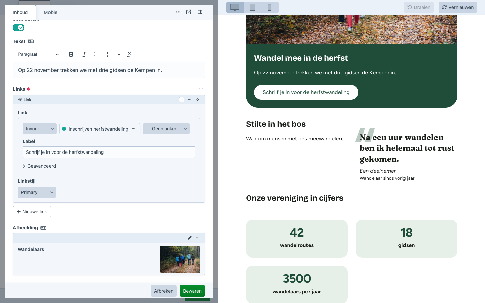
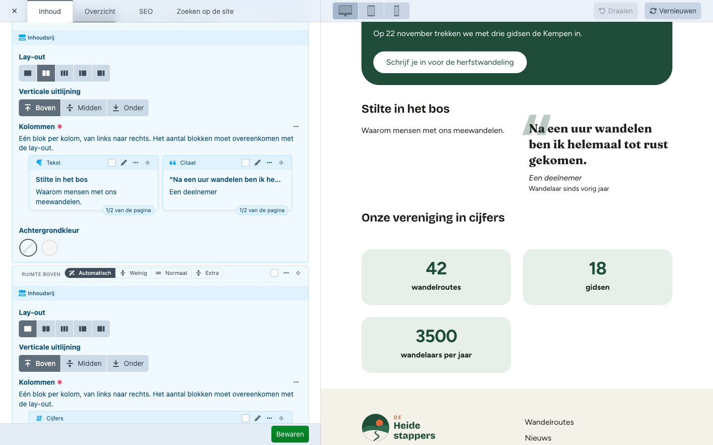
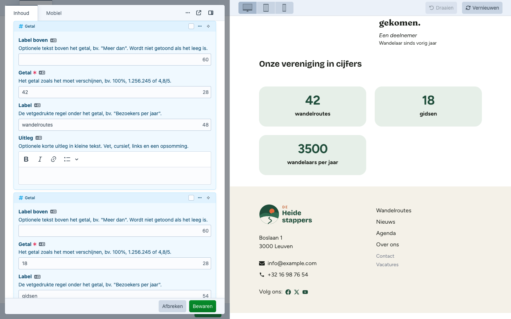

# Opvallen: call to action, citaat en cijfers

Drie kolomtypes zijn er om iets te laten opvallen: de **Call-to-action** zet aan tot één actie, het **Citaat** laat iemand aan het woord en **Cijfers** toont kerngetallen. Hier lees je welke velden ze hebben, waar ze passen en hoe je ze goed gebruikt.

## Call-to-action

Een call to action valt visueel op en leidt de bezoeker naar één actie die je zeker wil: inschrijven, contact opnemen, een folder downloaden. Je zet hem vaak onderaan een pagina, soms bovenaan.

De call to action neemt **altijd de volle breedte**. Kies dus een rij met lay-out **1**; in een smallere kolom staat hij grijs in het menu **Inhoud toevoegen**.

| Veld | Wat |
|---|---|
| **Titel** / **Titel tonen** | Een titel die aanspoort, bv. "Wandel mee in de herfst". |
| **Tekst** | Kort en bondig. |
| **Links** | Verplicht: minstens één knop, tot vijf. Een tweede knop kan als je een keuze wil geven. |
| **Afbeelding** | Optioneel. |

<!-- screenshot: Call-to-action-kolom ingevuld, preview rechts; markeer het veld Links -->

> **Let op:** De site snijdt de afbeelding bij naargelang de ruimte. Kies een sfeerbeeld: geen tekst op de foto, geen grafiek, niets dat volledig zichtbaar moet zijn.

> **Tip:** De knoptekst beschrijft wat er gebeurt: "Schrijf je in voor de herfstwandeling", niet "Klik hier". Zie *Goede linkteksten schrijven*.

## Citaat

Met een citaat laat je een uitspraak opvallen, bv. van een deelnemer of een gids. Het past in elke breedte, dus ook naast een tekst in een rij 1/2 + 1/2.

| Veld | Wat |
|---|---|
| **Citaat** | Verplicht: de uitspraak zelf, zonder aanhalingstekens: de site zet er zelf een groot aanhalingsteken bij. |
| **Auteur** / **Functie auteur** | Wie het zei en in welke rol. |
| **Afbeelding auteur** | Een fotootje: "een gezicht erop kleven" maakt het persoonlijker. |
| **Positie afbeelding auteur** | Waar het fotootje staat; verschijnt pas als je een foto kiest. |
| **Link** | Eén link, bv. "Lees het volledige interview met de gids". |

Een citaat en een FAQ kunnen niet in dezelfde rij.

<!-- screenshot: rij 1/2 + 1/2, Tekst links en Citaat rechts, preview -->

## Cijfers

Met **Cijfers** toon je kerngetallen als kaartjes: een groot getal met een korte omschrijving. De kolom heeft minstens de helft van de pagina nodig.

1. Vul bovenaan **Titel (anker)**, eventueel **Intro** en **Knoppen** in.
2. Klik bij **Cijfers** op **Cijfer toevoegen** voor elk getal (maximaal twaalf).
3. Per getal vul je **Getal** in (verplicht), en eventueel **Label boven**, **Label** en **Uitleg**.

In een kolom over de volle breedte staan er drie kaartjes naast elkaar, in een smallere kolom twee.

<!-- screenshot: preview van de Cijfers-kolom met drie kaartjes; formulier links met één getal opengeklapt -->

## Veelgestelde vragen

- **Kan een call to action naar een PDF linken?** Ja, kies bij de link **Bestand**. Zet onder **Geavanceerd** zelf **Openen in nieuw tabblad** aan, dan verlaat je bezoeker je site niet. Zie *Een knop of link toevoegen*.
- **Hoeveel calls to action zet ik op een pagina?** Liefst één, hooguit twee. Als alles opvalt, valt niets meer op.

## Zie ook

- Een knop of link toevoegen
- Goede linkteksten schrijven
- Tekst en afbeelding
- Naar andere pagina's verwijzen: overzicht en kaartje
