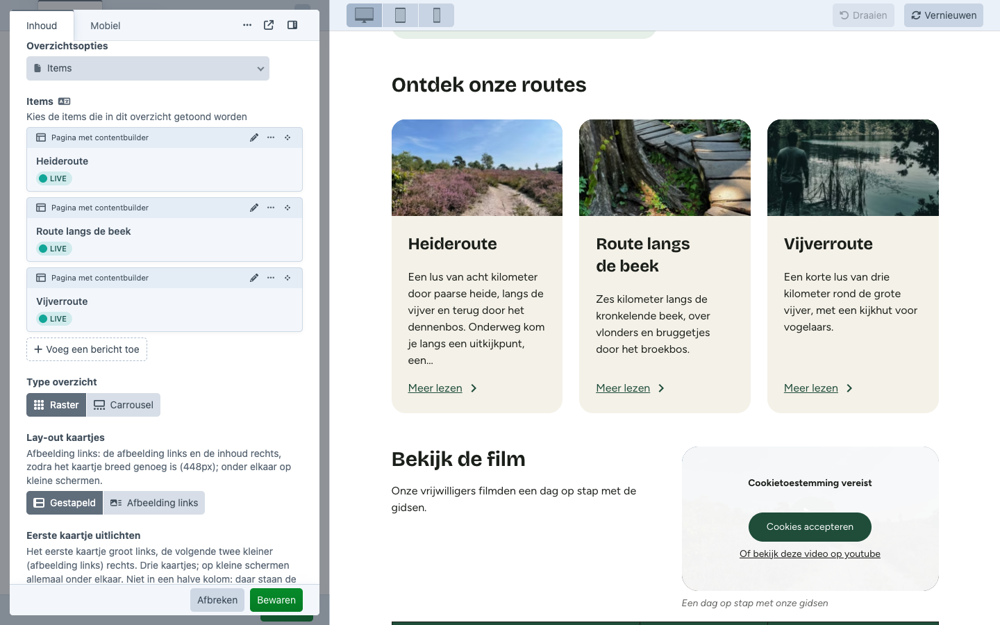
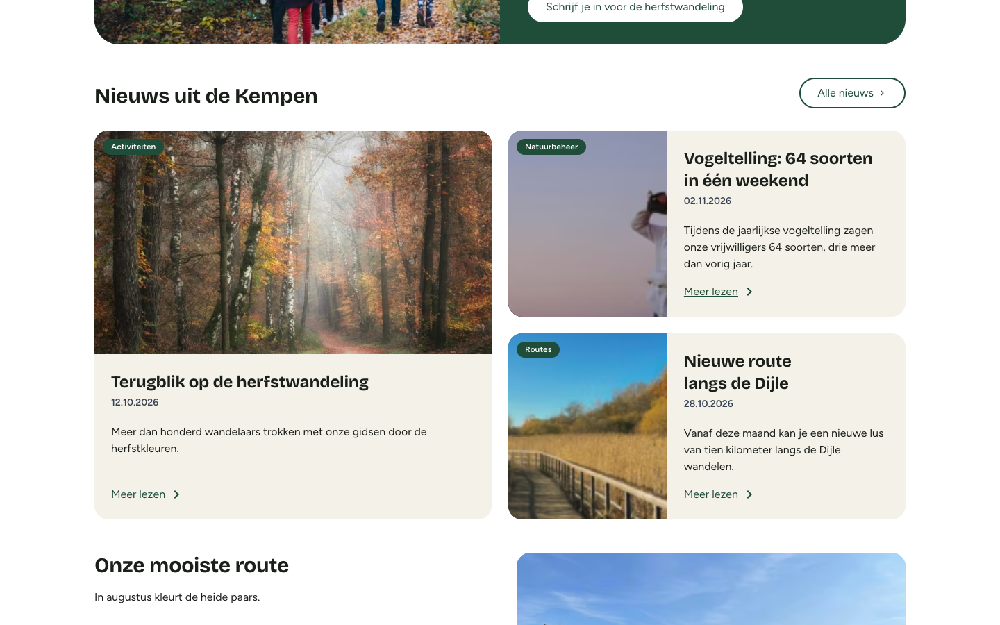

# Naar andere pagina's verwijzen: overzicht en kaartje

Met kaartjes leid je bezoekers naar andere pagina's: een overzichtspagina met links naar de deelpagina's, het laatste nieuws op de homepage, de volgende events. Daarvoor zijn er twee kolomtypes: **Overzicht** voor een reeks kaartjes en **Kaartje** voor één kaartje. Hier lees je alle opties.

## Overzicht: een reeks kaartjes

De kolom **Overzicht** staat in het menu **Inhoud toevoegen** in de groep **Dynamische gegevens**. Ze heeft minstens de helft van de pagina nodig.

1. Voeg een rij toe met lay-out **1** (of 1/2 + 1/2 voor een smal overzicht naast een tekst).
2. Kies **Inhoud toevoegen** > **Overzicht**.
3. Vul eventueel **Titel (anker)** en **Intro** in.
4. Kies bij **Overzichtsopties** wat je toont (zie hieronder) en selecteer de items.
5. Stel het type, de **Lay-out kaartjes** en de link in en bekijk de preview.

<!-- screenshot: Overzicht-kolom ingevuld met drie routepagina's, preview met drie kaartjes -->

### Overzichtsopties

| Optie | Wat je toont |
|---|---|
| **Items** | Pagina's die je zelf kiest, in jouw volgorde. |
| **Nieuws** | Nieuwsberichten. |
| **Agenda** | Events. |
| **Kennisbank** | Kennisbankitems (op sites met een kennisbank). |

Bij **Nieuws**, **Agenda** en **Kennisbank** staat **Dynamisch aanvullen**. Staat dat aan, dan komen de items die je zelf kiest eerst, en vult de site aan met de nieuwste items (bij de agenda: de eerstkomende events). De pagina zelf komt er nooit in. Kies je niets, dan toont het overzicht dus gewoon het nieuwste. Op een nieuwsbericht kan je met **Gerelateerd nieuws** ook nieuws over hetzelfde onderwerp laten voorgaan.

### Type, lay-out en link

- **Type overzicht**: **Raster** (kaartjes naast elkaar) of **Carrousel** (kaartjes om met pijltjes door te schuiven, handig om meer te tonen zonder een lange pagina).
- **Lay-out kaartjes**: **Gestapeld** (foto boven de tekst) of **Afbeelding links** (foto links, tekst rechts).
- **Eerste kaartje uitlichten** (alleen bij Raster): het eerste kaartje groot links, de volgende twee kleiner rechts. Ideaal voor het belangrijkste nieuws.
- **Link** en **Positie link**: een extra link, bv. "Alle nieuws", **Onder de kaartjes** of **Rechtsboven** (naast de titel op grote schermen).

In een kolom van een halve pagina zijn de kaartjes altijd "foto links", onder elkaar. **Lay-out kaartjes** en **Eerste kaartje uitlichten** staan daar niet.

<!-- screenshot: preview van een nieuwsoverzicht met Eerste kaartje uitlichten aan -->

## Kaartje: één los kaartje

De kolom **Kaartje** is precies een halve pagina breed: je zet ze in een rij 1/2 + 1/2, bv. naast een tekst of naast een tweede kaartje.

- **Type kaartje** **Item**: kies een pagina van je site. Met **Afbeelding tonen** zet je de foto aan of uit.
- **Type kaartje** **Eigen inhoud**: je vult zelf alles in bij **Info kaartje** (afbeelding, titel, tekst, link). Handig voor een kaartje naar een andere website, bv. een partner.
- **Lay-out kaartjes**: **Gestapeld** of **Afbeelding links**.

## Wat staat er op een kaartje?

De titel, de korte tekst en de foto van een kaartje van een pagina komen van die pagina zelf. Je past ze aan in de tab **Overzicht** van die pagina, niet in het overzicht. Zo kan je een kaartje een kortere titel of een ander beeld geven dan de pagina. Zie *Bepalen hoe je pagina als kaartje verschijnt*.

> **Tip:** Heeft een pagina geen eigen beeld, dan toont het kaartje de fallbackafbeelding van de site. Komt die te vaak terug, geef de pagina's dan een beeld in hun tab **Overzicht**, of zet bij een kaartje **Afbeelding tonen** uit.

## Veelgestelde vragen

- **Kan ik ook naar een externe website verwijzen?** Ja, met een kaartje van het type **Eigen inhoud**.
- **Hoeveel kaartjes toont een overzicht?** Wat je zelf kiest, wordt getoond. **Dynamisch aanvullen** vult aan tot één rij in een raster (drie kaartjes, vier met **Afbeelding links**) of tot zes in een carrousel. Wil je alles tonen, link dan naar de overzichtspagina.
- **Worden voorbije events getoond?** Nee, een agenda-overzicht toont alleen events die nog niet voorbij zijn, ook als je ze zelf koos.
- **Verschijnt een nieuw nieuwsbericht vanzelf?** Ja, als **Dynamisch aanvullen** aanstaat.

## Zie ook

- Bepalen hoe je pagina als kaartje verschijnt (tab Overzicht)
- Een nieuwsbericht plaatsen
- Een activiteit toevoegen aan de agenda
- Tekst en afbeelding
