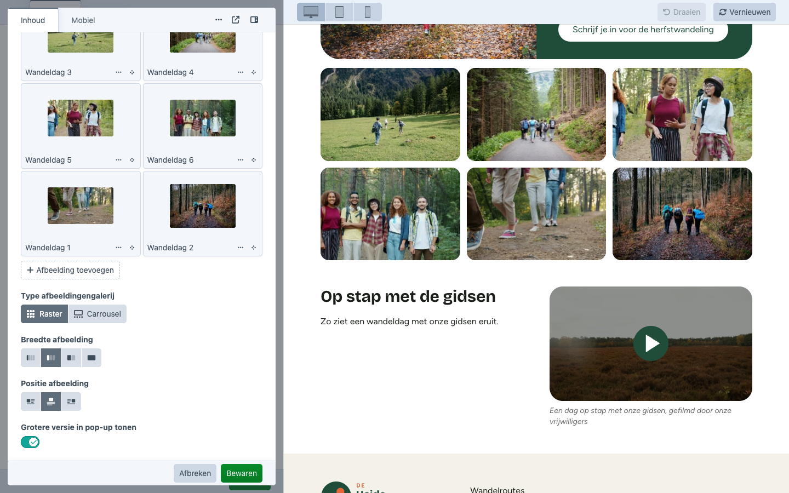
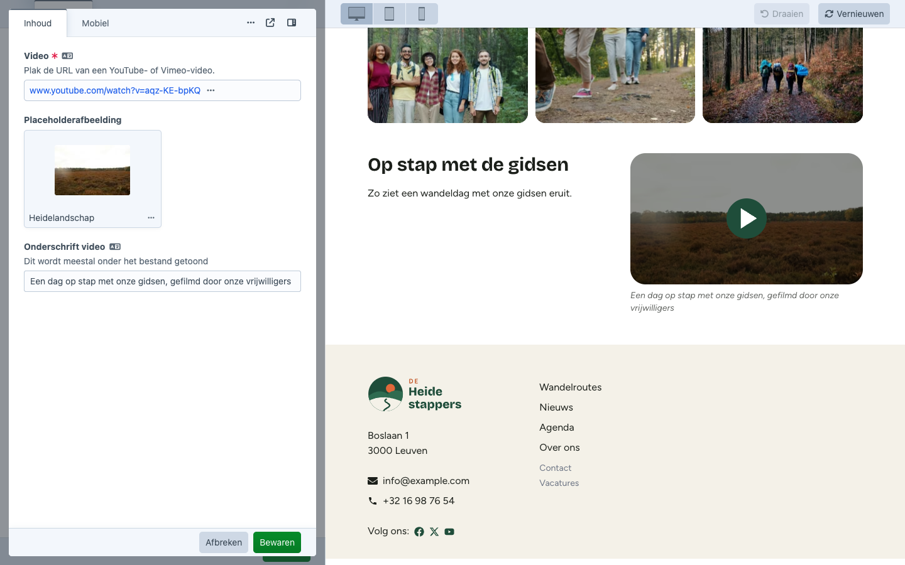

# Afbeeldingengalerij en video

Voor één foto naast een tekst gebruik je de kolom **Afbeelding** (zie *Tekst en afbeelding*). Heb je meerdere foto's, gebruik dan de **Afbeeldingengalerij**. Voor een filmpje van YouTube of Vimeo is er de kolom **Video**. Hier lees je hoe je beide instelt.

## Afbeeldingengalerij

De galerij heeft minstens de helft van de pagina nodig.

1. Voeg een rij toe (lay-out **1** voor een grote galerij, of 1/2 + 1/2 naast een tekst).
2. Kies **Inhoud toevoegen** > **Afbeeldingengalerij**.
3. Kies bij **Afbeeldingen** je foto's. De volgorde in het veld is de volgorde op de site; sleep om ze te herschikken.
4. Kies bij **Type afbeeldingengalerij**: **Raster** (alle foto's tegelijk) of **Carrousel** (foto's om met pijltjes door te schuiven).
5. Stel de breedte of de lay-out in (zie hieronder) en bekijk de preview.

<!-- screenshot: Afbeeldingengalerij-kolom ingevuld in een volle rij, preview met twee rijen van drie foto's -->

### Welke opties zie je?

Dat hangt af van de breedte van de kolom:

- **Volle breedte of 2/3**: **Breedte afbeelding** (1/4, 1/3, 1/2 of Volledige breedte) bepaalt hoeveel foto's naast elkaar staan. **Positie afbeelding** (Links, Midden, Rechts) bepaalt hoe de laatste, onvolledige rij uitgelijnd wordt.
- **Een halve pagina** (raster): bij **Lay-out afbeeldingen** kies je een patroon, bv. onder elkaar, twee op twee, of één grote en twee kleine.

> **Let op:** Deze opties verschijnen pas als de kolom op de pagina staat. Bij een nieuwe galerij klik je dus eerst **Maak invoer aan** en open je de kolom daarna opnieuw met het potloodje.

> **Tip:** Gelijke breedtes ogen het mooist: zes foto's op 1/3 geeft twee nette rijen van drie.

### Pop-up

Zet **Grotere versie in pop-up tonen** aan (bij een raster) en bezoekers klikken op een foto om ze groot te zien. Ze bladeren met pijltjes of het toetsenbord door alle foto's van de galerij. Ideaal voor bv. twintig sfeerfoto's van een wandeldag.

## Video

De kolom **Video** past in elke breedte.

1. Open de video op YouTube of Vimeo en kopieer de link uit de adresbalk.
2. Kies **Inhoud toevoegen** > **Video** en plak de link bij **Video** (verplicht).
3. Kies eventueel een **Placeholderafbeelding**.
4. Vul eventueel een **Onderschrift video** in.

<!-- screenshot: rij 1/2 + 1/2 met Tekst links en Video rechts; preview met de eigen placeholder en afspeelknop -->

**Placeholderafbeelding**: laat je dit leeg, dan zie je de miniatuur die YouTube kiest, met de afspeelknop van YouTube. Die is vaak van lage kwaliteit of toont een toevallig beeld. Met een eigen afbeelding bepaal je zelf wat bezoekers zien; klikken start de video.

**Onderschrift video**: een korte zin onder de video, bv. waarover hij gaat of wie hem maakte. Zo weet je bezoeker wat er komt, nog voor die klikt.

**Tekst en video naast elkaar**: zet een kolom **Tekst** en een kolom **Video** in een rij 1/2 + 1/2, net zoals tekst en afbeelding.

> **Let op:** Gebruik voor YouTube en Vimeo altijd de kolom **Video**, nooit **Embed**. De videokolom schaalt mee op elk scherm en ondersteunt de placeholder; een geplakte embedcode heeft niet altijd de juiste breedte.

## Veelgestelde vragen

- **Moet ik mijn foto's zelf omzetten naar een webformaat?** Nee. De site maakt zelf de juiste formaten en zet ze om naar een webformaat, de eerste keer dat een pagina de foto toont. Upload gewoon een grote JPG of PNG. Zie *Welke afbeelding upload je, en wat doet de site ermee*.
- **Kan ik een video van een andere site gebruiken?** De videokolom werkt met YouTube en Vimeo. Voor andere platformen, vraag het ons.
- **Moet ik een tekst met meerdere foto's in aparte rijen zetten?** Zet de tekst naast één foto, of naast een galerij in een rij 1/2 + 1/2.

## Zie ook

- Tekst en afbeelding
- Formulier en embed
- Welke afbeelding upload je, en wat doet de site ermee
- Alt-tekst, bijschrift en copyright
