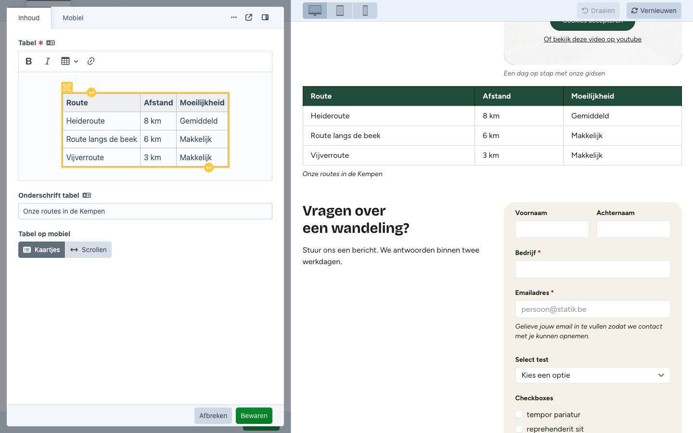
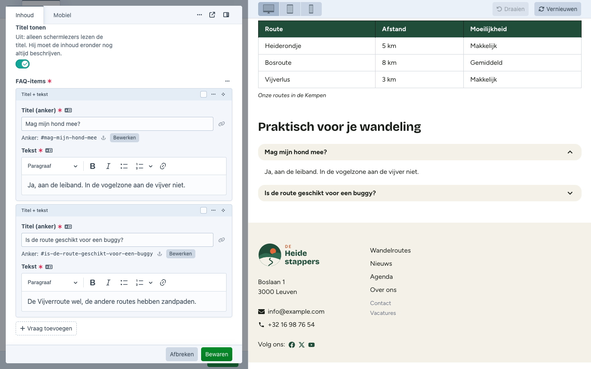

# Tabel en veelgestelde vragen

Gegevens in rijen en kolommen zet je in een **Tabel**, vragen met hun antwoord in een **FAQ**. Hier lees je hoe je een tabel maakt die ook voor schermlezers werkt, en hoe je een lijst vragen opbouwt die op de site openklapt.

## Tabel

De kolom **Tabel** heeft minstens de helft van de pagina nodig.

1. Voeg een rij toe en kies **Inhoud toevoegen** > **Tabel**.
2. Klik in het veld **Tabel** op **Tabel invoegen** en kies het aantal kolommen en rijen.
3. Typ in de eerste rij de omschrijving van elke kolom, en daaronder de gegevens. Je kan ook een tabel plakken.
4. Zet de eerste rij als titelrij: klik erin, open het menu van de rij en zet **Titel rij** aan.
5. Vul eventueel **Onderschrift tabel** in en kies **Tabel op mobiel**.

<!-- screenshot: tabel met drie routes; rijmenu open met Titel rij gemarkeerd -->

Met de menu's van een rij of kolom voeg je rijen en kolommen toe of verwijder je ze. In cellen kan je ook links zetten.

### Waarom een titelrij?

Een schermlezer leest een tabel cel per cel. Met een titelrij weet hij bij elke cel bij welke kolom ze hoort ("Afstand: 5 km"). Heeft je tabel in de eerste kolom ook omschrijvingen (een soort legende), zet dan ook **Titel kolom** aan.

### Op de gsm

Bij **Tabel op mobiel** kies je:

- **Kaartjes**: op een smal scherm wordt elke rij een kaartje onder elkaar.
- **Scrollen**: de tabel blijft een tabel en de bezoeker schuift ze opzij; de site zet er een kleine aanwijzing onder.

Bekijk het resultaat in de mobiele preview en kies wat het best leest.

> **Let op:** Een tabel is bewust beperkt: "geen halve Excel". Heb je veel gegevens, link dan naar een Excel-bestand of een gedeeld document.

## Veelgestelde vragen (FAQ)

De kolom **FAQ** heeft minstens de helft van de pagina nodig.

1. Voeg een rij toe en kies **Inhoud toevoegen** > **FAQ**.
2. Vul **Titel** in (en zet **Titel tonen** uit als je hem niet wil tonen).
3. Klik bij **FAQ-items** op **Vraag toevoegen** voor elke vraag.
4. Typ bij **Titel (anker)** de vraag en bij **Tekst** het antwoord. Het antwoord mag opmaak, lijstjes en links bevatten.
5. Sleep de vragen in de juiste volgorde: de belangrijkste bovenaan.

<!-- screenshot: FAQ-kolom met twee items, preview met de eerste vraag opengeklapt -->

Op de site staan de vragen onder elkaar; klikken klapt het antwoord open (een accordeon).

Een rij met een FAQ-kolom heeft **geen achtergrondkleur**: de instelling verdwijnt. Een citaat en een FAQ kunnen ook niet in dezelfde rij.

### Waarom vragen en antwoorden?

- Bezoekers vinden snel het antwoord op hun vraag.
- Zoekmachines en AI-assistenten werken graag met vragen en antwoorden, wat je pagina beter vindbaar maakt.

> **Tip:** Je hoeft niet alles op één FAQ-pagina te zetten. Een paar vragen onderaan een pagina waarover veel gevraagd wordt, werkt vaak beter.

## Veelgestelde vragen

- **Is er een maximum aantal vragen of tekens?** Zulke grenzen stellen wij in. Loop je ertegen aan, laat het ons weten.
- **Kan ik een tabel uit Excel plakken?** Ja, maar kijk daarna de titelrij en de opmaak na in de preview.
- **Kan ik dezelfde vragen op meerdere pagina's tonen?** Kopieer de rij naar de andere pagina (zie *Kopiëren naar een andere pagina*).

## Zie ook

- Kopiëren naar een andere pagina
- Rijen instellen
- Naar een blok linken met ankers (ankerlinks)
