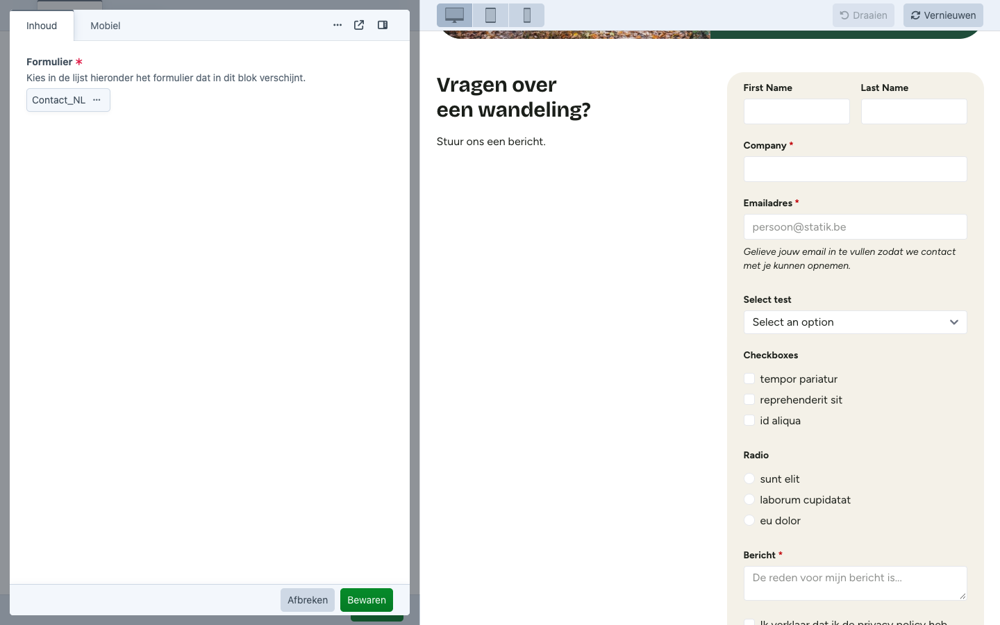
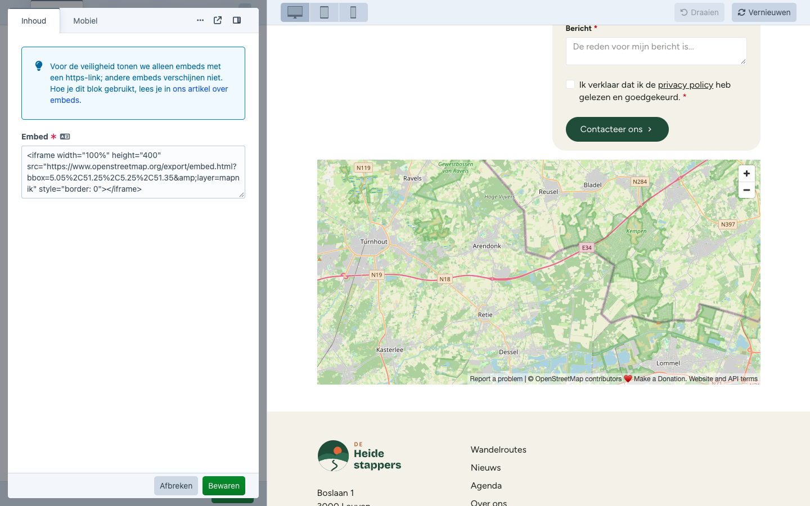

# Formulier en embed

Met de kolom **Formulier** zet je een formulier uit de site op een pagina, bv. een contact- of inschrijvingsformulier. Met **Embed** sluit je inhoud van een ander platform in, zoals een podcastspeler of een interactieve grafiek. Hier lees je hoe je beide gebruikt, en waarom je met embeds voorzichtig moet zijn.

## Formulier

De kolom **Formulier** heeft minstens de helft van de pagina nodig. Ze heeft één veld: het formulier zelf. Een titel of uitleg zet je in een kolom **Tekst** ernaast of in de rij erboven.

1. Voeg een rij toe, bv. 1/2 + 1/2 met links een kolom **Tekst** ("Vragen over een wandeling?").
2. Kies in de andere kolom **Inhoud toevoegen** > **Formulier**.
3. Kies bij **Formulier** een formulier uit de lijst.
4. Bekijk het resultaat in de preview en bewaar.

<!-- screenshot: rij 1/2 + 1/2, Tekst links, Formulier rechts met "Contact" gekozen; preview met het formulier -->

De formulieren zelf maak en beheer je in **Formie**: velden toevoegen, verplichte velden, wie een mail krijgt. Zie *Een formulier aanpassen en instellen wie een mail krijgt*. De site bewaart inzendingen één jaar.

> **Tip:** Bouw je formulieren liefst in de site, en sluit geen formulier van een ander platform in. Dan past het in je huisstijl, werkt het goed op elk scherm, en komen de inzendingen bij jou terecht.

## Embed

Met **Embed** plak je een stukje code van een ander platform in je pagina. De kolom heeft minstens de helft van de pagina nodig.

1. Ga naar het platform (bv. Spotify, SoundCloud of een grafiektool) en zoek de deelknop: meestal **Delen** of **Share**, dan **Insluiten** of **Embed**.
2. Kopieer de code die je krijgt.
3. Voeg een rij toe en kies **Inhoud toevoegen** > **Embed**.
4. Plak de code in het veld **Embed** en bekijk het resultaat in de preview.

<!-- screenshot: Embed-kolom met de tip bovenaan en een iframe-code in het veld; preview met de speler -->

De vormgeving van een embed komt van het platform, niet van je site. Vaak is het een "iframe": een webpagina in je pagina, alsof het een afbeelding is.

### Veiligheid

> **Let op:** Je plakt code rechtstreeks in je site. Kwaadaardige code kan je site openzetten voor aanvallen. Gebruik alleen code van platformen die je 100% vertrouwt: bekende spelers of diensten waarvoor je betaalt. Voelt dat een beetje spannend? Dat is een gezonde reflex.

- **Alleen https.** De site toont alleen embeds waarvan de links met `https://` beginnen. Een embed via `http://` zou beveiligingswaarschuwingen geven, dus die toont de site niet. De meeste platformen geven al https.
- **Geen volledige websites.** Technisch kan het, maar je weet niet hoe zwaar zo'n pagina laadt, en ze ziet er anders uit dan je site.

## Veelgestelde vragen

- **Is er een tool om die code te krijgen?** Meestal geeft het platform dat je wil insluiten zelf de code, via **Delen** > **Insluiten**.
- **Kan een YouTube-filmpje ook via embed?** Technisch wel, maar gebruik de kolom **Video**: die schaalt mee op elk scherm en laat je een eigen placeholder kiezen. Zie *Afbeeldingengalerij en video*.
- **Ik zie mijn embed niet op de site.** Kijk of de code https gebruikt. Werkt het dan nog niet, laat het ons weten.
- **Kan ik een formulier van een ander platform insluiten?** Het kan, maar bouw het liever in de site (zie hierboven), tenzij er een goede reden is.

## Zie ook

- Afbeeldingengalerij en video
- Een formulier aanpassen en instellen wie een mail krijgt
- Inzendingen bekijken, exporteren en spam
