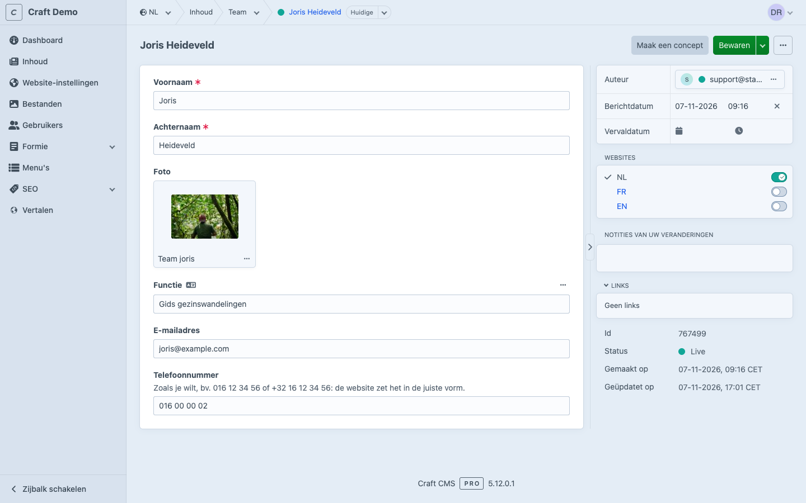
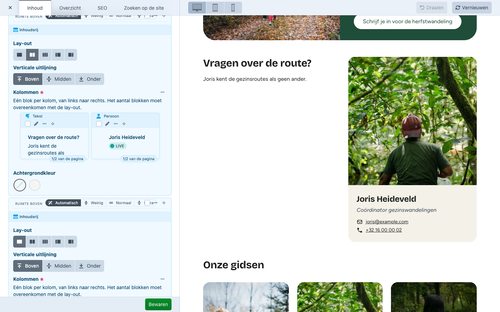
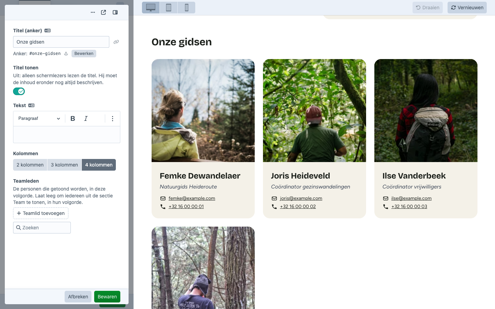

# Mensen tonen: persoon, team en partners

Een contactpersoon naast een tekst, een overzicht van je team of een rij partnerlogo's: dat doe je met de kolommen **Persoon**, **Team** en **Partners**. De mensen en partners zelf beheer je op één plek, in de secties **Team** en **Partners**. Hier lees je hoe dat samenwerkt.

## Mensen beheer je in de sectie Team

Mensen hebben geen eigen pagina. Ze zijn items in de sectie **Team** (in het menu **Inhoud**), met:

| Veld | |
|---|---|
| **Voornaam**, **Achternaam** | verplicht |
| **Foto**, **Functie**, **E-mailadres**, **Telefoonnummer** | optioneel; wat leeg is, wordt niet getoond |

<!-- screenshot: Inhoud > Team, een fictieve gids opengeklapt met alle velden -->

Omdat iedereen maar één keer bestaat, past een wijziging zich overal aan:

- **Iemand verandert van functie?** Pas het aan in de sectie **Team**. Het verandert meteen op elke pagina waar die persoon staat.
- **Iemand vertrekt?** Schakel die persoon uit in de sectie **Team**. Die verdwijnt overal van de site, maar de gegevens blijven bewaard.

> **Let op:** Pas een persoon nooit aan via een kopie op een pagina. Er is maar één versie: die in de sectie Team.

## Persoon: een contactpersoon naast een tekst

De kolom **Persoon** is hoogstens een halve pagina breed. Meestal gebruik je ze zo: een rij 1/2 + 1/2 met links een tekst ("Vragen over de route?") en rechts de contactpersoon.

1. Kies **Inhoud toevoegen** > **Persoon**.
2. Klik bij **Persoon** op **Kies een persoon** en kies iemand uit de sectie Team.
3. Staat de persoon er nog niet in, maak die dan meteen aan vanuit het venster. De nieuwe persoon is meteen gekozen en staat daarna ook in de sectie Team.

In een halve kolom staat de foto links en de gegevens rechts; op een gsm onder elkaar.

<!-- screenshot: rij 1/2 + 1/2 met Tekst en Persoon; preview met het persoonskaartje -->

## Team: het hele team

De kolom **Team** (groep **Dynamische gegevens**) neemt altijd de volle breedte.

- **Titel (anker)**, **Titel tonen** en **Tekst**: zoals bij een tekstkolom.
- **Kolommen**: 2, 3 of 4 personen naast elkaar.
- **Teamleden**: kies wie je toont, in jouw volgorde. **Laat je het leeg, dan toont de site iedereen uit de sectie Team**, in de volgorde van die sectie. Nieuwe collega's verschijnen dan vanzelf.

<!-- screenshot: Team-kolom ingevuld; preview met vier gidsen naast elkaar -->

## Partners: logo's

De kolom **Partners** (groep **Dynamische gegevens**) heeft minstens de helft van de pagina nodig. Partners zijn items in de sectie **Partners**, met een naam, een **Logo** (verplicht) en een **Website**.

- **Partners**: kies welke je toont, of laat leeg voor alle partners, in de volgorde van de sectie.
- **Type partners**: **Raster** (alle logo's tegelijk) of **Carrousel** (één rij logo's om door te schuiven).

Twee Partners-kolommen kunnen niet in dezelfde rij.

> **Tip:** Gebruik voor iedereen een foto met dezelfde uitsnede en achtergrond. Dan oogt je team als één geheel.

## Veelgestelde vragen

- **Moet ik een persoon op elke pagina apart aanpassen?** Nee, alleen in de sectie Team.
- **Hoe haal ik iemand van de site die vertrokken is?** Schakel de persoon uit in de sectie Team. Verwijderen kan ook, maar uitschakelen bewaart de gegevens voor als je ze nog nodig hebt.
- **Kan ik de volgorde van het team kiezen?** Ja: kies de teamleden zelf in de kolom, of sleep de personen in de sectie Team in de juiste volgorde.

## Zie ook

- Tekst en afbeelding
- Online, offline en ingepland
- Focuspunt en afbeelding bewerken (zodat gezichten mooi in beeld blijven)
