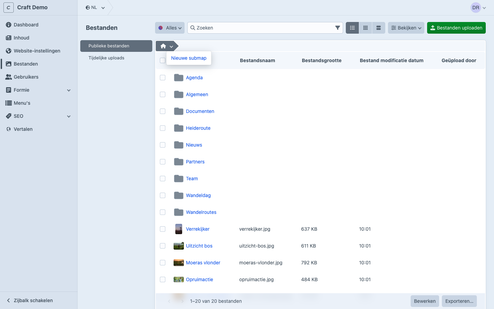
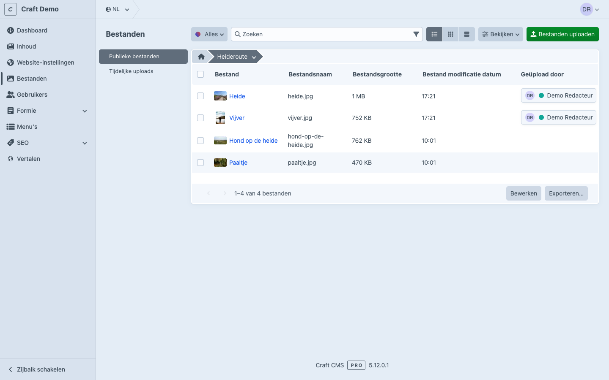
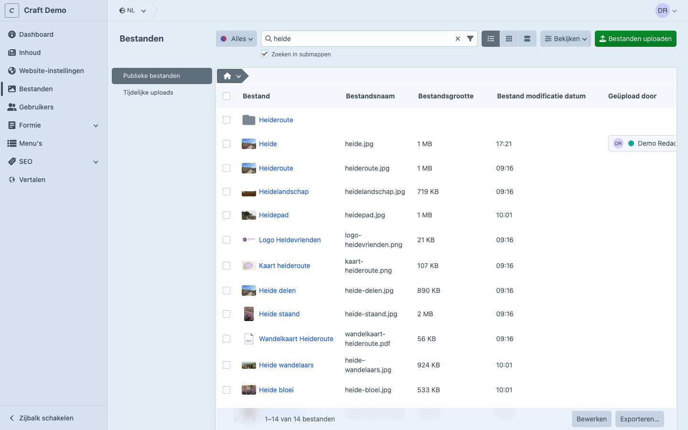

# Bestanden uploaden en ordenen in mappen

Alles wat je op je site toont of aanbiedt, van foto's tot een PDF met een wandelkaart, staat onder **Bestanden**. Hier lees je hoe je bestanden uploadt, hoe je ze in mappen ordent en hoe je ze terugvindt. Lees dit voor je de eerste keer iets uploadt: een goede mappenstructuur bespaart je later veel zoekwerk.

## Wat staat er onder Bestanden?
Klik in de zijbalk op **Bestanden**. Je ziet de hoofdmap, **Publieke bestanden**: eerst de mappen die erin zitten, daarna de losse bestanden. Het grootste deel zijn afbeeldingen, maar je kan elk bestand uploaden dat je op je computer hebt: PDF, Word, Excel, een zip-bestand. Het werkt zoals de mappen op je eigen computer.

<!-- screenshot: Bestanden > Publieke bestanden, met de mappen bovenaan de lijst; markeer het item Bestanden in de zijbalk -->

## Een map maken
1. Open de map waarin je de nieuwe map wilt (voor de hoofdmap klik je op het huisje) en klik op het pijltje ernaast.
2. Kies **Nieuwe submap**.
3. Je browser vraagt een naam. Geef de map een duidelijke naam, bijvoorbeeld "Heideroute", en klik op **OK**.

Je kan mappen in mappen maken, zo diep als je wilt. Via hetzelfde pijltje kan je een map ook een andere naam geven (**Geef map een andere naam**) of verwijderen (**Map verwijderen**).

<!-- screenshot: open menu naast Publieke bestanden; markeer Nieuwe submap -->

> **Let op:** op sommige sites vult de site zelf een map, bijvoorbeeld met bestanden die bezoekers via een formulier opsturen. Hernoem of verplaats zo'n map niet.

## Uploaden
1. Klik eerst op de map waar het bestand moet komen.
2. Klik op **Bestanden uploaden** en kies een of meer bestanden. Je kan ze ook vanuit je computer in het venster slepen.

Een bestand komt altijd in de map waarin je op dat moment staat. Geef het bestand vóór het uploaden al een duidelijke naam: die wordt de titel van het bestand in het beheer.

<!-- screenshot: map Heideroute geopend; markeer de knop Bestanden uploaden -->

## Bestanden verplaatsen
Er zijn twee manieren:
- **Slepen:** sleep het bestand naar een map in de lijst.
- **Via de acties:** vink een of meer bestanden aan, open het tandwiel onderaan de lijst en kies **Verplaatsen…**. Kies dan de doelmap en klik op **Verplaatsen**. Dat is handiger als die map een paar niveaus diep zit.

Links op je eigen site naar een bestand blijven werken als je het verplaatst, maar het webadres van het bestand verandert. Heb je het adres ooit in een mail of nieuwsbrief gezet, dan werkt die link niet meer. Orden dus liefst vóór de lancering.

## Bestanden terugvinden
Typ een deel van de bestandsnaam of titel in het zoekveld bovenaan. Standaard zoek je alleen in de map waarin je staat. Vink **Zoeken in submappen** aan om ook in de onderliggende mappen te zoeken. Ga naar de hoofdmap als je overal wilt zoeken.

<!-- screenshot: zoekterm "heide" in Publieke bestanden met Zoeken in submappen aangevinkt; markeer het vinkje -->

Zoeken helpt, maar duidelijke bestandsnamen en een vaste mappenstructuur helpen meer.

## Alles is publiek
Bestanden die je hier uploadt, zijn openbaar: iedereen met het adres kan ze openen, en met de juiste zoekterm kan Google ze vinden. Daarom staat er een gele waarschuwing bovenaan elk bestand. Zet hier geen vertrouwelijke documenten. Wil je toch gevoelige bestanden bewaren, laat het ons weten.

> **Tip:** maak meteen een mappenstructuur en spreek met je collega's af wat waar komt, bijvoorbeeld een map per sectie (Wandelroutes, Nieuws, Agenda) en een map Documenten voor PDF's. Zonder afspraken staan er na een jaar honderden bestanden in de hoofdmap.

## Veelgestelde vragen
- **Kan ik de naam van een PDF of afbeelding nog aanpassen?** Ja, de titel kan je altijd wijzigen in het bestand zelf. Een goede bestandsnaam bij het uploaden is wel het handigst.
- **Zijn mijn bestanden echt voor iedereen zichtbaar?** Ja, alle bestanden in deze map zijn publiek, ook als ze op geen enkele pagina staan.

## Zie ook
- Welke afbeelding upload je, en wat doet de site ermee
- Alt-tekst, bijschrift en copyright
- Een PDF of ander bestand aanbieden
