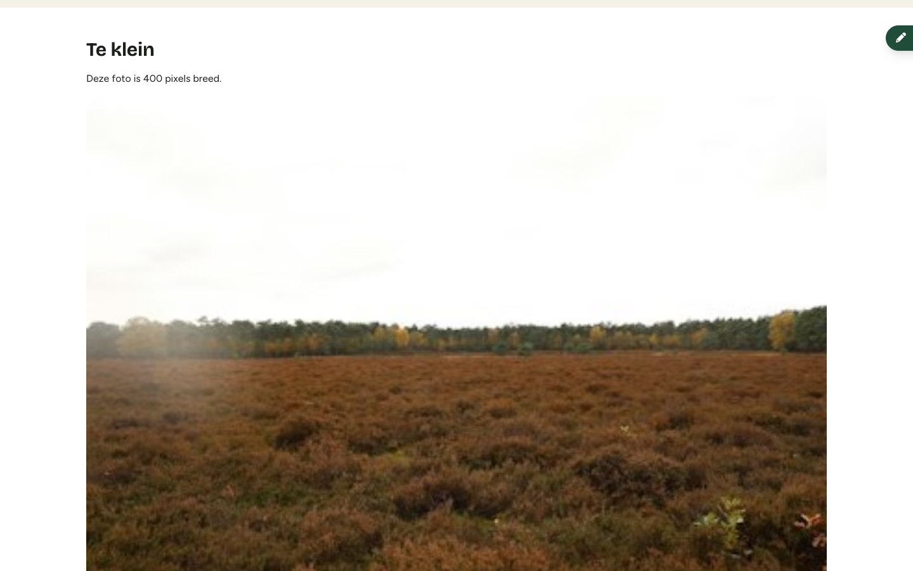
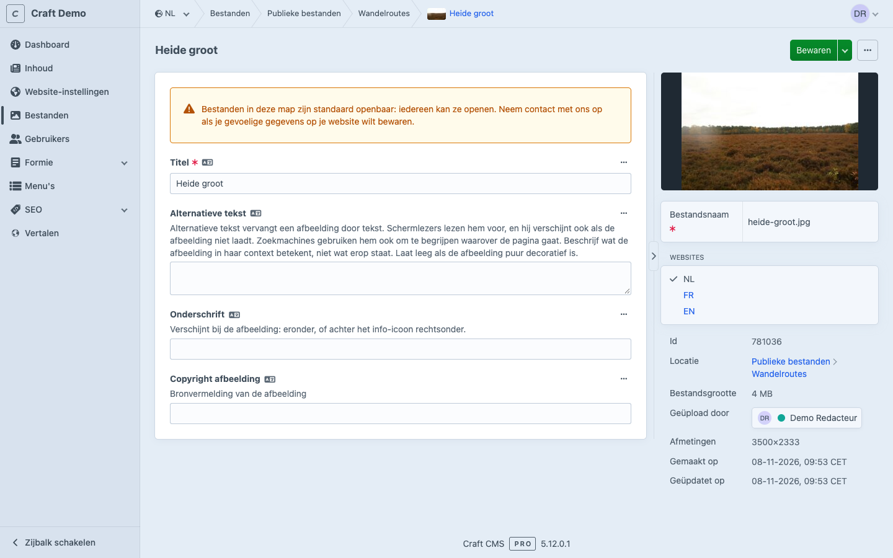

# Welke afbeelding upload je, en wat doet de site ermee

Moet je foto's eerst verkleinen? Welk formaat kies je? En waarom laadt een nieuwe foto de eerste keer iets trager? Hier lees je wat je best uploadt en wat de site daarna zelf met je afbeelding doet.

## Upload groot
Een afbeelding verkleinen kost bijna geen kwaliteit: de site laat gewoon pixels weg. Een te kleine afbeelding vergroten kan niet zonder verlies: de site moet dan pixels bijverzinnen en het beeld wordt wazig of korrelig, zeker over de volle breedte van een groot scherm.

Upload dus altijd de grootste versie die je hebt. Krijg je foto's van een fotograaf of collega, vraag dan de originelen en geen versie die al voor e-mail verkleind is. Een foto van 100 KB is bijna zeker te klein.

<!-- screenshot: site, afbeeldingkolom over de volle breedte met de foto van 400 px; markeer het wazige beeld -->

## Te groot? De site verkleint zelf
Is de langste zijde van een afbeelding groter dan 3500 pixels, dan verkleint de site ze meteen bij het uploaden tot 3500 pixels. Zo blijft de opslag beheersbaar en heb je toch genoeg pixels voor elk scherm. Je ziet de nieuwe grootte bij **Afmetingen** in het bestand.

Er is wel een limiet per bestand: standaard 16 MB. Krijg je een melding dat het bestand te groot is, laat het ons weten.

<!-- screenshot: open bestand heide-groot.jpg; markeer Afmetingen -->

## Welk bestandsformaat?
- **JPG** voor foto's.
- **PNG** kan ook, en is handig voor logo's, iconen en tekeningen, zeker met een transparante achtergrond.

Staand, liggend of vierkant: het maakt niet uit. Op kaartjes en in kolommen snijdt de site zelf uit wat nodig is, standaard rond het midden. Hoe je bepaalt welk deel zichtbaar blijft, lees je bij *Focuspunt en afbeelding bewerken*. Vraagt een bepaalde plek toch iets speciaals, dan staat dat in de uitleg bij dat veld.

## Wat de site met je afbeelding doet
Je uploadt één afbeelding, de site maakt er zelf alle versies van die nodig zijn:
- per plek op de site de juiste maten, voor gsm, tablet en groot scherm, ook voor schermen met een hoge resolutie;
- in een licht webformaat, dat veel kleiner is dan een JPG maar er even scherp uitziet.

Zo krijgt elke bezoeker het kleinste beeld dat op dat scherm nog scherp is. Dat maakt je site sneller en zuiniger, zonder dat jij iets hoeft te doen.

Die versies maakt de site **de eerste keer dat een pagina het beeld toont**. Die allereerste keer kan de pagina dus iets trager laden. Elke bezoeker daarna krijgt meteen de klaargemaakte versie. Bekijk een nieuwe pagina dus gerust zelf even voor je ze deelt.

## Veel foto's tegelijk uploaden
Dat mag. Selecteer of sleep ze allemaal samen naar de map. Omdat de site de versies pas maakt wanneer een pagina ze toont, belast een grote upload de site niet.

> **Tip:** zet geen tekst in een foto. Op een gsm wordt die te klein, in een uitsnede valt hij weg, en een schermlezer kan hem niet voorlezen. Zet tekst in een tekstkolom naast de afbeelding.

> **Tip:** bewerk een foto vooraf in een fotoprogramma als je meer wilt dan draaien of bijsnijden. De editor in het beheer is handig voor kleine aanpassingen (zie *Focuspunt en afbeelding bewerken*), maar geen fotobewerkingsprogramma.

## Veelgestelde vragen
- **Moet ik mijn foto's zelf naar een webformaat omzetten?** Nee, dat doet de site zelf. Upload gewoon een JPG.
- **Is het slecht om alles in één keer te uploaden?** Nee. Upload gerust in bulk.
- **Mijn nieuwe foto verscheen de eerste keer pas na een paar seconden. Is dat een fout?** Nee, de site maakte toen de versies. Daarna gaat het meteen.
- **Hoe groot moet een foto minstens zijn?** Voor een beeld over de volle breedte minstens 2000 pixels aan de langste zijde. Groter mag altijd; boven 3500 pixels verkleint de site zelf.

## Zie ook
- Bestanden uploaden en ordenen in mappen
- Alt-tekst, bijschrift en copyright
- Focuspunt en afbeelding bewerken
