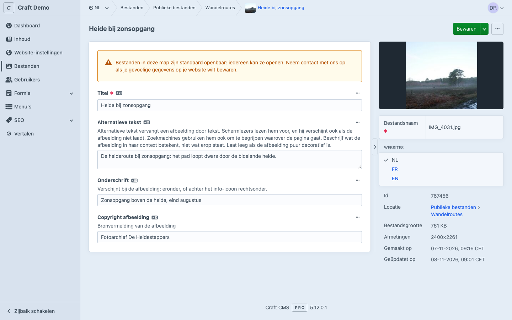
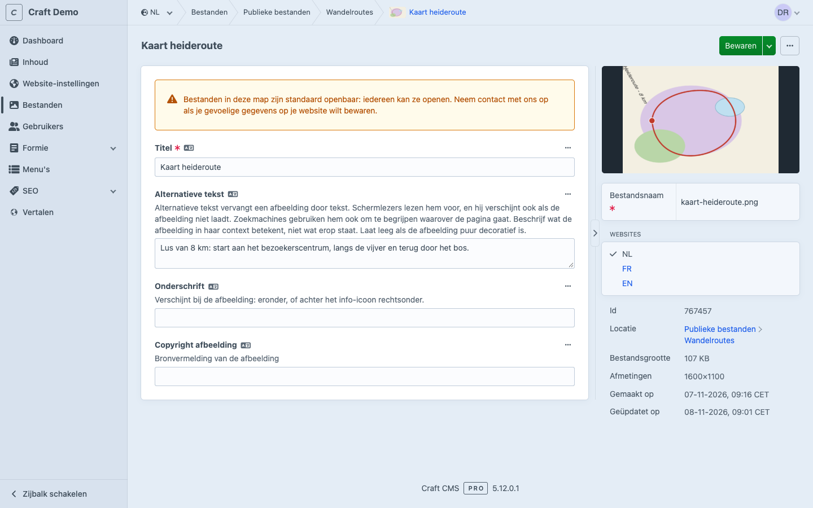
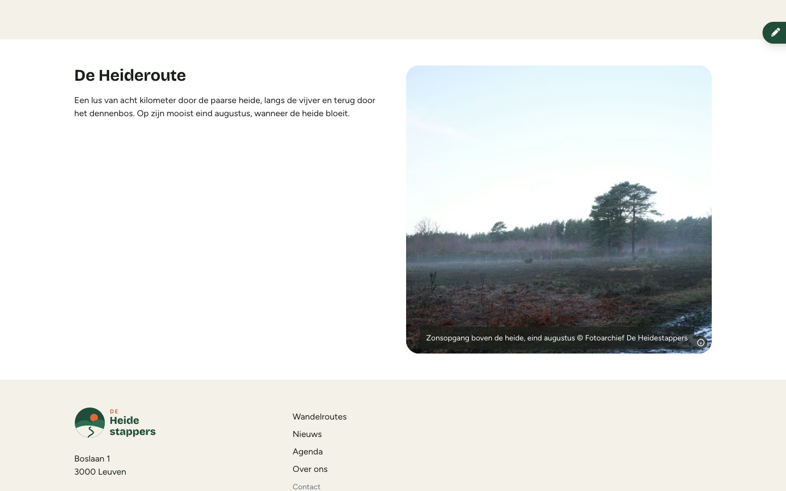

# Alt-tekst, bijschrift en copyright

Bij elke afbeelding vul je een paar velden in: de titel, de alternatieve tekst, het bijschrift en het copyright. Ze lijken op elkaar, maar ze dienen elk voor iets anders en voor een ander publiek. Hier lees je waarvoor elk veld is, en wat je in de alternatieve tekst schrijft.

## De velden openen
1. Ga naar **Bestanden** en open de map met je afbeelding.
2. Klik op de naam van de afbeelding. De gegevens openen.
3. Pas de velden aan en klik op **Bewaren**.

Je kan een afbeelding ook openen vanuit een pagina: klik op de afbeelding in een veld.

<!-- screenshot: paneel van "Heide bij zonsopgang" met alle vier velden zichtbaar; markeer de vier velden -->

## Titel: alleen voor jou en je collega's
De titel is standaard de bestandsnaam, zoals "IMG_4031". Hij verschijnt nergens op de site; hij helpt je alleen om het beeld terug te vinden. Geef een omschrijvende titel, zoals "Heide bij zonsopgang". Het makkelijkst is het bestand vóór het uploaden al een goede naam te geven.

## Alternatieve tekst: wat het beeld betekent
Alternatieve tekst vervangt een afbeelding door tekst. Hij is onzichtbaar op de site. Een schermlezer leest hem voor aan mensen die het beeld niet kunnen zien, en de browser toont hem als het beeld niet laadt. Zoekmachines gebruiken hem ook, om te begrijpen waarover de pagina gaat. De uitleg onder het veld zegt hetzelfde.

**Vul hem in** voor elke afbeelding die in haar context iets betekent. Beschrijf wat de afbeelding op die plek betekent, niet wat erop staat. Vraag je af: wat vertelt dit beeld hier, naast deze tekst?

- **Een foto naast een tekst.** Staat de foto van de heide bij zonsopgang naast de tekst over de heideroute, schrijf dan niet "een pad door de heide", maar "De heideroute bij zonsopgang: het pad loopt dwars door de bloeiende heide."
- **Een kaart of plattegrond.** Beschrijf wat iemand eruit moet onthouden, niet hoe hij eruitziet. Dus niet "een kaart met een groene lijn", maar "Lus van 8 km: start aan het bezoekerscentrum, langs de vijver en terug door het bos."
- **Een grafiek of schema.** Schrijf de conclusie op die je eruit moet halen: "Het aantal deelnemers aan de herfstwandeling verdubbelde tussen 2022 en 2025."
- **Tekst op het beeld** die ertoe doet, zoals op een affiche: neem die tekst over.

<!-- screenshot: paneel van kaart-heideroute.png met ingevulde Alternatieve tekst; markeer het veld -->

**Laat hem leeg** als de afbeelding puur decoratief is of enkel voor sfeer zorgt, en dus geen inhoudelijke meerwaarde heeft: een sfeerfoto, een achtergrondpatroon, een sierlijn, een icoontje naast een tekst die al zegt wat het icoontje toont. Dat geldt voor de meeste beelden die je gebruikt. Een lege alternatieve tekst vertelt een schermlezer dat hij het beeld mag overslaan.

De alternatieve tekst hoort bij de afbeelding, niet bij een pagina. Gebruik je dezelfde foto op meerdere pagina's, dan geldt overal dezelfde tekst: kies er een die overal klopt.

Op een meertalige site vul je de alternatieve tekst per taal in. Kies de taal rechts bij **Websites**.

## Bijschrift: voor iedereen zichtbaar
Het bijschrift (in het bestand heet het veld **Onderschrift**) is er voor elke bezoeker. In een Afbeelding-kolom toont de site het, samen met het copyright, achter een klein info-icoontje rechtsonder op de foto: wie erover beweegt of er met het toetsenbord naartoe gaat, ziet de tekst. Gebruik het voor uitleg die iedereen mag lezen: waar of wanneer de foto genomen is, wie erop staat. Het is er niet voor Google. Ook het bijschrift vul je per taal in.

## Copyright: wie maakte de foto
In **Copyright afbeelding** zet je de naam van de fotograaf of de bron. De site toont die bij het beeld, met een © ervoor. Typ dus alleen de naam.

<!-- screenshot: site, Afbeelding-kolom met de foto; info-icoontje open met "Zonsopgang boven de heide, eind augustus © Fotoarchief De Heidestappers" -->

> **Tip:** twijfel je over de alternatieve tekst, stel jezelf dan één vraag: wat vertelt dit beeld op deze plek? Dat schrijf je op. Vertelt het niets, omdat het puur decoratief is, dan laat je het veld leeg.

## Veelgestelde vragen
- **Moet ik bij elke afbeelding een alternatieve tekst invullen?** Nee, alleen bij een afbeelding met inhoudelijke meerwaarde. Is een beeld puur decoratief of zorgt het enkel voor sfeer, dan laat je het veld leeg. Dat geldt voor de meeste beelden die je gebruikt.
- **Kan ik de alternatieve tekst per pagina aanpassen?** Nee, hij hoort bij de afbeelding. Schrijf een tekst die past op elke plek waar je het beeld gebruikt.
- **Is het bijschrift voor SEO?** Nee, het is zichtbare uitleg voor je bezoekers.
- **Waar komt de titel van de afbeelding op de site?** Nergens, hij is alleen voor het beheer.

## Zie ook
- Welke afbeelding upload je, en wat doet de site ermee
- Focuspunt en afbeelding bewerken
- De verplichte pagina's (toegankelijkheidsverklaring)
