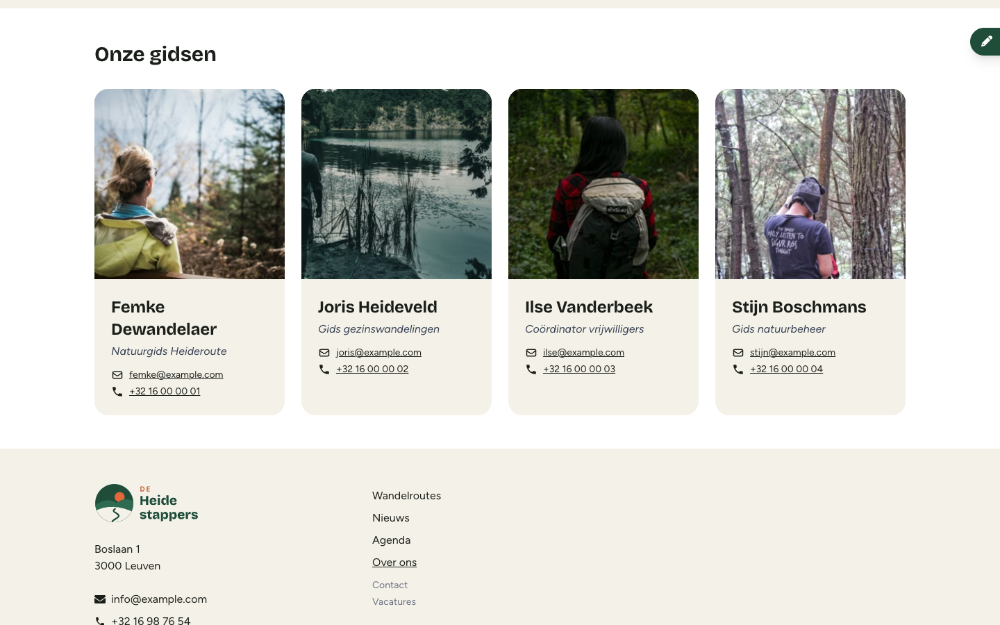
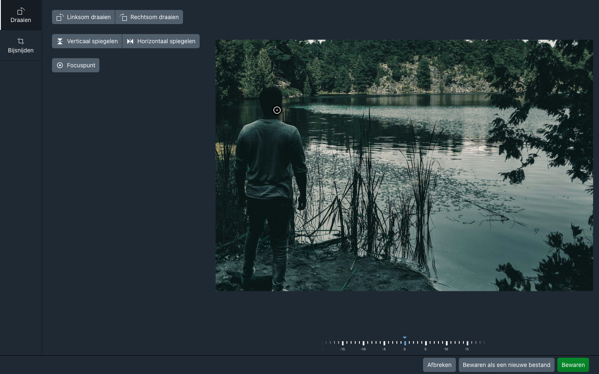
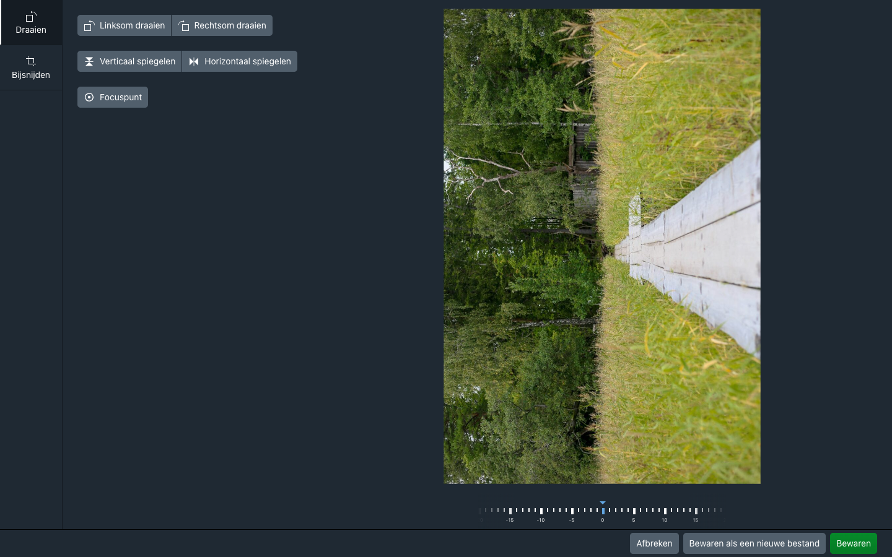

# Focuspunt en afbeelding bewerken

Op kaartjes, in kolommen en in carrousels toont de site vaak maar een deel van je foto: een vierkant uit een liggend beeld, of een smalle strook. Met het **focuspunt** bepaal je welk deel altijd zichtbaar blijft. In dezelfde editor kan je een foto ook draaien, spiegelen en bijsnijden.

## Waarom de site uitsnijdt
Een overzicht ziet er rustig uit als alle kaartjes dezelfde verhouding hebben. Daarom snijdt de site zelf uit, standaard rond het **midden** van de foto. Bij een landschap is dat meestal prima. Staat de persoon of het onderwerp aan de rand, dan valt het er soms half af.

<!-- screenshot: site, Ons team met het vierkante kaartje van Joris (gids-aan-de-vijver.jpg) vóór het verzetten; markeer de afgesneden gids -->

## Het focuspunt zetten
1. Open de afbeelding: via **Bestanden**, of door in een pagina op de afbeelding in een veld te klikken.
2. Klik onder de miniatuur op **Afbeelding bewerken**.
3. Klik in de editor op **Focuspunt**. Er verschijnt een bolletje, standaard in het midden.
4. Sleep het bolletje naar wat zeker zichtbaar moet blijven.
5. Klik op **Bewaren**.

Het focuspunt wordt het centrum van elke uitsnede. Bij een persoon zet je het **tussen de ogen**: dan valt het gezicht bijna altijd mooi in beeld, in welke verhouding ook.

<!-- screenshot: Afbeelding bewerken, Focuspunt actief, bolletje op het hoofd van de gids; markeer het bolletje -->

Daarna hoef je niets meer te doen. De site maakt de versies van de afbeelding vanzelf opnieuw met het nieuwe focuspunt, de eerste keer dat een pagina het beeld toont. Herlaad de pagina met het kaartje om het resultaat te zien.

Het focuspunt hoort bij de afbeelding: het geldt op elke plek waar je ze gebruikt.

## Draaien, spiegelen en bijsnijden
In dezelfde editor vind je:
- **Linksom draaien** en **Rechtsom draaien**, per 90 graden. Handig voor gsm-foto's die op hun kant staan.
- **Horizontaal spiegelen** en **Verticaal spiegelen**.
- **Bijsnijden**: kies een vaste verhouding of sleep de hoeken vrij.

<!-- screenshot: Afbeelding bewerken met vlonder.jpg; markeer draaien, spiegelen en Bijsnijden -->

> **Let op:** **Bewaren** vervangt het originele bestand. Wil je het origineel houden, bijvoorbeeld omdat je het elders onbewerkt gebruikt, kies dan **Bewaren als een nieuwe bestand**. Je krijgt dan een tweede bestand in dezelfde map.

De editor is geen fotobewerkingsprogramma. Voor kleur, belichting of een precieze uitsnede bewerk je de foto beter vooraf op je computer en upload je het resultaat.

## Logo's en iconen
Bij een logo of icoon helpt een focuspunt vaak niet: de uitsnede snijdt toch letters of randen af. Zet zo'n beeld vooraf op een ruimere, effen achtergrond (bijvoorbeeld wit, in een eenvoudige ontwerptool), zodat er rondom genoeg ruimte is. Of gebruik een andere versie van het logo.

> **Tip:** zet het focuspunt meteen bij het uploaden van een portret of groepsfoto. Dan klopt elk kaartje vanaf de eerste keer.

## Veelgestelde vragen
- **Moet ik wachten tot de nieuwe versies klaar zijn?** Nee. De site maakt ze zelf bij de eerstvolgende keer dat een pagina het beeld toont.
- **Kan ik per pagina een andere uitsnede kiezen?** Nee, het focuspunt geldt voor de afbeelding. Heb je echt een andere uitsnede nodig, bewaar dan een bijgesneden kopie als nieuw bestand.

## Zie ook
- Welke afbeelding upload je, en wat doet de site ermee
- Alt-tekst, bijschrift en copyright
- Bepalen hoe je pagina als kaartje verschijnt
