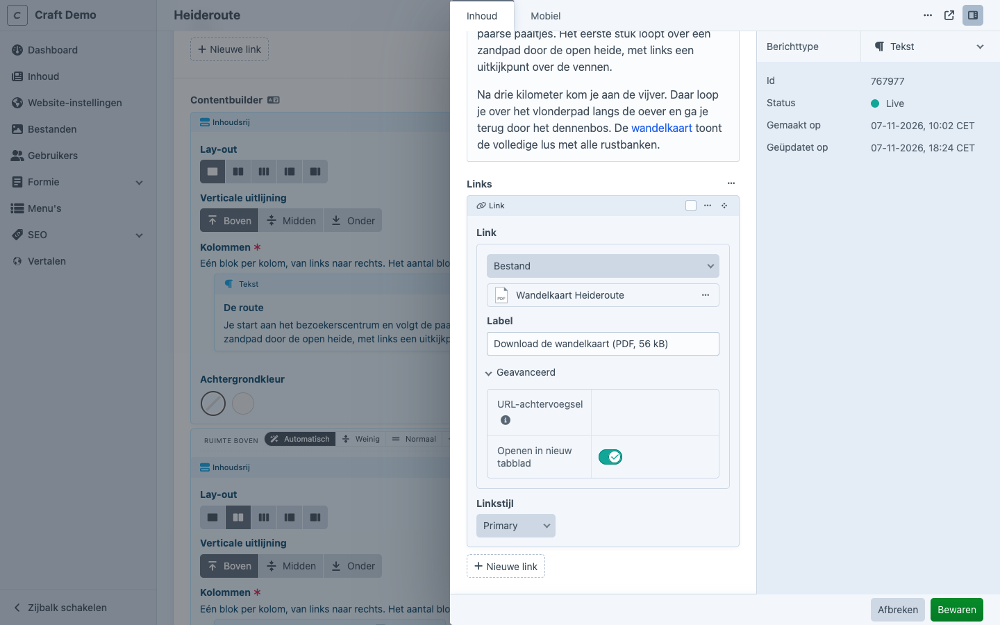
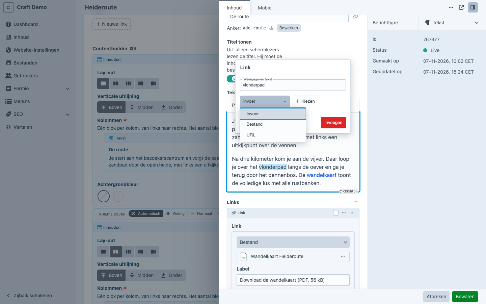
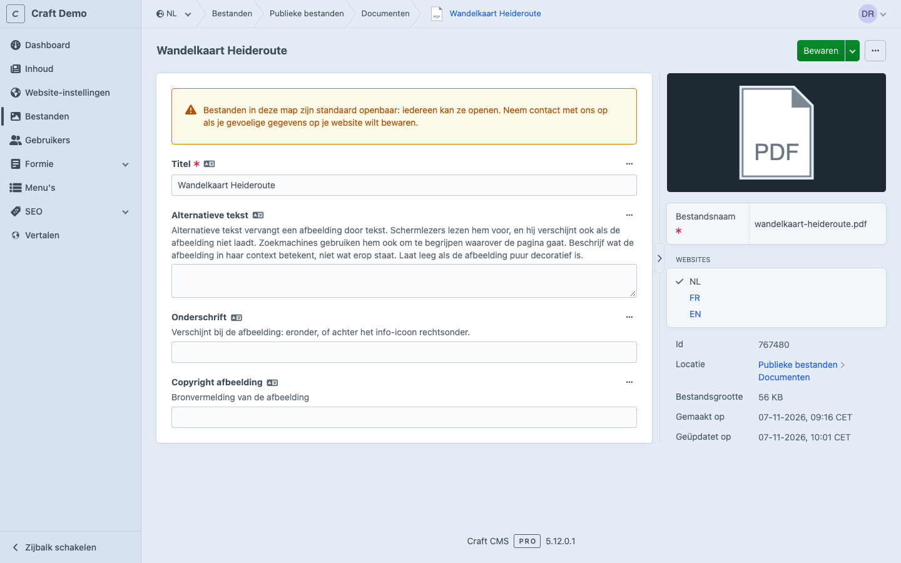

# Een PDF of ander bestand aanbieden

Een wandelkaart om af te drukken, een inschrijvingsformulier, een jaarverslag: soms wil je een bestand aanbieden. Hier lees je hoe je een knop of een link in de tekst naar een PDF maakt, waarom je zelf "nieuw tabblad" aanvinkt, en hoe je later een nieuwe versie plaatst zonder links te breken.

## Eerst het bestand uploaden
Upload het bestand bij **Bestanden**, in een vaste map voor documenten. Geef het een duidelijke titel: die zie je terug wanneer je het bestand kiest. Zie *Bestanden uploaden en ordenen in mappen*.

## Een knop naar het bestand
1. Open de pagina en ga naar de kolom of plek met het veld **Links**.
2. Klik op **Nieuwe link**.
3. Kies als type **Bestand** en selecteer je PDF.
4. Vul bij **Label** de tekst van de knop in.
5. Kies een **Linkstijl**, bijvoorbeeld een knop of een gewone link.
6. Klik op **Geavanceerd** en vink **Openen in nieuw tabblad** aan.
7. Bewaar de pagina.

<!-- screenshot: Links-veld met een link van type Bestand naar "Wandelkaart Heideroute", Geavanceerd open; markeer type Bestand en het vinkje -->

### Waarom zelf een nieuw tabblad?
Een link naar een bestand opent **niet vanzelf** in een nieuw tabblad. De meeste browsers tonen een PDF gewoon in het tabblad zelf. Sluit je bezoeker daarna de PDF, dan is die ook van je site weg. Met een nieuw tabblad blijft je site openstaan.

### Een goede linktekst
Zeg in de linktekst wat het bestand is, en dat het een bestand is: "Download de wandelkaart (PDF, 2 MB)" in plaats van "Klik hier". Zo weet de bezoeker wat er gebeurt, ook op een gsm met een trage verbinding. Meer over linkteksten lees je bij *Goede linkteksten schrijven*.

## Een link in de tekst
1. Selecteer in het tekstveld de woorden die de link worden.
2. Klik op het linkicoon in de werkbalk. Kies in de keuzelijst **Bestand** en klik op **Kiezen**.
3. Kies het bestand. De link staat er meteen op.
4. Klik op de link en kies in het menu **Linkeigenschappen**. Zet **Open een nieuw tabblad** aan.

<!-- screenshot: tekstveld, linkvenster open met de keuzelijst; markeer Bestand -->

## Een nieuwe versie van het bestand
Is de wandelkaart vernieuwd? Upload dan geen tweede bestand, maar vervang het bestaande:
1. Open het bestand bij **Bestanden**.
2. Open het menu met de drie puntjes rechtsboven, kies **Bestand vervangen** en upload de nieuwe versie.

Alle knoppen en links naar het bestand tonen meteen de nieuwe versie. Upload je een apart nieuw bestand, dan moet je elke link zelf aanpassen, en blijft de oude versie online vindbaar.

<!-- screenshot: paneel van "Wandelkaart Heideroute"; markeer Bestand vervangen -->

## Goed om te weten
- **Downloads worden niet geteld.** De site houdt standaard niet bij hoe vaak of door wie een bestand gedownload wordt.
- **PDF's zijn vaak niet toegankelijk.** Een schermlezer kan ze moeilijk voorlezen, en op een gsm lezen ze slecht. Zet belangrijke informatie liever ook op een pagina. Bied je toch alleen een PDF aan, vermeld dat dan in je toegankelijkheidsverklaring.
- **Op sommige sites** is er een apart downloadblok dat een bestand meteen downloadt in plaats van het te openen.
- Alle bestanden zijn publiek (zie *Bestanden uploaden en ordenen in mappen*).

> **Tip:** controleer na het bewaren altijd even de knop op de site: opent het juiste bestand, in een nieuw tabblad?

## Veelgestelde vragen
- **Opent een link naar een bestand vanzelf in een nieuw tabblad?** Nee, dat vink je zelf aan.
- **Kunnen we zien wie iets downloadt?** Niet standaard. Heb je dat nodig, laat het ons weten.

## Zie ook
- Bestanden uploaden en ordenen in mappen
- Een knop of link toevoegen
- Goede linkteksten schrijven
