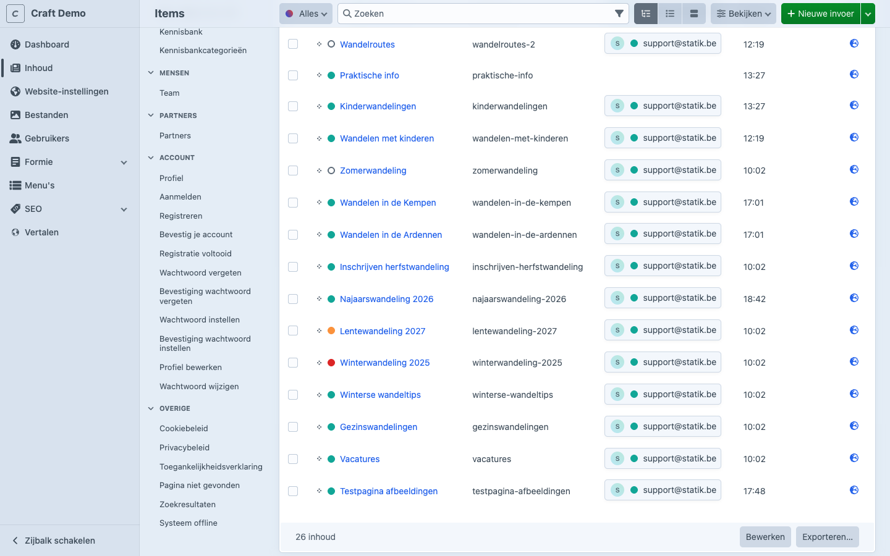
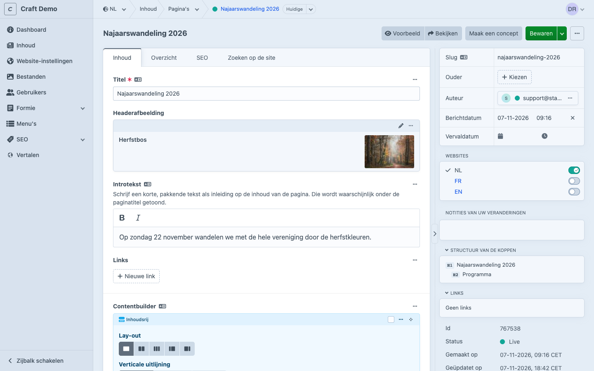
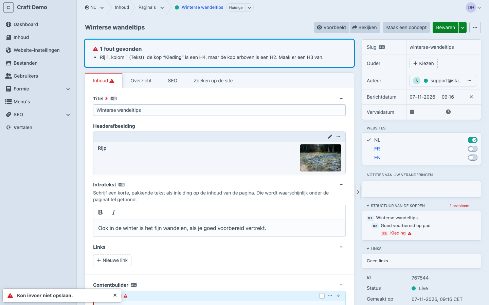

# Online, offline en ingepland

Een pagina staat niet altijd meteen online, en moet er ook niet altijd blijven. Hier lees je hoe je een pagina online en offline zet, hoe je ze op een gekozen moment laat verschijnen of verdwijnen, en wat er gebeurt als de site weigert te publiceren.

## De status in het overzicht
In elk overzicht van pagina's, nieuws of events staat naast de titel een bolletje:

| Bolletje | Status | Betekenis |
|---|---|---|
| groen | **Live** | iedereen ziet de pagina |
| oranje | **Wachtend** | de berichtdatum ligt in de toekomst; de pagina gaat dan vanzelf live |
| rood | **Verlopen** | de vervaldatum is voorbij; de pagina is offline |
| leeg | **Uitgeschakeld** | je hebt de pagina zelf offline gezet |

<!-- screenshot: Inhoud > Pagina's met een pagina per status; markeer de bolletjes -->

## Een pagina offline of online zetten
1. Open de pagina.
2. Zet rechts, bij **Websites**, de schakelaar van de taal uit (offline) of aan (online), bijvoorbeeld **NL**.
3. Klik op **Bewaren**.

Een uitgeschakelde pagina blijft volledig bewaard, met al haar inhoud. Zet je ze weer aan, dan staat ze er opnieuw zoals voordien. Op een meertalige site schakel je zo per taal in of uit: de Nederlandse pagina kan online staan terwijl de Franse nog uit staat.

<!-- screenshot: zijbalk van "Najaarswandeling 2026"; markeer Berichtdatum, Vervaldatum en de schakelaars bij Websites -->

## Later publiceren: de berichtdatum
Standaard is de **Berichtdatum** het moment waarop je de pagina aanmaakt. Kies je een datum en uur in de toekomst en bewaar je, dan krijgt de pagina de status **Wachtend**. Op dat moment gaat ze vanzelf live, ook als niemand ingelogd is. Handig voor een aankondiging of actie die op een vast moment moet starten.

## Vanzelf offline: de vervaldatum
Met een **Vervaldatum** verdwijnt de pagina vanzelf op dat moment, ook al staat de schakelaar bij **Websites** nog aan. In het beheer staat ze dan als **Verlopen**. Wil je ze weer tonen, verwijder of verschuif dan de vervaldatum.

> **Let op:** een pagina die offline is, door uitschakelen of een vervaldatum, geeft bezoekers een foutpagina (404). Ook de kaartjes die elders op de site naar die pagina verwijzen, verdwijnen. Zoekmachines houden niet van pagina's die plots wegvallen. Haal een veelbezochte pagina dus niet zomaar offline; verwijs eventueel door naar een andere pagina.

## De auteur
Het veld **Auteur** toont wie de pagina maakte. Die naam verschijnt niet op de site. Zo weten je collega's bij wie ze terechtkunnen. Je kan hem aanpassen.

## Als de site weigert te publiceren
Je site controleert bij het publiceren de volgorde van de tussentitels. Slaat een kop een niveau over, bijvoorbeeld een H4 zonder H3 erboven, dan publiceert de site de pagina niet:

- je krijgt de melding **Kon invoer niet opslaan.**;
- bovenaan staat **1 fout gevonden**, met de plaats (bijvoorbeeld rij 1, kolom 1) en wat je moet doen, zoals "Maak er een H3 van.";
- de rij en de kolom met het probleem kleuren rood, met dezelfde uitleg onder de kolom.

Pas de kop aan en bewaar opnieuw. Meer daarover lees je bij *Tussentitels gebruiken: de kopstructuur*.

<!-- screenshot: "Winterse wandeltips" na Bewaren met 1 fout gevonden bovenaan en de melding Kon invoer niet opslaan; markeer de melding -->

Wanneer de site een gebroken link ziet, waarschuwt ze ook, maar dan bewaart ze de pagina wel (zie *Gebroken links opsporen*).

> **Tip:** filter in het overzicht op status om snel te zien welke pagina's ingepland, verlopen of uitgeschakeld zijn.

## Veelgestelde vragen
- **Is een uitgeschakelde pagina verwijderd?** Nee, ze is alleen onzichtbaar voor bezoekers. Je kan ze altijd weer inschakelen.
- **Gaat een ingeplande pagina echt vanzelf live?** Ja, op het uur van de berichtdatum.
- **Wordt de auteur op de site getoond?** Nee.

## Zie ook
- Tussentitels gebruiken: de kopstructuur
- Werken met een concept
- Iets ongedaan maken: revisies en de prullenbak
