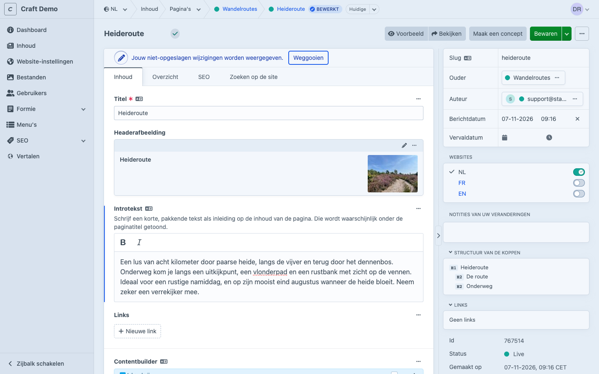
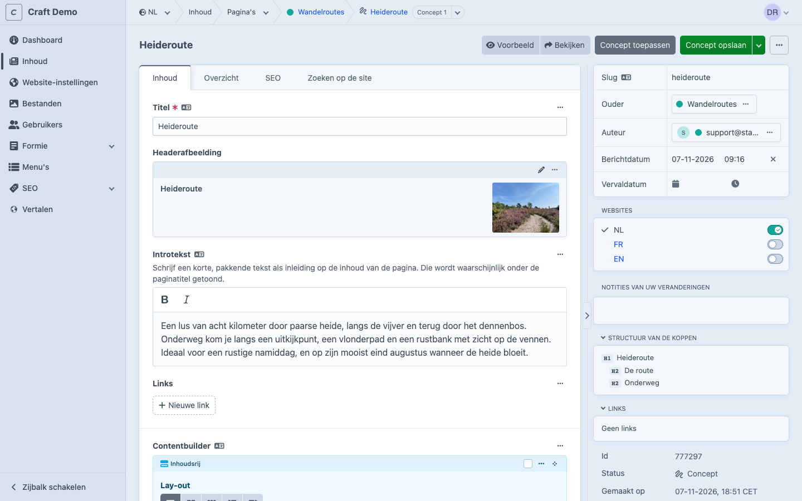

# Werken met een concept

Een **concept** (in het Engels draft) is een kopie van een pagina waarin je werkt zonder dat de live versie verandert. Hier lees je wanneer je een concept gebruikt, hoe je het maakt, bewaart en toepast, en hoe het verschilt van de wijzigingen die de site vanzelf bijhoudt.

## Autosave: je werk is veilig, maar niet live
Terwijl je in een pagina typt, houdt de site je wijzigingen automatisch bij. Bovenaan zie je dan **Jouw niet-opgeslagen wijzigingen worden weergegeven.** Sluit je per ongeluk je browser, dan staat je tekst er nog als je de pagina opnieuw opent.

Maar die wijzigingen zijn **niet live** en niet echt bewaard: bezoekers en collega's zien ze niet tot jij op **Bewaren** klikt. Wil je ze schrappen, klik dan op **Weggooien**: de pagina staat weer zoals ze bewaard was.

Gebruik autosave niet als "ik werk morgen verder". Daarvoor is een concept: dat is duidelijk, je collega's zien dat het bestaat, en het blijft staan.

<!-- screenshot: pagina met een gewijzigde intro; markeer de melding en Weggooien -->

## Wanneer gebruik je een concept?
- Je herschrijft een pagina en hebt meer dan één keer werk.
- Iemand moet je tekst eerst nalezen of goedkeuren.
- Een pagina moet op een bepaalde dag in één keer veranderen, bijvoorbeeld de homepage bij de start van een nieuwe actie.

## Een concept maken en bewaren
1. Open de live pagina.
2. Klik bovenaan op **Maak een concept**. Bovenaan staat nu **Concept 1**.
3. Pas aan wat je wilt. Alles gebeurt in het concept.
4. Klik op **Concept opslaan**. Je kan de pagina sluiten en later verder werken.

<!-- screenshot: "Heideroute" in Concept 1; markeer het versiemenu, Concept opslaan en Concept toepassen -->

## Wisselen tussen live versie en concept
Bovenaan staat een menu met de versies: **Huidige** is de live versie, daaronder je concepten. Klik om te wisselen. Zo kan je een dringende fout in de live pagina verbeteren en bewaren terwijl je concept klaarstaat. De site neemt die verbetering daarna ook over in je concept, behalve in de velden die je in het concept zelf al aanpaste.

Wil je dat een collega in jouw concept verder werkt? Zeg het, en stuur het adres van het concept in het beheer door.

## Bekijken
Met **Voorbeeld** zie je het concept naast je velden, met **Bekijken** in een nieuw tabblad. Bezoekers zien het concept nooit. Iemand zonder account laten meekijken? Zie *Een previewlink delen met iemand zonder account*.

## Het concept toepassen
Klaar en nagekeken? Klik op **Concept toepassen**. Het concept vervangt de live versie en het concept zelf verdwijnt. Je ziet de melding **Concept toegepast.** Je hoeft daarna niet nog eens te bewaren.

Slaat een tussentitel in het concept een niveau over, dan weigert de site het toe te passen, net zoals bij gewoon bewaren (zie *Online, offline en ingepland* en *Tussentitels gebruiken: de kopstructuur*).

> **Let op:** een concept hoef je niet uit te schakelen, en de pagina zelf moet ingeschakeld blijven. De schakelaars bij **Websites** gaan over de live pagina. Zet je er een uit, dan haal je de live pagina offline, en dat is net niet de bedoeling van een concept.

> **Tip:** een concept dat je niet meer nodig hebt, verwijder je via het menu met de drie puntjes van het concept.

## Veelgestelde vragen
- **Moet ik het concept uitschakelen tot het klaar is?** Nee, een concept is nooit zichtbaar voor bezoekers.
- **Moet de schakelaar bij Websites aan staan?** Ja, die gaat over de live pagina. Die blijft gewoon online.
- **Is een concept een apart document?** Het is een kopie van dezelfde pagina, met de naam Concept 1. Na het toepassen wordt het de nieuwe live versie.
- **Moet ik na Concept toepassen nog bewaren?** Nee.

## Zie ook
- Opslaan, en wat autosave wel en niet doet
- Een previewlink delen met iemand zonder account
- Iets ongedaan maken: revisies en de prullenbak
