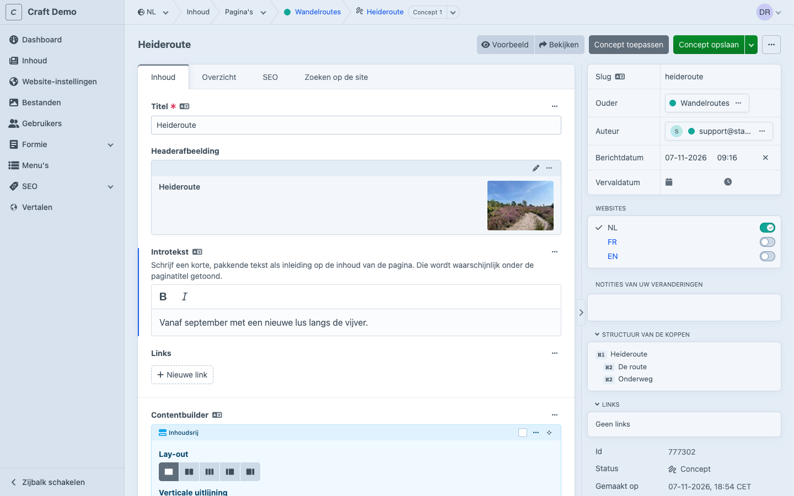
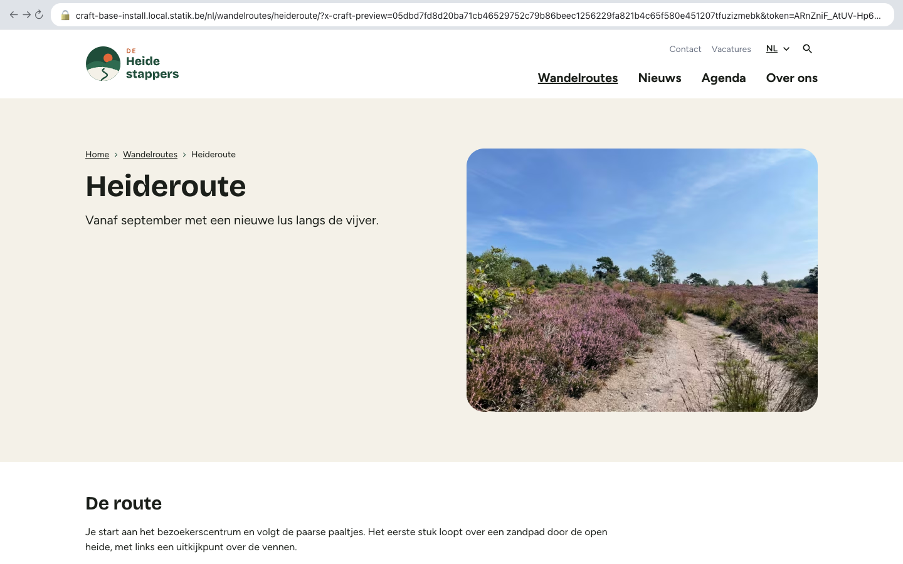

# Een previewlink delen met iemand zonder account

Moet een leidinggevende een tekst goedkeuren, of wil de schrijver van een tekst zien hoe die op de site staat? Met een previewlink laat je iemand zonder account een concept of een nog niet gepubliceerde pagina bekijken. Hier lees je hoe je die link maakt, hoe lang hij werkt en wat je beter niet doet.

## De link maken
1. Open het concept of de nieuwe pagina.
2. Bewaar eerst je werk: klik op **Concept opslaan** (of **Bewaren** bij een nieuwe, uitgeschakelde pagina).
3. Klik op **Bekijken**. De pagina opent in een nieuw tabblad, zoals bezoekers ze zullen zien.
4. Kopieer het **volledige** adres uit de adresbalk.
5. Stuur het door, bijvoorbeeld per mail.

<!-- screenshot: "Heideroute" in Concept 1; markeer Bekijken -->

## Wat zit er in dat adres?
Achteraan het adres staat een extra stuk met `x-craft-preview` en een `token`: een lange code. Dat is een sleutel. Wie de link met die sleutel heeft, ziet het concept, zonder in te loggen. Wie het gewone adres van de pagina opent, ziet de live versie, of een foutpagina als de pagina nog niet gepubliceerd is.

<!-- screenshot: nieuw tabblad met de previewpagina; markeer x-craft-preview en token in de adresbalk -->

## Hoe lang werkt de link?
Een previewlink werkt **tien dagen**. Daarna krijgt de ontvanger een foutmelding. Klik dan opnieuw op **Bekijken** en stuur de nieuwe link.

Pas je het concept daarna nog aan en bewaar je het, dan ziet de ontvanger met dezelfde link de nieuwe versie.

> **Let op:** iedereen die de link heeft, kan het concept bekijken zolang de link geldig is. Stuur hem alleen naar wie het mag zien.

## Collega's met een account
Heeft je collega een account op de site? Stuur dan het adres van het concept in het beheer, uit de adresbalk van het control panel. Die collega kan het dan niet alleen bekijken, maar er ook in verder werken. Spreek wel af wie wanneer werkt (zie *Met meerdere mensen aan de site werken*).

## Voorbeeld en Bekijken
- **Voorbeeld** toont de pagina naast je velden; je wijzigingen verschijnen terwijl je typt. Handig voor jezelf, maar niet om te delen.
- **Bekijken** opent de pagina in een nieuw tabblad, met het deelbare adres.

Meer over beide lees je bij *Bekijken terwijl je werkt: Voorbeeld en Bekijken*.

> **Tip:** test de link even in een privévenster van je browser. Daar ben je niet ingelogd, dus je ziet precies wat de ontvanger ziet.

## Veelgestelde vragen
- **Kan iemand zonder account kijken?** Ja, met de previewlink, tien dagen lang.
- **Ik stuurde de gewone link en mijn collega kreeg een foutpagina.** De pagina is nog niet gepubliceerd. Stuur de link uit **Bekijken**, met de sleutel erin.
- **Ziet de ontvanger ook latere aanpassingen?** Ja, zodra je het concept opnieuw bewaart.

## Zie ook
- Bekijken terwijl je werkt: Voorbeeld en Bekijken
- Werken met een concept
- Met meerdere mensen aan de site werken
