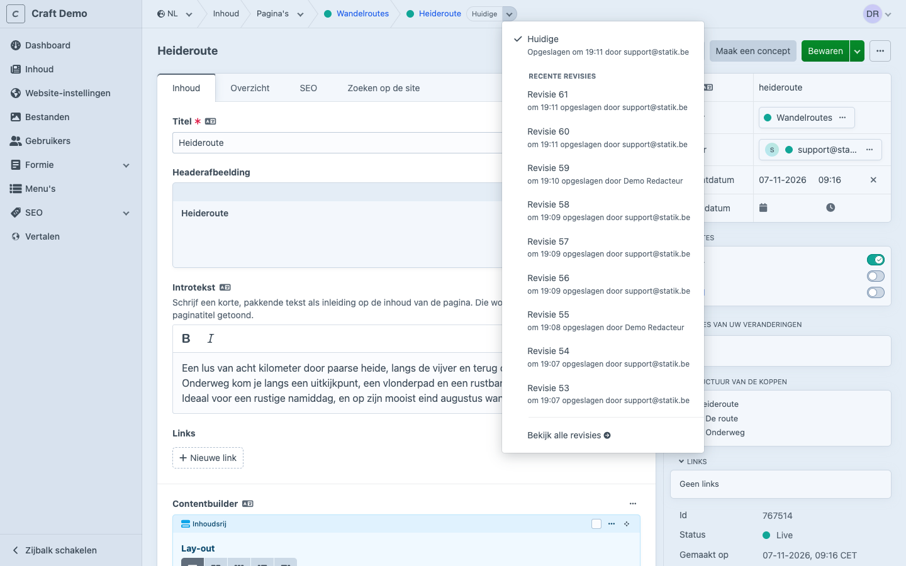
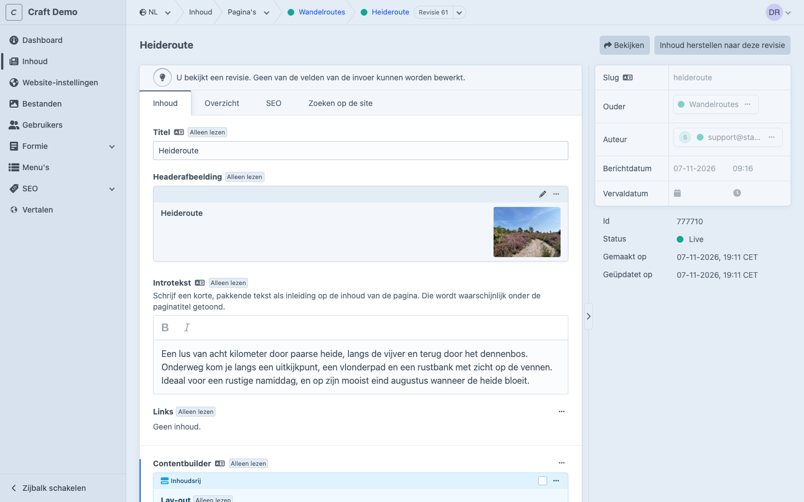
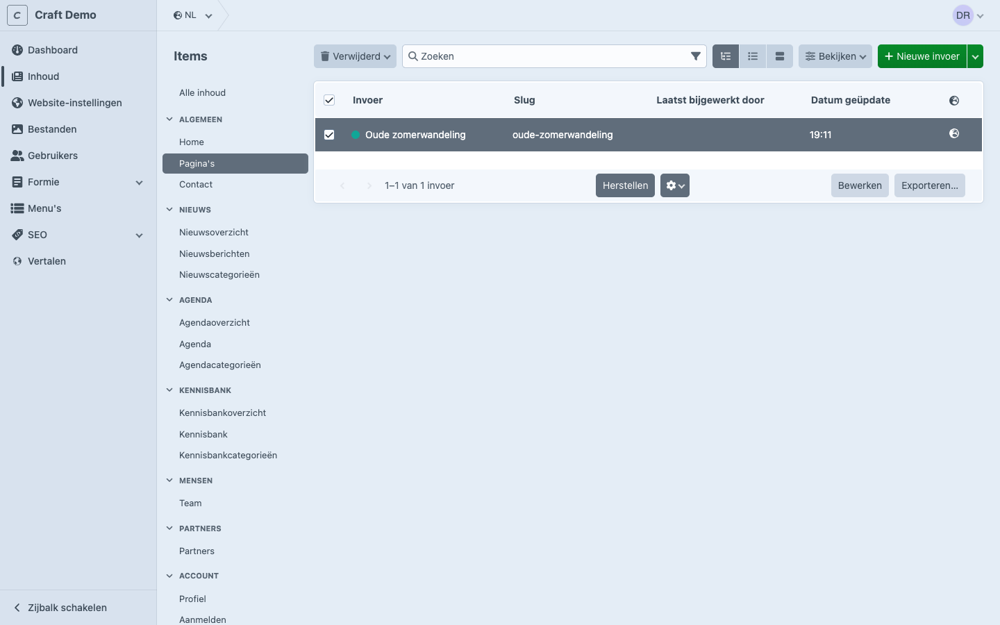

# Iets ongedaan maken: revisies en de prullenbak

Een verkeerde tekst bewaard, een inhoudsrij weggeklikt, of een hele pagina verwijderd? Meestal kan je dat terugdraaien. Hier lees je hoe je een vorige versie van een pagina terugzet met **revisies**, en hoe je een verwijderde pagina uit de **prullenbak** haalt.

## Revisies: de geschiedenis van een pagina
Telkens je een pagina bewaart, of een concept toepast, houdt de site de vorige versie bij als revisie. Zo kan je altijd terug naar hoe de pagina eerder was.

1. Open de pagina.
2. Klik bovenaan op het versiemenu **Huidige**. Onder **Recente revisies** zie je de laatste versies, met wie ze bewaarde en wanneer. Via **Bekijk alle revisies** zie je de volledige lijst.
3. Klik op een revisie. Je ziet de pagina zoals ze toen was. Er verandert nog niets.
4. Is dit de versie die je wilt? Klik op **Inhoud herstellen naar deze revisie**.

De pagina krijgt de inhoud van die revisie en is meteen live (als ze ingeschakeld is). Ook dat terugzetten wordt een nieuwe revisie, dus je kan het weer ongedaan maken.

<!-- screenshot: "Heideroute", versiemenu Huidige open; markeer de lijst Recente revisies -->

<!-- screenshot: een revisie geopend; markeer de knop Inhoud herstellen naar deze revisie -->

## Wat haal je zo terug?
- Een **inhoudsrij of kolom** die je per ongeluk verwijderde: zet de revisie van vóór het verwijderen terug.
- Tekst die een **collega overschreef**: jouw versie zit in een revisie.
- Een reeks aanpassingen die je toch niet wilt.

Een revisie zet altijd de **hele pagina** terug. Wil je maar één stukje terug, kopieer het dan uit de oude revisie en plak het in de huidige versie.

## Hoeveel revisies?
De site bewaart de **laatste tien revisies** per pagina. Oudere verdwijnen, anders wordt de databank te groot. Wil je iets terug, wacht dan niet tot je de pagina nog tien keer bewaard hebt.

> **Let op:** op een meertalige site gaat een revisie over **alle talen samen**. Zet je een oude revisie terug, dan gaan ook de andere taalversies terug naar die stand. Heb je intussen in een andere taal iets aangepast, dan ben je dat kwijt. Werk daarom met een concept als je grote aanpassingen doet (zie *Werken met een concept*), of kopieer alleen het stuk dat je nodig hebt.

## De prullenbak: een verwijderde pagina herstellen
Een verwijderde pagina is niet meteen weg. Ze staat eerst in de prullenbak.
1. Ga naar het overzicht, bijvoorbeeld **Pagina's**.
2. Open bovenaan het statusmenu (standaard staat daar **Alles**) en kies **Verwijderd**.
3. Vink de pagina aan.
4. Klik op **Herstellen**, onder de lijst.

De pagina staat weer in het overzicht, met haar inhoud. Kijk na of ze ingeschakeld is.

<!-- screenshot: Pagina's met status Verwijderd, "Oude zomerwandeling" aangevinkt; markeer Herstellen -->

> **Let op:** wacht niet. Na een tijd maakt de site de prullenbak vanzelf leeg, standaard na 30 dagen. Daarna is de pagina definitief weg. Met **Definitief verwijderen** gaat ze meteen weg; gebruik dat alleen als je zeker bent.

> **Tip:** twijfel je of iets terug kan? Probeer het eerst in een revisie te bekijken: bekijken verandert niets.

## Veelgestelde vragen
- **Kan ik een verwijderd blok of een verwijderde rij terughalen?** Ja, zet de revisie van vóór het verwijderen terug.
- **Een collega bewaarde over mijn werk heen. Is het weg?** Nee, jouw versie staat in de revisies.
- **Gaat een revisie alleen over de taal waarin ik werk?** Nee, over alle talen van de pagina samen.

## Zie ook
- Werken met een concept
- Met meerdere mensen aan de site werken
- Een pagina vertalen
