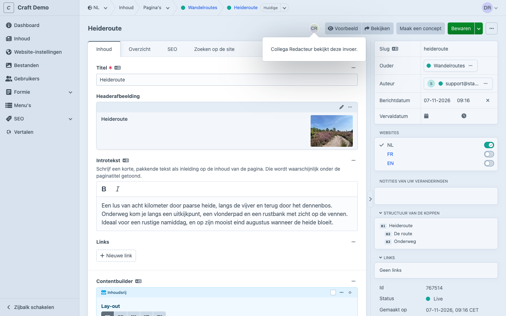
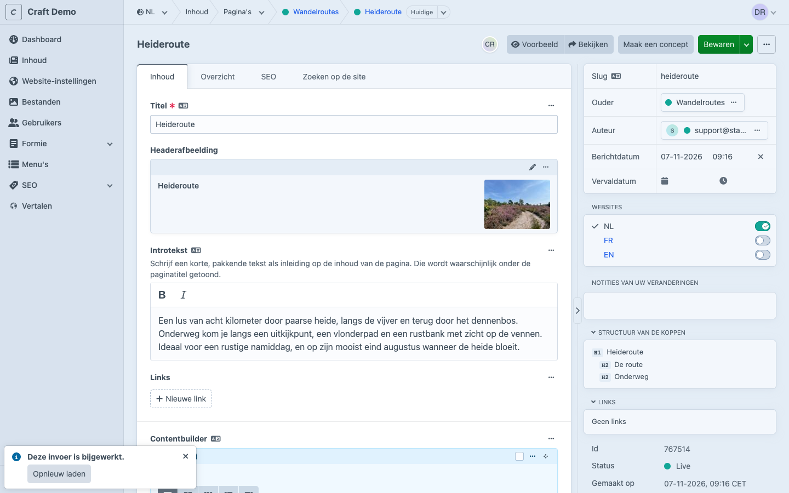

# Met meerdere mensen aan de site werken

Zodra meer dan één persoon de site beheert, wil je weten wie waaraan werkt, en wil je vermijden dat iemand andermans werk overschrijft. Hier lees je wat de site je daarvoor toont, wat er gebeurt als twee mensen tegelijk bewaren, en welke afspraken goed werken.

## Zien wie de pagina openheeft
Opent een collega dezelfde pagina, dan verschijnt bovenaan een bolletje met de initialen van die collega. Beweeg over het bolletje: je ziet of die de pagina alleen bekijkt of ze aan het bewerken is, bijvoorbeeld "Collega Redacteur bewerkt deze invoer."

<!-- screenshot: "Heideroute" in venster A met het bolletje van Redacteur B en de tooltip; markeer het bolletje -->

## Als twee mensen tegelijk bewerken
Werken twee mensen tegelijk in dezelfde pagina en bewaren ze allebei, dan kan wie het laatst bewaart het werk van de ander overschrijven. De site helpt je om dat te vermijden: bewaart een collega de pagina terwijl jij ze openhebt, dan krijg je links onderaan de melding **Deze invoer is bijgewerkt.**, met de knop **Opnieuw laden**.

1. Klik op **Opnieuw laden** voor je verder werkt.
2. Kijk of jouw wijzigingen er nog staan, en vul aan waar nodig.
3. Bewaar.

Doe je dat niet, dan loop je het risico dat jullie elkaars werk overschrijven.

<!-- screenshot: venster A na het bewaren in venster B; markeer de melding en Opnieuw laden -->

## Toch iets overschreven?
Dan is het niet weg. Elke bewaarde versie staat in de **revisies**: open het versiemenu **Huidige**, zoek de versie van vóór het overschrijven en kopieer of herstel wat je nodig hebt. Zie *Iets ongedaan maken: revisies en de prullenbak*.

## Werk in een concept
Werk je langer aan een pagina, of over meerdere dagen, maak dan een concept (zie *Werken met een concept*). Je collega's zien dat er een concept bestaat, en jullie werken intussen niet door elkaar in de live versie. Mag een collega in jouw concept verder werken, zeg het dan en stuur het adres van het concept in het beheer.

## Goede afspraken
- **Verdeel het werk.** Spreek af wie welke pagina's of secties beheert.
- **Eén eigenaar voor gedeelde dingen.** De menu's en de categorieën gelden voor de hele site. Laat één persoon die beheren, zodat ze niet door elkaar veranderen.
- **Een eigen account voor iedereen.** Werk nooit met een gedeeld account. Met een eigen account zie je in de revisies wie wat deed, toont de site wie een pagina openheeft, en kan je iemand gericht rechten geven of afnemen. Een collega toegang geven: zie *Een collega toegang geven*.
- **Mappen en namen.** Spreek ook af hoe jullie bestanden ordenen (zie *Bestanden uploaden en ordenen in mappen*).

## Interne notities
Op sommige sites heeft een pagina een veld voor interne notities, bijvoorbeeld "foto nog zoeken" of "nakijken door de coördinator". Dat veld verschijnt nooit op de site. Heeft jouw site het niet en heb je het nodig, laat het ons weten.

> **Tip:** vraag bij twijfel even aan je collega of die nog in een pagina werkt. Het bolletje bovenaan vertelt je wie er zit.

## Veelgestelde vragen
- **Wat als we per ongeluk tegelijk bewaren?** Wie het laatst bewaart, overschrijft. De andere versie staat in de revisies.
- **Kan een collega in mijn concept verder werken?** Ja, stuur het adres van het concept door.

## Zie ook
- Werken met een concept
- Iets ongedaan maken: revisies en de prullenbak
- Een collega toegang geven
