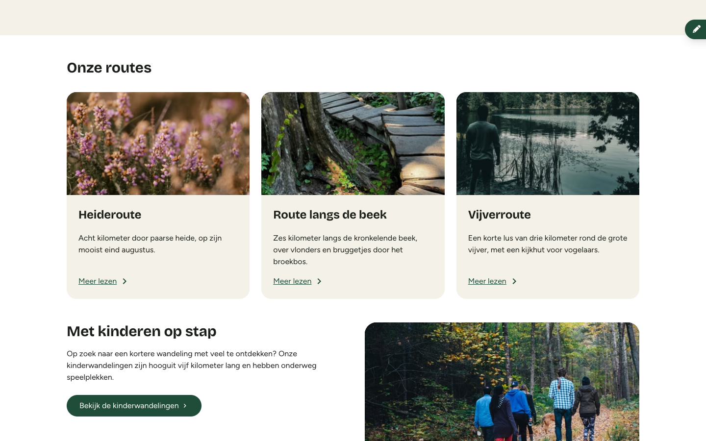
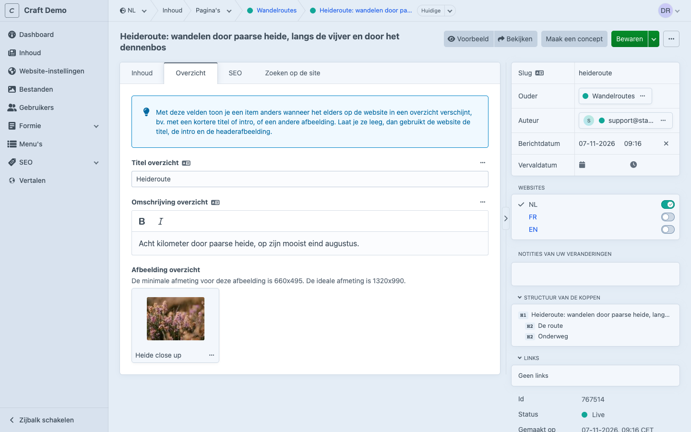

# Bepalen hoe je pagina als kaartje verschijnt

Je pagina's verschijnen niet alleen op zichzelf, maar ook als **kaartje** op andere pagina's: in een overzicht van routes, in een carrousel met nieuws, of als uitgelicht kaartje op de homepage. Met de tab **Overzicht** bepaal je hoe dat kaartje eruitziet, zonder je pagina zelf te veranderen.

## Wat is een kaartje?
Een kaartje is een korte verwijzing naar een pagina: een afbeelding, een titel en een korte tekst. Wie erop klikt, komt op de pagina. Kaartjes verschijnen in een Overzicht-kolom (zie *Naar andere pagina's verwijzen: overzicht en kaartje*), in carrousels en in de zoekresultaten van de site.

<!-- screenshot: site, pagina "Wandelroutes" met drie kaartjes; markeer afbeelding, titel en tekst van één kaartje -->

## Wat toont het kaartje als je niets invult?
De site gebruikt dan wat al op je pagina staat:

| Kaartje | Leeg in Overzicht | Ingevuld in Overzicht |
|---|---|---|
| Titel | de titel van de pagina | **Titel overzicht** |
| Tekst | de eerste 140 tekens van de intro | **Omschrijving overzicht** |
| Afbeelding | de headerafbeelding; zonder headerafbeelding de fallbackafbeelding uit de **Website-instellingen** | **Afbeelding overzicht** |

Voor veel pagina's is dat prima. Je hoeft de tab dus niet altijd in te vullen.

## Het kaartje aanpassen
1. Open de pagina en klik op de tab **Overzicht**.
2. Vul in wat je wilt overschrijven:
   - **Titel overzicht**: een kortere of krachtigere titel.
   - **Omschrijving overzicht**: één korte zin die zegt waarom iemand moet klikken.
   - **Afbeelding overzicht**: een beeld dat beter werkt op klein formaat.
3. Klik op **Bewaren**.
4. Bekijk het resultaat op een pagina waar het kaartje staat.

<!-- screenshot: "Heideroute", tab Overzicht ingevuld; markeer de drie velden en de uitleg erboven -->

## Wanneer overschrijf je?
- De titel is te lang en wordt afgebroken of neemt drie regels in.
- De intro komt traag op gang, waardoor de eerste 140 tekens weinig zeggen.
- De headerafbeelding is een brede sfeerfoto die op een klein, vaak vierkant kaartje niets toont. Een close-up of een detail werkt daar beter. Vergeet ook het focuspunt niet (zie *Focuspunt en afbeelding bewerken*).
- Je wilt dat de kaartjes in een overzicht er gelijkmatiger uitzien, met teksten van ongeveer dezelfde lengte.

Schrijf voor kaartjes kort en scanbaar: bezoekers overlopen een overzicht snel.

> **Let op:** wat je hier invult, zie je **alleen op het kaartje**, niet op de pagina zelf. Wil je het resultaat zien, open dan een pagina met een overzicht waarin dit kaartje staat.

> **Tip:** vul de tab niet meteen in. Kijk eerst hoe het kaartje eruitziet, en pas aan als de tekst afgebroken wordt of het beeld niet werkt.

## Veelgestelde vragen
- **Waarom staat alles er twee keer in?** Het staat er niet dubbel. De velden op de eerste tab zijn je pagina; de tab Overzicht is alleen voor het kaartje. Laat je de tab leeg, dan hergebruikt de site de gegevens van je pagina.
- **Wat is een kaartje precies?** De korte verwijzing naar je pagina in een overzicht, carrousel of zoekresultaat.
- **Moet ik dit invullen als mijn pagina nog nergens als kaartje staat?** Nee. Je kan het later doen, wanneer je de pagina in een overzicht opneemt.

## Zie ook
- Naar andere pagina's verwijzen: overzicht en kaartje
- Focuspunt en afbeelding bewerken
- De SEO-tab: titel, beschrijving en delen op sociale media
- Algemene inhoud op één plek
