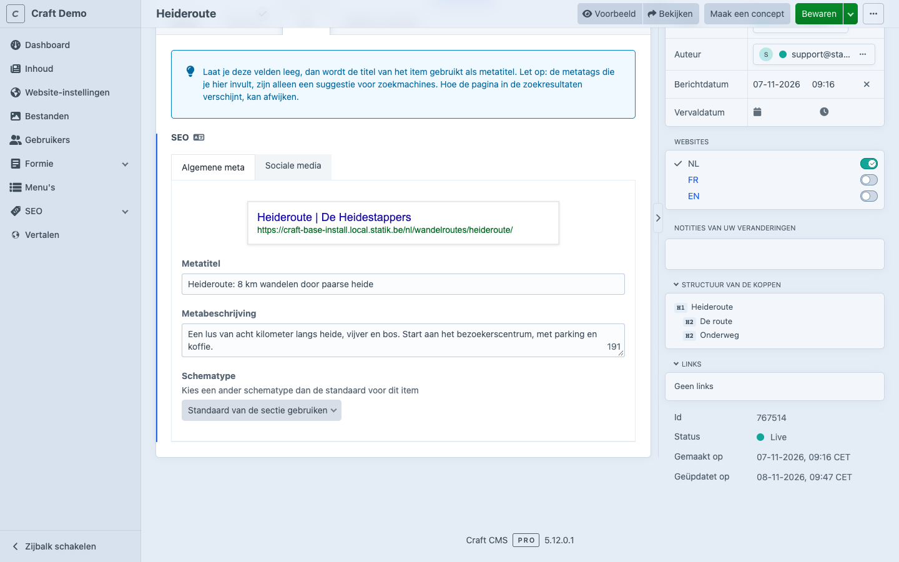
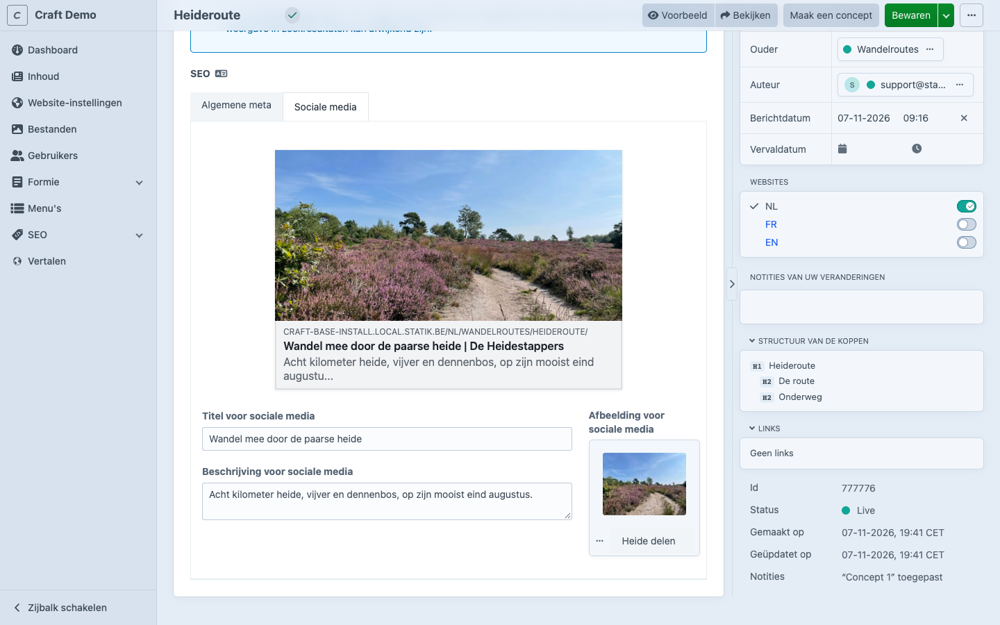

# De SEO-tab: titel, beschrijving en delen op sociale media

Elke pagina heeft een tab **SEO**. Daar bepaal je hoe je pagina in zoekmachines zoals Google verschijnt, en hoe ze eruitziet als iemand ze deelt op sociale media. Hier lees je wat elk veld doet, wat de site gebruikt als je niets invult, en voor welke pagina's het de moeite loont.

## Moet je dit voor elke pagina invullen?
Nee. Laat je de tab leeg, dan vult de site zelf iets in (zie de tabel hieronder). Vul hem wel in voor:
- je belangrijkste pagina's, waarvoor je goed gevonden wilt worden;
- pagina's die je zelf deelt of promoot, bijvoorbeeld een nieuwe route of een evenement.

## Algemene meta: hoe je pagina in Google staat
1. Open de pagina en klik op de tab **SEO**.
2. Onder **Algemene meta** vul je in:
   - **Metatitel**: de titel in de zoekresultaten. De site zet de naam van je website er zelf achter.
   - **Metabeschrijving**: het tekstje onder de titel in de zoekresultaten. Een of twee zinnen die zeggen wat de bezoeker er vindt.
3. Klik op **Bewaren**.

<!-- screenshot: "Heideroute", tab SEO > Algemene meta ingevuld; markeer Metatitel en Metabeschrijving -->

Zoekmachines zien beide als een **suggestie**. Vinden ze een ander stuk van je pagina relevanter voor wat iemand zocht, dan tonen ze dat. Dat is normaal en geen fout. Een duidelijke, eerlijke titel en beschrijving worden wel het vaakst overgenomen.

## Sociale media: hoe je pagina eruitziet als ze gedeeld wordt
Onder **Sociale media** vul je in wat LinkedIn, Facebook en andere platformen tonen als iemand je link deelt:
- **Titel voor sociale media**
- **Beschrijving voor sociale media**
- **Afbeelding voor sociale media**: kies met **Kies een afbeelding** een afbeelding. Een liggende foto werkt het best.

Sociale media nemen deze gegevens meestal wel letterlijk over. Schrijf ze dus zo dat iemand zin krijgt om te klikken.

<!-- screenshot: tab SEO > Sociale media ingevuld met heide-delen.jpg; markeer de drie velden -->

## Wat gebruikt de site als je niets invult?

| Veld | Leeg |
|---|---|
| Metatitel | de titel van de pagina |
| Metabeschrijving | de standaardomschrijving uit de SEO-instellingen |
| Titel voor sociale media | de metatitel, of anders de titel van de pagina |
| Beschrijving voor sociale media | de standaardomschrijving uit de SEO-instellingen |
| Afbeelding voor sociale media | de standaardafbeelding uit de SEO-instellingen |

Omdat de beschrijving dan voor elke pagina dezelfde algemene tekst is, loont het om voor belangrijke pagina's een eigen **Metabeschrijving** te schrijven.

## De standaardwaarden
De naam van de site, de standaardomschrijving (**Standaard meta omschrijving**) en de standaardafbeelding om te delen (**Standaard meta afbeelding**) staan op één plek in de SEO-instellingen. We stellen ze in bij de lancering. Kloppen ze niet meer, of heb je er geen toegang toe, laat het ons weten.

> **Let op:** vul de tab in **vóór** je de link voor het eerst deelt of test. Platformen zoals Facebook onthouden wat ze de eerste keer zien. Pas je daarna iets aan, dan kan het uren tot dagen duren voor de nieuwe titel of afbeelding verschijnt.

## En met AI?
SEO blijft nuttig nu mensen ook via AI-assistenten zoeken. Alles wat machines helpt om je pagina te begrijpen, helpt ook daar: een duidelijke titel, een goede beschrijving, een logische koppenstructuur.

> **Tip:** schrijf de metabeschrijving voor mensen, niet voor zoekmachines: wat vindt iemand op deze pagina, en waarom zou die klikken?

## Veelgestelde vragen
- **Welke afbeelding wordt gebruikt als ik geen deelafbeelding kies?** De standaardafbeelding uit de SEO-instellingen.
- **Ik vulde een metatitel in, maar Google toont iets anders.** Google gebruikt het als suggestie en kiest soms zelf.
- **Moet ik dit voor elke pagina doen?** Nee, alleen voor belangrijke pagina's en pagina's die je deelt.

## Zie ook
- Bepalen hoe je pagina als kaartje verschijnt
- Zoekwoorden toevoegen voor de zoekfunctie op de site
- Tussentitels gebruiken: de kopstructuur
