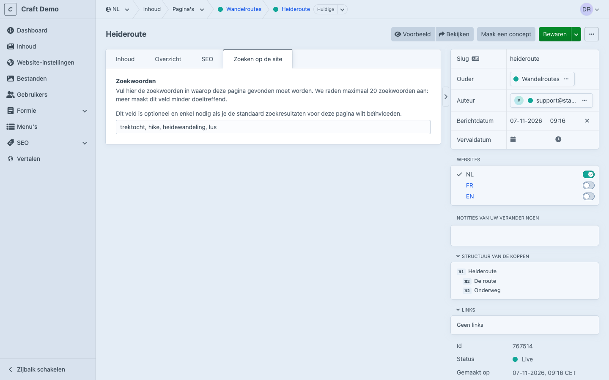
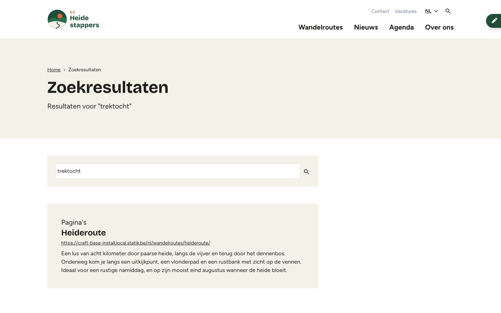

# Zoekwoorden toevoegen voor de zoekfunctie op de site

Je site heeft een eigen zoekfunctie. Die vindt pagina's op de woorden die erin staan. Soms zoeken bezoekers op een woord dat niet in je tekst voorkomt: een synoniem, een plaatsnaam, een afkorting of een vakterm. Met het veld **Zoekwoorden** laat je je pagina ook op die woorden vinden.

## Waar staat het veld?
Op pagina's, nieuwsberichten en events vind je een tab **Zoeken op de site** met één veld: **Zoekwoorden**.

<!-- screenshot: "Heideroute", tab Zoeken op de site met ingevulde Zoekwoorden; markeer het veld en de uitleg -->

## Zoekwoorden toevoegen
1. Open de pagina en klik op de tab **Zoeken op de site**.
2. Typ de woorden in het veld **Zoekwoorden**, gescheiden door een komma. Bijvoorbeeld: `trektocht, hike, heidewandeling, lus`.
3. Klik op **Bewaren**.
4. Zoek op de site naar een van de woorden om te testen.

Hou het beperkt: de uitleg bij het veld raadt maximaal 20 zoekwoorden aan.

## Wat zet je erin?
Goede kandidaten:
- **synoniemen**: "trektocht" of "hike" voor een wandelroute;
- **plaatsnamen** die niet in de tekst staan, bijvoorbeeld de dorpen in de buurt;
- **vaktermen, afkortingen of oude namen** waarop mensen zoeken, maar die je in de tekst niet gebruikt.

Wat er niet in hoort:
- woorden die al in de tekst staan: die vindt de zoekfunctie toch;
- lange lijsten met alles wat er een beetje mee te maken heeft. Dan verschijnt je pagina bij zoekopdrachten waar ze niet bij past, en worden de resultaten voor je bezoekers slechter.

> **Let op:** deze zoekwoorden werken **alleen voor de zoekfunctie van je eigen site**. Google en andere zoekmachines gebruiken ze niet. Wil je beter gevonden worden in Google, zorg dan dat de belangrijke woorden in je tekst en titels staan, en kijk naar de tab SEO (zie *De SEO-tab: titel, beschrijving en delen op sociale media*).

## Meestal laat je het leeg
Het belangrijkste is dat de woorden waarop je gevonden wilt worden in de inhoud zelf staan: in de titel, de intro en de tekst. Dat helpt zowel de zoekfunctie van je site als Google. Gebruik het veld Zoekwoorden alleen als aanvulling.

<!-- screenshot: site, zoekresultaten voor "trektocht" met Heideroute; markeer het resultaat -->

In de zoekresultaten toont de site de titel en de omschrijving uit de tab **Overzicht** als je die invulde (zie *Bepalen hoe je pagina als kaartje verschijnt*), anders de titel en het begin van de intro.

> **Tip:** denk als je bezoeker. Welk woord zou iemand typen die deze pagina zoekt? Staat het niet in de tekst en past het daar ook niet, zet het dan bij de zoekwoorden.

## Veelgestelde vragen
- **Helpt dit voor Google?** Nee, alleen voor de zoekbalk van je eigen site.
- **Heeft dit iets met de filters in een overzicht te maken?** Nee. Filters werken met categorieën; zoekwoorden alleen met de zoekbalk.
- **Hoe scheid ik de woorden?** Met een komma. Hou het bij maximaal een twintigtal.

## Zie ook
- Bepalen hoe je pagina als kaartje verschijnt
- De SEO-tab: titel, beschrijving en delen op sociale media
- De vaste pagina's
