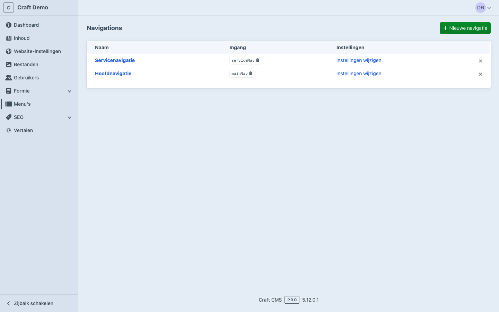
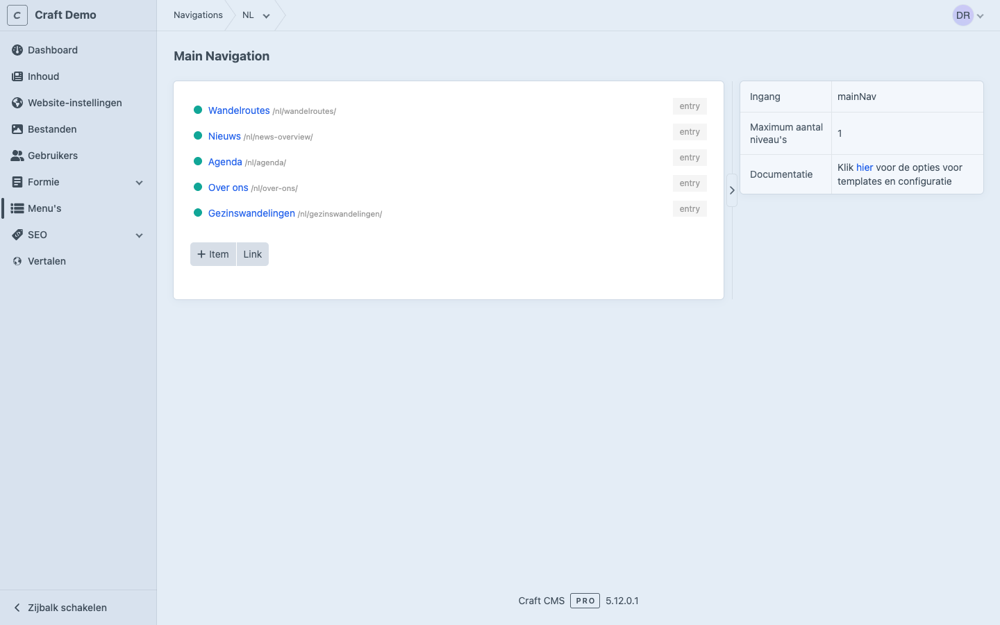
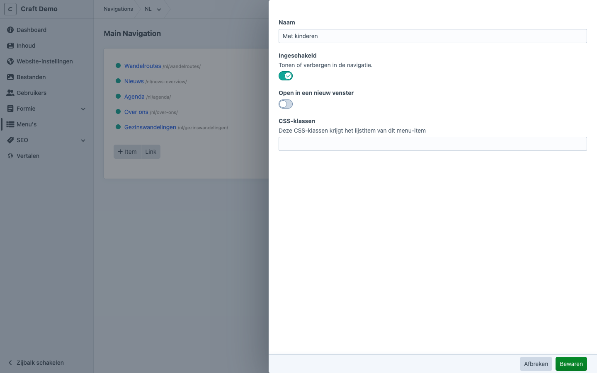

# De menu's aanpassen

De menu's van je site beheer je zelf: pagina's toevoegen, de volgorde wijzigen, een kortere naam geven of een item weghalen. Dat heb je nodig als er een nieuwe belangrijke pagina bijkomt, of als je een menu-item duidelijker wil benoemen.

## Welke menu's zijn er?

Ga in de zijbalk naar **Menu's**. Je ziet twee menu's:

- **Hoofdnavigatie**: het hoofdmenu, groot bovenaan de site.
- **Servicenavigatie**: de kleine links boven het hoofdmenu, bijvoorbeeld "Contact" of "Vacatures".

Beide menu's komen onderaan de site in de footer nog eens terug. Er is dus geen apart footermenu: wat je in deze twee menu's zet, staat automatisch ook in de footer. De rest van de footer (adres, e-mail, telefoon, sociale media) komt uit de **Website-instellingen** (zie *Algemene inhoud op één plek*). De links naar het cookiebeleid, het privacybeleid en de toegankelijkheidsverklaring zet de site er zelf bij.

<!-- screenshot: overzicht Menu's, beide menu's zichtbaar; markeer de twee namen -->

De menu's in deze basis hebben één niveau: geen uitklapmenu's. Sommige sites hebben een uitgebreider hoofdmenu (een megamenu met kolommen en knoppen); dat bouwen we anders op, en dat bekijken we samen in je live opleiding.

## Een pagina aan een menu toevoegen

1. Klik op het menu, bijvoorbeeld **Hoofdnavigatie**.
2. Klik onderaan op **Item** voor een pagina van je eigen site, of op **Link** voor een andere website.
3. Kies de pagina in het venster en klik op **Selecteren**. Kies je **Link**, dan vul je zelf een **Naam** in en bij **Link** het webadres.
4. Het nieuwe item komt altijd onderaan de lijst te staan.
5. Sleep het met het pijlenkruisje (**Verplaatsen**) naar de juiste plek. De volgorde in de lijst is de volgorde op de site.

<!-- screenshot: Hoofdnavigatie geopend, knoppen onderaan gemarkeerd, nieuw item onderaan de lijst -->

## Naam en instellingen van een item

Klik op het tandwieltje (**Instellingen**) naast een item. Je kan:

- **Naam**: de tekst in het menu. Die mag korter zijn dan de titel van de pagina, bijvoorbeeld "Met kinderen" in plaats van "Wandelingen voor gezinnen met jonge kinderen".
- **Ingeschakeld**: het item tijdelijk verbergen zonder het weg te halen.
- **Open in een nieuw venster**: de link opent in een nieuw tabblad. Gebruik dit enkel voor een andere website of een extern document. Voor je eigen pagina's laat je het uit: bezoekers raken anders de weg kwijt in hun tabbladen.

Laat het veld **CSS-klassen** leeg; dat is voor ons.

Klik op **Bewaren**.

<!-- screenshot: venster van het tandwiel met Naam, Ingeschakeld en Open in een nieuw venster -->

## Een item verwijderen

Klik op het kruisje (**Verwijderen**) naast het item en bevestig in het venster dat verschijnt. De pagina zelf blijft bestaan; ze staat alleen niet meer in het menu.

## Meteen online

> **Let op:** wijzigingen in een menu zijn meteen live. Er is geen concept en geen "opslaan voor later". Kijk na elke wijziging op de site, bovenaan en in de footer.

Een horizontaal hoofdmenu heeft weinig plaats. Lange namen of te veel items duwen het menu op twee regels of naar het menu op mobiel. Hou namen kort, en vraag je bij een te vol menu af of de structuur van je site nog klopt.

## Vaste items

Sommige knoppen in de kop van de site, zoals de taalkeuze of de zoekknop, staan in de code. Die zie je hier niet en hoef je ook niet te beheren.

## Veelgestelde vragen

- **Waar stel ik de namen van de menu-items in?** Bij het tandwieltje van het item in **Menu's**. De titel van de pagina zelf verandert daardoor niet.
- **Ik heb een item verwijderd en het staat er nog.** Ververs de site. Staat het er dan nog, ververs ook het menu in het control panel, verwijder het opnieuw en controleer of de melding "Menu-item verwijderd" verschijnt.
- **Ik kan een nieuw item niet verslepen of verwijderen.** Een item dat je net toevoegde, kan je pas verslepen of verwijderen nadat je de pagina van het menu ververst. Daarna lukt het wel.
- **Mag iedereen in het team de menu's aanpassen?** Technisch wel. Spreek af dat één persoon het beheert, zodat het menu overzichtelijk blijft.
- **Is het menu per taal anders?** Ja, op een meertalige site heeft elke taal haar eigen menu. Kies de taal bovenaan het menu.

## Zie ook

- Algemene inhoud op één plek (wat er verder in de footer staat)
- Een pagina vertalen
