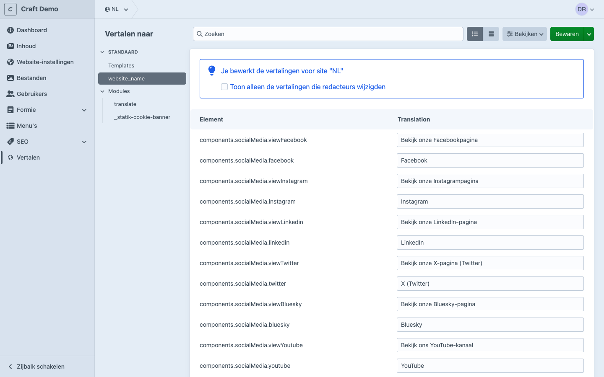
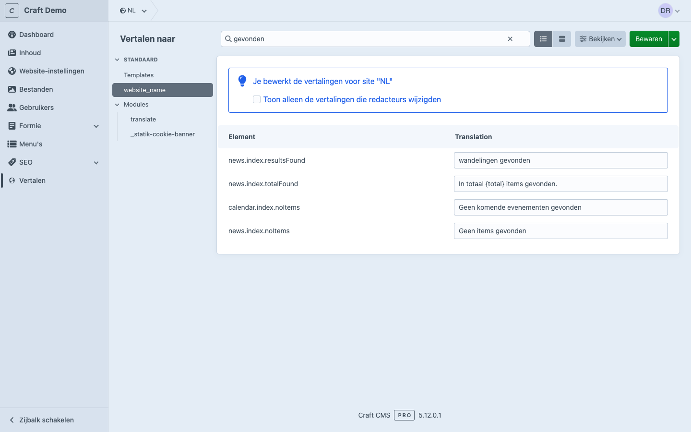

# Vaste teksten aanpassen

Veel tekst op je site staat niet in een pagina, maar in de site zelf: de knop "Zoeken", labels bij filters, "Lees meer", meldingen zoals "resultaten gevonden". Die pas je aan onder **Vertalen**. Je hebt dit nodig als je onze woorden door die van jullie organisatie wil vervangen, en op een meertalige site om die teksten te vertalen.

## Waar vind je ze?

Klik in de zijbalk op **Vertalen**. Je komt op de pagina **Vertalen naar**. Bovenaan staat voor welke taal je werkt: "Je bewerkt de vertalingen voor site NL".

<!-- screenshot: Vertalen-overzicht, site NL; markeer de melding met de taal en het zoekveld -->

Links zie je de groepen. Kies de groep met de naam van je website: daar staan de teksten van de site (in onze demo heet die groep **website_name**). De groep **Templates** is meestal leeg. Andere groepen, zoals die van de cookiebanner, laat je best met rust, tenzij we iets anders afspraken.

## Een tekst aanpassen

1. Zoek op de tekst zoals je hem **nu op de site ziet**. De zoekfunctie zoekt in beide kolommen, dus je vindt hem ook als iemand hem al eens aanpaste.
2. In de kolom **Element** staat een code, zoals `news.index.resultsFound`. Die vertelt ons waar de tekst op de site staat. In de kolom **Translation** staat wat de site toont.
3. Typ je eigen tekst in de kolom **Translation**.
4. Klik op **Bewaren**. De tekst is meteen overal aangepast waar hij gebruikt wordt.

<!-- screenshot: bron website_name, zoekterm "gevonden", kolom Translation aangepast naar "wandelingen gevonden" -->

Ook op een Nederlandstalige site heet dit "vertalen", al vertaal je eigenlijk van onze woorden naar de jouwe. Zo gebruik je de woorden van jullie organisatie, zonder dat er voor elk woordje een apart veld in de pagina's nodig is. Eén tekst kan op meer plaatsen staan: "resultaten gevonden" staat bijvoorbeeld boven het nieuws, de agenda en de kennisbank.

> **Tip:** bekijk de pagina na het bewaren. Sommige stukken van de site, zoals de footer, houdt de site even bij om snel te blijven. Zie je daar na een tijd nog de oude tekst, laat het ons weten.

## In een andere taal

Op een meertalige site kies je bovenaan, in het kruimelpad naast **NL**, een andere taal (**FR** of **EN**). De codes links blijven dezelfde, rechts vul je de vertaling in. Doe dit zeker na de lancering eens grondig: blader door de Franse en Engelse site, en elke Nederlandse tekst die je daar ziet, staat hoogstwaarschijnlijk hier.

## Wat je wijzigt, blijft bewaard

De site bewaart je aanpassingen apart. Ze blijven staan, ook als wij de site later bijwerken met nieuwe teksten. Bij elke gewijzigde tekst zie je wie hem wanneer veranderde ("Gewijzigd door … op …").

- Vink **Toon alleen de vertalingen die redacteurs wijzigden** aan om enkel jullie aanpassingen te zien.
- Met **Standaard terugzetten** zet je één tekst terug naar het origineel.
- Maak je een veld leeg, dan toont de site ook weer de standaardtekst.

## Wat hoort hier niet?

Vertalen is enkel voor teksten die in de site zelf zitten. Je kan hier geen woord vervangen in je eigen inhoud: een tikfout in tien pagina's pas je in die tien pagina's aan. Paginatitels, menu-items en categorieën pas je ook elders aan.

## Veelgestelde vragen

- **Als we een label aanpassen, vind ik het dan nog terug om het te vertalen?** Ja. Zoek op de tekst die je nu op de knop ziet; er wordt in beide kolommen gezocht.
- **Kan ik hier een woord in onze eigen inhoud overal vervangen?** Nee, enkel teksten van de site zelf.
- **Er zijn heel veel teksten, moet ik ze allemaal nakijken?** Nee. Gebruik het zoekveld voor wat je op de site tegenkomt. In het begin is het wat werk, daarna verandert er zelden nog iets.
- **Ik vind een tekst nergens.** Laat het ons weten, dan zeggen we waar hij staat of passen we het aan.

## Zie ook

- De menu's aanpassen
- Een pagina vertalen
