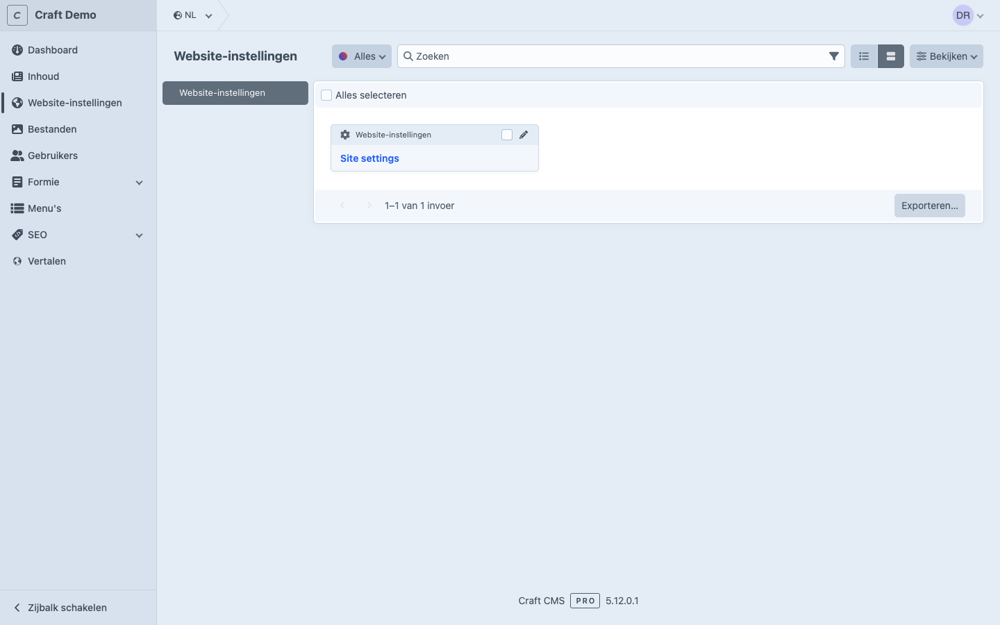
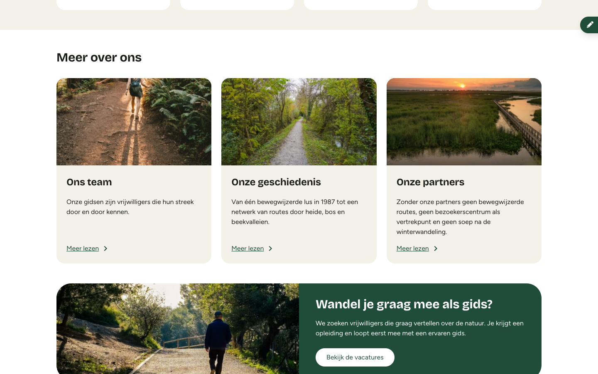
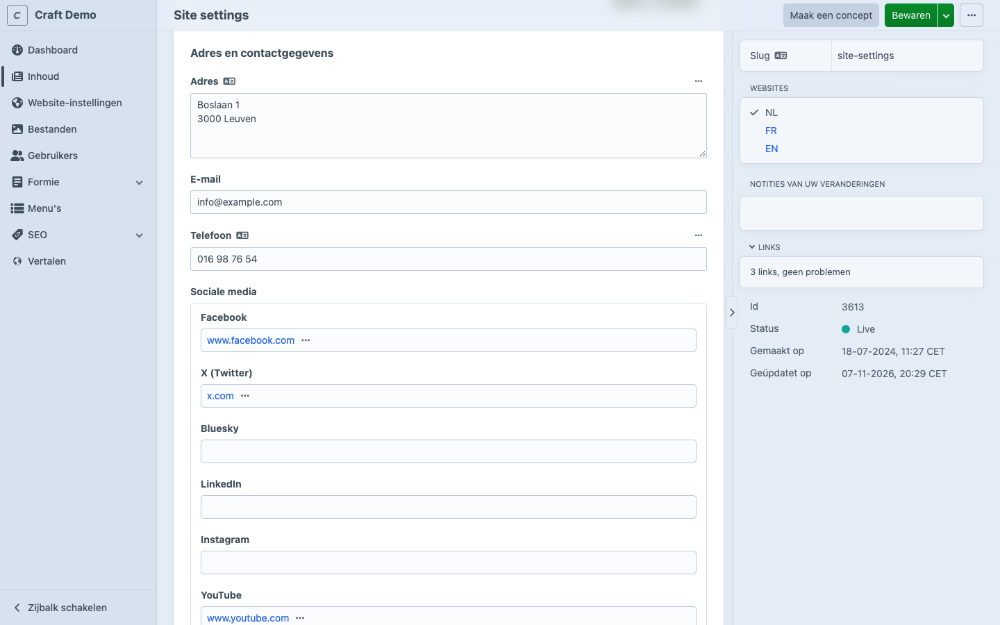

# Algemene inhoud op één plek

Sommige inhoud hoort niet bij één pagina maar komt overal terug: je adres in de footer, de links naar je sociale media, een reserveafbeelding voor kaartjes zonder beeld. Die staat op één plek, de **Website-instellingen**. Je past het één keer aan, en het klopt overal.

## Waar vind je ze?

Klik in de zijbalk op **Website-instellingen**. Je krijgt een lijst met één item, **Site settings**: klik het open.

<!-- screenshot: Website-instellingen geopend via de zijbalk, lijst met het ene item Site settings -->

Het is één vaste pagina: je kan ze niet verwijderen of dupliceren, en ze heeft geen eigen adres op de site.

## Fallbackafbeelding

De site toont de **Fallbackafbeelding** waar het ontwerp een afbeelding verwacht maar er geen is. Typisch: een kaartje in een overzicht van een pagina zonder **Headerafbeelding** en zonder **Afbeelding overzicht**.

- Kies een algemeen beeld dat bij jullie organisatie past, bijvoorbeeld een sfeerbeeld van een wandelpad. Geen beeld met een duidelijke boodschap of herkenbare personen: het kan bij heel uiteenlopende pagina's opduiken.
- Het veld is verplicht.
- Zolang de site nog testinhoud bevat, zie je de fallbackafbeelding vaak. Op een goed gevulde site zie je hem bijna nooit. Zie je hem toch, geef die pagina dan een eigen beeld.

<!-- screenshot: website, overzicht met kaartjes; markeer het kaartje met de fallbackafbeelding -->

## Adres en contactgegevens

Onder **Adres en contactgegevens** vul je in:

- **Adres**: zoals het op de site moet staan, over meerdere regels.
- **E-mail**: het algemene e-mailadres. De site beschermt het tegen spambots.
- **Telefoon**: typ het zoals je wil, bijvoorbeeld 016 12 34 56 of +32 16 12 34 56. De site zet het zelf in de juiste vorm en maakt er een link van die je op een gsm kan aantikken.

Deze gegevens staan in de footer van elke pagina en naast het formulier op de contactpagina. Een leeg veld toont de site niet.

## Sociale media

In **Sociale media** plak je de volledige link naar elk kanaal (Facebook, X (Twitter), Bluesky, LinkedIn, Instagram, YouTube). Elk ingevuld kanaal wordt een icoontje in de footer en op de contactpagina. Een leeg veld geeft geen icoontje. Een link haal je weg met de drie puntjes ernaast en **Remove**.

> **Let op:** bij een nieuwe site staan hier soms nog voorbeeldlinks. Vervang ze of maak ze leeg vóór de lancering.

<!-- screenshot: Website-instellingen, contactvelden en sociale media ingevuld met demowaarden -->

## Bewaren

Klik op **Bewaren** en bekijk de footer op de site. De wijziging staat meteen op alle pagina's.

## Per taal

Op een meertalige site kies je bovenaan, in het kruimelpad naast **NL**, de taal. Het adres, het telefoonnummer en de sociale media kunnen per taal verschillen (bijvoorbeeld een Franstalig account), dus vul elke taal na. Het e-mailadres is voor alle talen hetzelfde.

## Wat staat er op andere sites nog?

Op sommige sites staat hier meer: een vast nieuwsbriefblok, links voor de footer of blokken die op een hele reeks pagina's terugkomen. Het principe blijft hetzelfde: wat op veel pagina's hetzelfde is, beheer je hier.

## Veelgestelde vragen

- **Ons adres is veranderd. Moet ik dat overal aanpassen?** Nee, enkel hier. Footer en contactpagina volgen vanzelf.
- **Waarom zie ik overal dezelfde afbeelding op de kaartjes?** Dat is de fallbackafbeelding: die pagina's hebben nog geen eigen beeld.
- **Ik vind niet waar een tekst in de footer staat.** Adres en contact staan hier, de links komen uit de menu's (zie *De menu's aanpassen*), en vaste teksten zoals "Volg ons" staan in **Vertalen** (zie *Vaste teksten aanpassen*).

## Zie ook

- De menu's aanpassen
- De vaste pagina's
- Bepalen hoe je pagina als kaartje verschijnt
