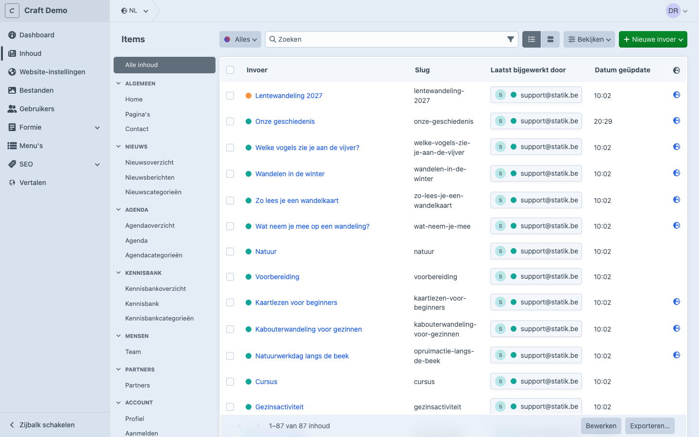
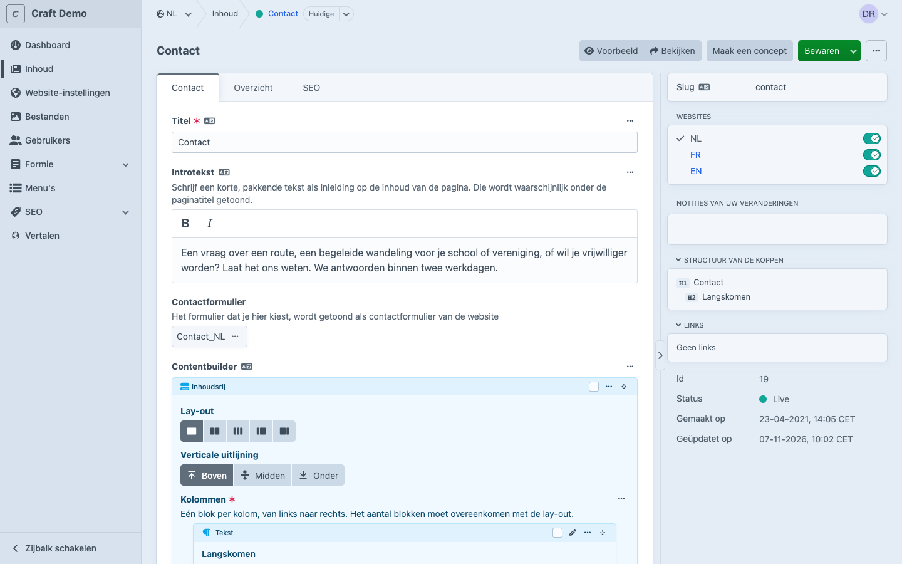
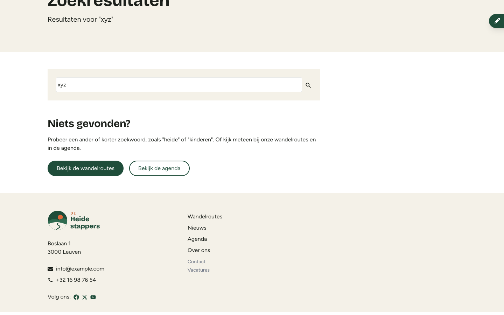

# De vaste pagina's

Naast je gewone pagina's heeft de site een aantal pagina's met een vaste rol. Ze bestaan altijd precies één keer, je kan ze niet verwijderen en hun adres ligt vast. Je vult ze wel zelf in. Hier lees je per pagina wat je kan aanpassen en wat de site zelf doet.

Je vindt ze allemaal onder **Inhoud**, in de linkerkolom. Klik je erop, dan opent de pagina meteen, zonder lijst ertussen. In het menu met de drie puntjes naast **Bewaren** staat geen **Verwijderen**.

<!-- screenshot: Inhoud, linkerkolom met Home, Contact, Nieuwsoverzicht, Agendaoverzicht, Pagina niet gevonden, Zoekresultaten gemarkeerd -->

## Home

De homepage heeft geen gewone paginaheader. Bovenaan staat het blok **Hero**: titel, afbeelding, intro en knoppen. Daaronder bouw je de pagina verder op met de **Contentbuilder**, net als andere pagina's. De tabs **Overzicht** en **SEO** zijn er ook.

- Een veld met een rood sterretje is verplicht.
- Een optioneel veld dat je leeg laat, wordt niet getoond.

## Contact

De contactpagina heeft een **Introtekst**, een **Contactformulier** en een **Contentbuilder**.

- Bij **Contactformulier** kies je welk formulier van Formie er komt. Het formulier zelf pas je aan in Formie (zie *Een formulier aanpassen en instellen wie een mail krijgt*).
- Het adres, e-mailadres, telefoonnummer en de sociale media naast het formulier komen uit de **Website-instellingen** (zie *Algemene inhoud op één plek*). Je past ze daar aan, niet op de contactpagina.

<!-- screenshot: Contact geopend, velden Introtekst, Contactformulier en Contentbuilder gemarkeerd -->

## Nieuwsoverzicht en Agendaoverzicht

Deze overzichtspagina's hebben weinig velden: een titel, **Headerafbeelding** en **Introtekst** in de tab Algemeen, plus Overzicht en SEO. De rest maakt de site zelf:

- de kaartjes van alle nieuwsberichten (nieuwste eerst) of alle komende activiteiten (eerstvolgende eerst);
- de zoekbalk en de filter op categorie;
- de paginering, telkens negen per pagina.

Wil je de lijst anders, voeg dan berichten of categorieën toe (zie *Categorieën beheren*, *Een nieuwsbericht plaatsen* en *Een activiteit toevoegen aan de agenda*). Op sommige sites is er ook een kennisbankoverzicht dat op dezelfde manier werkt.

## Pagina niet gevonden

Dit is de 404-pagina: bezoekers zien ze als ze een adres openen dat niet (meer) bestaat, bijvoorbeeld via een oude link of een tikfout. Ze heeft een **Headerafbeelding**, een **Introtekst**, **Links** en een **Contentbuilder**.

Maak er iets nuttigs van:
- een korte, vriendelijke uitleg dat de pagina niet bestaat;
- links naar je homepage en een paar veelbezochte pagina's;
- eventueel een zoektip.

> **Tip:** welke adressen bezoekers tevergeefs proberen, zie je bij **SEO** → **404's**. Daar kan je ze doorsturen naar een bestaande pagina (zie *404's opvolgen en redirects maken*).

## Zoekresultaten

De resultaten zelf maakt de site. In de **Contentbuilder** van deze pagina zet je wat bezoekers zien als hun zoekopdracht **niets** oplevert (de tip in het formulier zegt het ook). Toon er bijvoorbeeld je belangrijkste pagina's of een link naar contact.

<!-- screenshot: website, zoekopdracht zonder resultaten met de inhoud van de contentbuilder eronder -->

## Wat je laat liggen

- **Systeem offline**: de pagina die verschijnt als de site in onderhoud is. Daar hoef je niets mee te doen.
- De pagina's onder **Account** (**Aanmelden**, **Registreren**, **Profiel** …) zijn enkel van belang op sites met een ledenzone. Heeft je site die niet, dan laat je ze liggen.
- **Cookiebeleid**, **Privacybeleid** en **Toegankelijkheidsverklaring** onder **Overige** zijn wel belangrijk: meer daarover lees je bij *De verplichte pagina's*.
- **Website-instellingen** is geen pagina en heeft een eigen plek in de zijbalk (zie *Algemene inhoud op één plek*).

## Veelgestelde vragen

- **Waarom kan ik de homepage niet verwijderen of de slug aanpassen?** Een site heeft altijd een homepage op hetzelfde adres. De inhoud pas je vrij aan.
- **Kan ik de volgorde van het nieuwsoverzicht kiezen?** Nee, het nieuwste staat altijd eerst. Een bericht in de kijker zetten doe je met een overzichtskolom op een andere pagina (zie *Een nieuwsbericht plaatsen*).

## Zie ook

- Algemene inhoud op één plek
- Een nieuwsbericht plaatsen
- 404's opvolgen en redirects maken
- De verplichte pagina's
