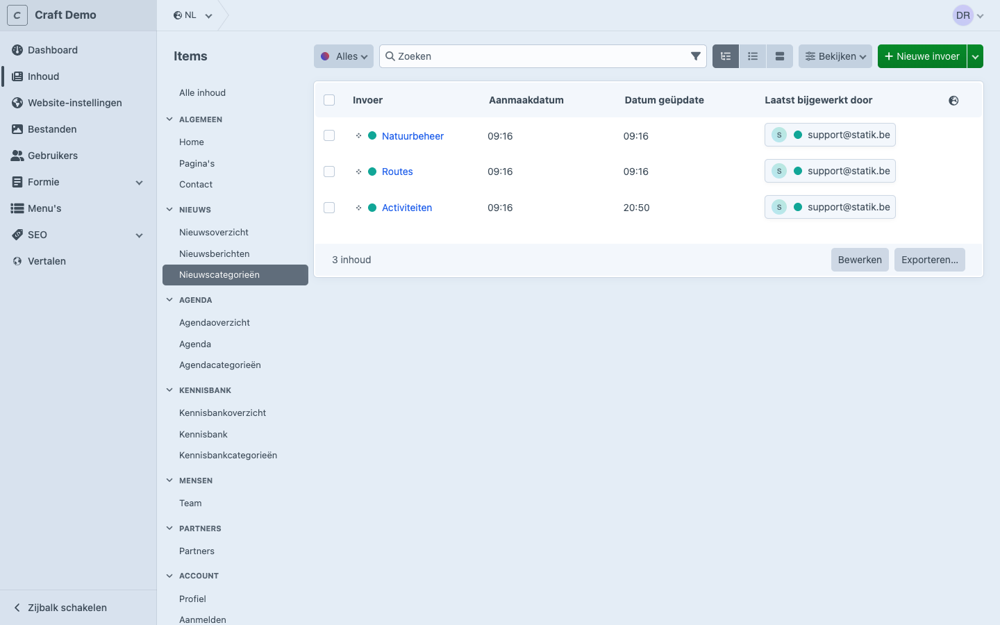
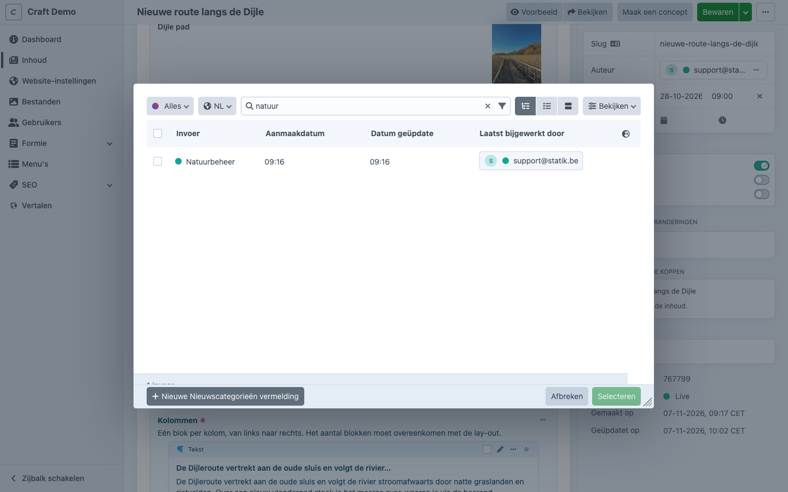

# Categorieën beheren

Categorieën zijn labels die je aan je inhoud hangt: thema's, soorten activiteiten, onderwerpen. Ze koppelen inhoud aan elkaar en bezoekers gebruiken ze om te filteren in het nieuws- en het agendaoverzicht. De categorieën zelf beheer je helemaal zelf.

## Waar vind je ze?

Elke soort categorie heeft een eigen lijst onder **Inhoud**, bij het onderdeel waar ze bij hoort:

- **Nieuwscategorieën** onder de kop **Nieuws**;
- **Agendacategorieën** onder **Agenda**;
- op sites met een kennisbank ook **Kennisbankcategorieën**.

<!-- screenshot: Inhoud, Nieuwscategorieën geselecteerd, lijst met demo-categorieën -->

## Een categorie toevoegen

1. Open de lijst, bijvoorbeeld **Nieuwscategorieën**.
2. Klik rechtsboven op **Nieuwe invoer**.
3. Vul de titel in. Meer is er niet nodig.
4. Klik op **Maak invoer aan**.

## Een categorie hernoemen

Open de categorie, pas de titel aan en bewaar. De nieuwe naam verschijnt meteen overal: in de filter, op de kaartjes en bij alle berichten die de categorie al hadden. Je hoeft die berichten niet opnieuw te openen.

## De volgorde bepalen

De volgorde in de lijst is de volgorde in de filter op de site. Sleep een categorie naar de juiste plek.

> **Let op:** de volgorde stel je in de lijst in, niet in het bericht. In een bericht maakt de volgorde niet uit.

De filter op de site toont enkel het bovenste niveau. Sleep een categorie dus niet onder een andere, tenzij we dat zo afspraken.

## Een categorie kiezen in een bericht

In een nieuwsbericht staat het veld **Nieuwscategorie**, in een activiteit **Evenementcategorie**.

1. Klik onder het veld op **Voeg een bericht toe**. Zo heet de knop, ook al kies je een categorie. Er opent een venster met de categorieën.
2. Typ een deel van de naam om te zoeken.
3. Selecteer de categorie en bevestig.
4. Bestaat ze nog niet, maak ze dan in hetzelfde venster aan met **Nieuwe Nieuwscategorieën vermelding** onderaan. Ze staat daarna ook in de lijst van categorieën.

Een bericht of een activiteit kan meer dan één categorie hebben. Een categorie die het bericht al heeft, staat grijs in het venster.

<!-- screenshot: nieuwsbericht, venster van Nieuwscategorie open, zoekterm "natuur" en resultaat Natuurbeheer -->

## Een categorie verwijderen

Vink de categorie aan in de lijst, klik onderaan op het tandwiel (**Acties**) en kies **Verwijderen**. Bevestig. De categorie verdwijnt ook van de berichten die ze hadden; de berichten zelf blijven bestaan. Een verwijderde categorie kan je terughalen uit de prullenbak (zie *Iets ongedaan maken: revisies en de prullenbak*), maar de koppelingen met berichten moet je dan opnieuw leggen.

## Per taal

Op een meertalige site kies je bovenaan de taal en vertaal je de titel van elke categorie. Het blijft dezelfde categorie: een bericht met "Routes" heeft in het Frans automatisch "Itinéraires".

## Wat jij doet en wat wij doen

- **Jij**: welke categorieën er zijn, hoe ze heten, de volgorde.
- **Wij**: welke soorten categorieën er bestaan en waar ze gebruikt worden. Wil je een nieuwe soort, of een categorie aan een ander soort inhoud koppelen? Vraag het ons gerust.

> **Tip:** spreek af dat één persoon eigenaar is van de categorieën. Anders sluipen er dubbels in zoals "Routes" en "Wandelroutes", of "erfgoed" naast "natuurerfgoed". Elke extra categorie maakt de filter minder overzichtelijk.

## Veelgestelde vragen

- **Is een categorie hetzelfde als een pagina met dezelfde naam?** Nee. Een categorie is een label; een pagina "Routes" is een pagina. Ze staan los van elkaar.
- **Mogen we de voorbeeldcategorieën aanpassen of weggooien?** Ja, allemaal.
- **Ik zie de categorieën van de agenda niet.** Misschien heeft je account er geen rechten op. Laat het ons weten.

## Zie ook

- Een nieuwsbericht plaatsen
- Een activiteit toevoegen aan de agenda
- Een pagina vertalen
