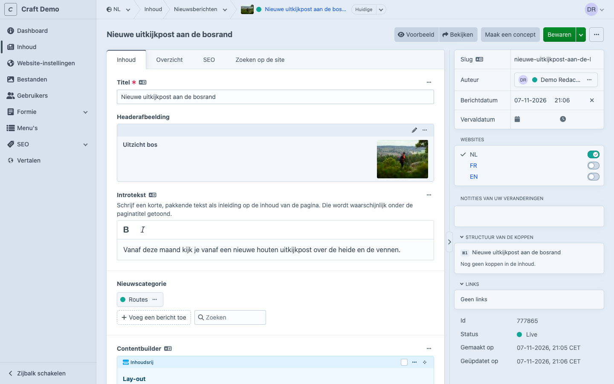
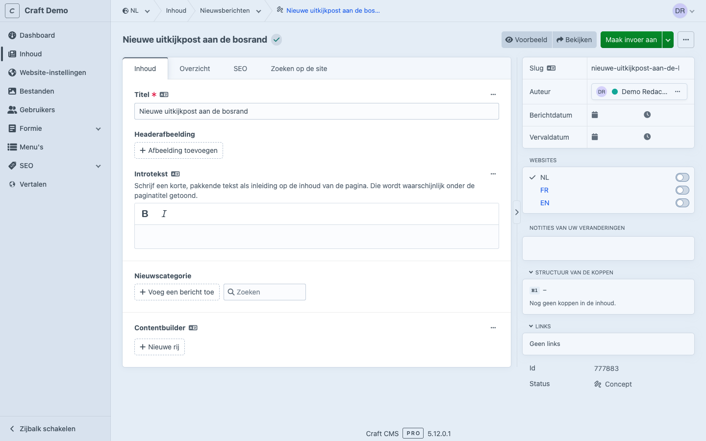

# Een nieuwsbericht plaatsen

Nieuws werkt met twee soorten pagina's: één **overzichtspagina** die zichzelf vult, en losse **nieuwsberichten** die jij schrijft. Hier lees je hoe je een bericht maakt, wat je zeker invult en waar het daarna overal verschijnt.

## Het overzicht doet zichzelf

Het **Nieuwsoverzicht** toont automatisch alle ingeschakelde berichten, het nieuwste eerst, met een zoekveld, een filter op categorie en paginering per negen berichten. Op die pagina vul je enkel een titel, headerafbeelding en intro in (zie *De vaste pagina's*).

## Een bericht maken

1. Ga naar **Inhoud** en klik onder **Nieuws** op **Nieuwsberichten**.
2. Klik op **Nieuwe invoer**.
3. Vul de **Titel** in.
4. Kies een **Headerafbeelding** en schrijf een korte **Introtekst**: een of twee zinnen die zeggen waar het bericht over gaat. Titel, intro en headerafbeelding zijn ook wat op het kaartje in overzichten komt, tenzij je in de tab Overzicht iets anders kiest (zie *Bepalen hoe je pagina als kaartje verschijnt*).
5. Kies een **Nieuwscategorie** met **Voeg een bericht toe** (zo heet de knop, ook al kies je een categorie). Daarmee kunnen bezoekers filteren. Een bericht kan meer dan één categorie hebben.
6. Bouw de inhoud op in de **Contentbuilder**, met rijen en kolommen zoals op elke pagina (zie *Rijen en kolommen: het principe*).
7. Zet rechts bij **Websites** de schakelaar van je taal aan en klik op **Maak invoer aan**.

<!-- screenshot: nieuw nieuwsbericht, bovenste velden ingevuld met demo-inhoud; markeer Nieuwscategorie -->

## Waarom staat mijn bericht uit?

Een nieuw nieuwsbericht staat standaard **uitgeschakeld**: rechts bij **Websites** staan de schakelaars van alle talen uit. Zo kan je rustig schrijven en bewaren zonder dat er een half bericht online komt. Pas als je de schakelaar van je taal aanzet en bewaart, verschijnt het op de site.

> **Let op:** vergeet je dat, dan bestaat je bericht wel, maar ziet niemand het. Zie je het niet in het overzicht, kijk dan eerst naar de status.

<!-- screenshot: nieuw nieuwsbericht, zijbalk met Websites: alle schakelaars uit -->

## De publicatiedatum bepaalt de volgorde

Overzichten tonen het bericht met de recentste **Berichtdatum** eerst. De site vult die in wanneer je het bericht voor het eerst bewaart. Je kan ze aanpassen:

- in de **toekomst**: het bericht verschijnt pas op dat moment (handig om een bericht in te plannen);
- in het **verleden**: bijvoorbeeld als je een ouder bericht overzet en het niet bovenaan wil.

Meer over status, publicatie- en vervaldatum lees je bij *Online, offline en ingepland*.

## Waar verschijnt je bericht?

- In het **Nieuwsoverzicht**, bovenaan.
- In elke **overzichtskolom** die **Nieuws** toont en dynamisch aanvult, bijvoorbeeld "Laatste nieuws" op de homepage. Die tonen automatisch de nieuwste berichten.
- In de zoekresultaten van de site.

## Zelf kiezen of automatisch laten vullen

In een overzichtskolom kan je zelf berichten kiezen om in de kijker te zetten. Met **Dynamisch aanvullen** aan vult de site de overige plaatsen aan met de nieuwste berichten. Kies je niets, dan toont de kolom gewoon het nieuwste. Zo hoef je na een nieuw bericht niets aan je andere pagina's te veranderen.

## Per taal

Op een meertalige site staat een nieuw bericht in alle talen uit. Vertaal het en zet het per taal aan; een bericht dat enkel in het Nederlands bestaat, laat je in de andere talen uit (zie *Een pagina vertalen*).

## Veelgestelde vragen

- **Kan ik de volgorde in het nieuwsoverzicht zelf bepalen?** Niet rechtstreeks: het nieuwste staat eerst. Pas eventueel de publicatiedatum aan, of zet een bericht in de kijker met een overzichtskolom.
- **Kan een bericht meerdere categorieën hebben?** Ja. Kies gerust meer dan één categorie als ze passen.
- **Mijn bericht staat niet in het overzicht.** Kijk of het ingeschakeld is en of de publicatiedatum niet in de toekomst ligt.

## Zie ook

- Categorieën beheren
- Een activiteit toevoegen aan de agenda
- Online, offline en ingepland
- Bepalen hoe je pagina als kaartje verschijnt
