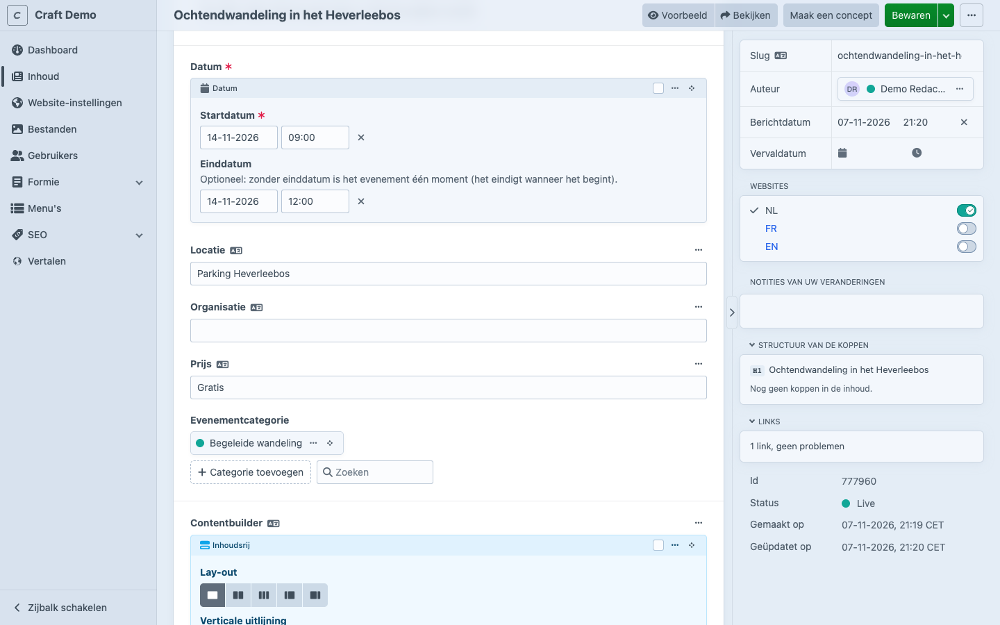
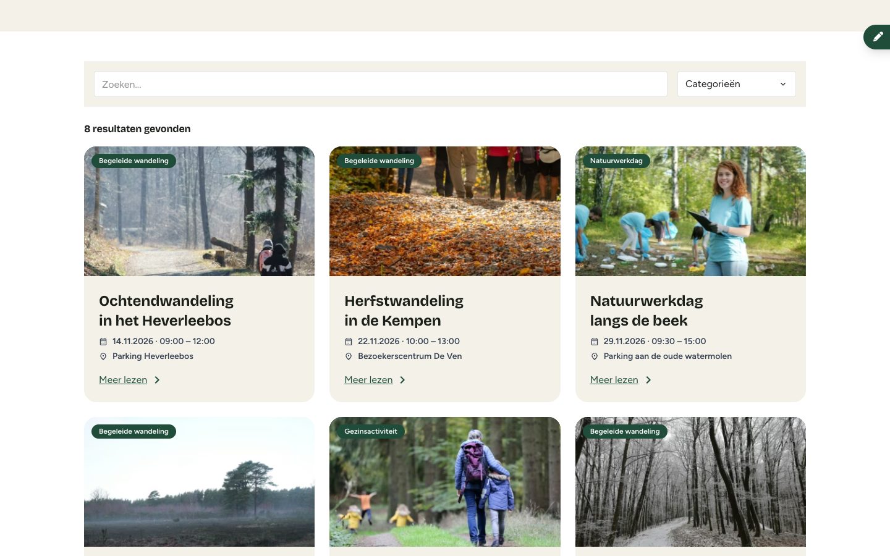

# Een activiteit toevoegen aan de agenda

De agenda werkt zoals het nieuws: een **Agendaoverzicht** dat zichzelf vult en losse activiteiten die jij invoert. Hier lees je welke velden een activiteit heeft, wat er gebeurt als je ze leeg laat, en wanneer een activiteit in de agenda staat.

## Een activiteit maken

1. Ga naar **Inhoud** en klik onder de kop **Agenda** op de lijst met activiteiten (**Agenda**).
2. Klik op **Nieuwe invoer**.
3. Vul **Titel**, **Headerafbeelding** en **Introtekst** in, net als bij een pagina.
4. Vul de **Datum** in (zie hieronder).
5. Vul de praktische info in: **Locatie**, **Prijs**, **Organisatie**.
6. Kies bij **Evenementcategorie** met **Categorie toevoegen** een of meer categorieën voor de filter.
7. Vul de pagina aan met de **Contentbuilder**.
8. Zet rechts bij **Websites** de schakelaar van je taal aan en klik op **Maak invoer aan**. Een nieuwe activiteit staat standaard in alle talen uit, zodat er niets halfafgewerkt online komt.

<!-- screenshot: nieuwe activiteit, blok Datum en de velden Locatie, Prijs, Organisatie, Evenementcategorie ingevuld met demo-inhoud -->

## De datum

In het blok **Datum** staan twee velden:

- **Startdatum**: verplicht, met datum en uur.
- **Einddatum**: optioneel. Zonder einddatum is de activiteit één moment: ze eindigt wanneer ze begint. Dat staat ook in de uitleg onder het veld.

Enkele voorbeelden:

| Soort activiteit | Startdatum | Einddatum |
| --- | --- | --- |
| Wandeling van 9 tot 12 uur | 14/6, 9:00 | 14/6, 12:00 |
| Weekend op kamp | 20/6, 10:00 | 22/6, 16:00 |
| Lezing, enkel een beginuur | 3/10, 20:00 | leeg |

De site past de weergave aan aan wat je invult: één dag met een begin- en einduur, of een periode over meerdere dagen.

## Praktische info: leeg verschijnt niet

**Locatie**, **Prijs** en **Organisatie** zijn vrije tekstvelden. Ze staan bovenaan de activiteit, elk met een icoontje. Een leeg veld verschijnt niet. Laat de prijs dus leeg als je er niets over wil zeggen, en vul "Gratis" in als het gratis is.

## Inschrijven

De site beheert zelf geen inschrijvingen of tickets: dat is een andere wereld, met betalingen en wachtlijsten. Moeten mensen zich inschrijven:

- zet een knop of link naar jullie inschrijfsysteem in de inhoud (zie *Een knop of link toevoegen*);
- of, voor een kleine activiteit, een formulier van Formie in een formulierkolom.

## Wanneer staat een activiteit in de agenda?

- Het **Agendaoverzicht** toont alleen activiteiten die nog niet voorbij zijn, de eerstvolgende eerst.
- Een activiteit is voorbij als haar einddatum voorbij is, of haar startdatum als er geen einddatum is. Ze verdwijnt dan vanzelf uit het overzicht. Er is geen archief van voorbije activiteiten.
- De pagina van de activiteit zelf blijft bestaan zolang ze ingeschakeld is. Wil je ze helemaal offline, gebruik dan een vervaldatum of schakel ze uit (zie *Online, offline en ingepland*).
- Overzichtskolommen met de optie **Agenda** tonen ook automatisch de eerstvolgende activiteiten.

<!-- screenshot: website, agendaoverzicht met de demo-activiteit en haar datum op het kaartje -->

## Gerelateerde activiteiten

Onder elke activiteit staan drie gerelateerde activiteiten. In de tab **Gerelateerde evenementen** stel je dat in:

- **Gerelateerde evenementen**: kies er zelf tot drie. Voorbije activiteiten slaat de site over.
- **Gerelateerde evenementen aanvullen** (standaard aan): kies je er minder dan drie, dan vult de site aan met komende activiteiten uit dezelfde categorie, en daarna met de eerstvolgende.

Laat je alles leeg, dan doet de site het helemaal zelf.

## Veelgestelde vragen

- **Waar zijn de activiteiten van vorige maand?** Voorbije activiteiten verdwijnen uit de agenda. Hun pagina bestaat nog, tenzij je ze uitschakelt.
- **Kunnen mensen zich via de site inschrijven?** Niet via de agenda zelf. Link naar je inschrijfsysteem, of gebruik een formulier.
- **Ik zie de agenda niet in mijn menu.** Misschien heeft je account er geen rechten op. Laat het ons weten.

## Zie ook

- Een nieuwsbericht plaatsen
- Categorieën beheren
- Een formulier aanpassen en instellen wie een mail krijgt
