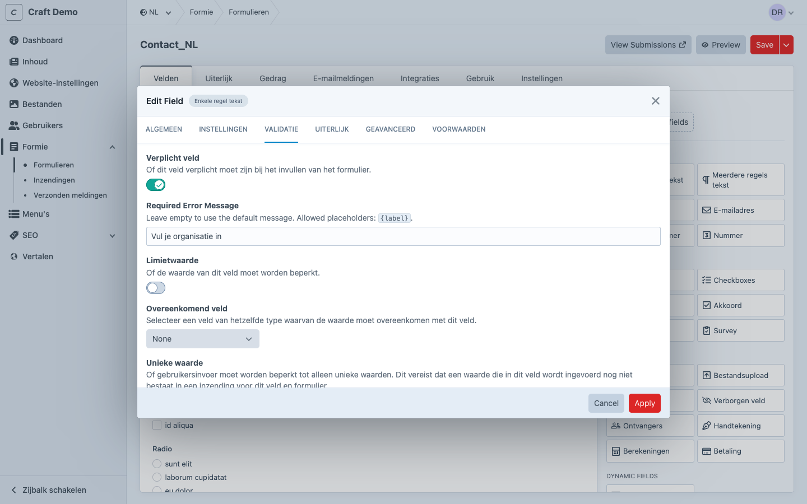
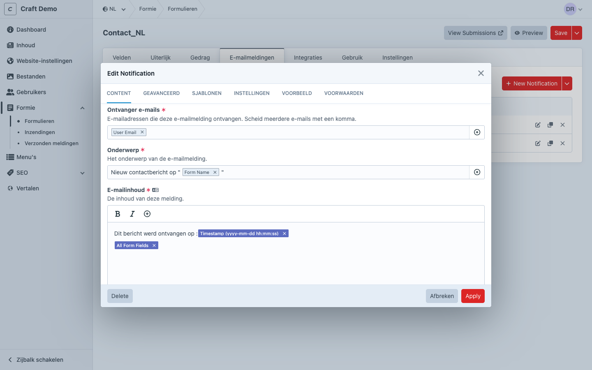

# Een formulier aanpassen en instellen wie een mail krijgt

Formulieren maak en beheer je in **Formie**. Hier lees je hoe je een veld toevoegt aan een bestaand formulier, hoe je instelt wie een mail krijgt, en waar je beter afblijft.

## Een formulier openen

Klik in de zijbalk op **Formie**. Je ziet de lijst **Formulieren**. Klik op een formulier om het te openen. Bovenaan staan de tabs, onder meer **Velden**, **Gedrag**, **E-mailmeldingen**, **Gebruik** en **Instellingen**. Een deel van Formie is nog niet vertaald: knoppen als **Save** en **Apply** en sommige velden staan in het Engels.

## Een veld toevoegen

1. Ga naar de tab **Velden**.
2. Sleep een veldtype uit de lijst naar de plek in het formulier waar je het wil. Sleep je het naast een bestaand veld, dan komen ze naast elkaar te staan.
3. Het venster **Edit Field** gaat meteen open. Stel het veld in:
   - **Label** (tab **Algemeen**): de vraag. Elk veld heeft een label nodig, ook voor schermlezers.
   - **Verplicht veld** (tab **Validatie**): moet iemand dit invullen?
   - **Required Error Message** (tab **Validatie**, verschijnt als het veld verplicht is): wat de invuller ziet als een verplicht veld leeg is. Zeg wat er ontbreekt: "Vul je organisatie in".
   - **Instructies**: een korte uitleg onder het label, als de vraag niet vanzelf spreekt.
4. Klik op **Apply** om het venster te sluiten, en daarna bovenaan op **Save** om het formulier te bewaren.

<!-- screenshot: Formie, contactformulier, venster Edit Field van het nieuwe veld "Organisatie", tab Validatie: Verplicht veld aan, Required Error Message ingevuld (niet bewaard) -->

In de tab **Voorwaarden** toon je een veld enkel als iemand een bepaald antwoord gaf, bijvoorbeeld "Hoeveel kinderen wandelen mee?" enkel als iemand "Ja" antwoordt op "Kom je met kinderen?".

## Opslaan is meteen live

> **Let op:** een formulier heeft geen concept. **Save** zet de wijziging meteen op de site. En verwijder je een veld en sla je op, dan zijn ook alle antwoorden die mensen in dat veld gaven weg.

Test na elke wijziging door het formulier zelf in te vullen op de site.

## Wat er gebeurt na het verzenden

In de tab **Gedrag** stel je bij **Completion Behaviour** in wat de invuller ziet: een bericht op dezelfde pagina, of een doorverwijzing naar een bedankpagina die je zelf maakt.

## Wie krijgt een mail? De meldingen

In de tab **E-mailmeldingen** staan de mails die vertrekken bij elke inzending. Formulieren gemaakt vanuit ons sjabloon hebben er twee:

- **Admin Notification**: naar jullie, met alle antwoorden.
- **User Notification**: een bevestiging naar het e-mailadres dat de invuller opgaf.

Open een melding om ze aan te passen:

- **Ontvanger e-mails**: de ontvangers. Meerdere adressen scheid je met een komma. In de tab **Geavanceerd** staan ook velden voor **CC** en **BCC**.
- **Onderwerp** en **E-mailinhoud**: vrij aan te passen. Met het plusje voeg je antwoorden uit het formulier in; die verschijnen als gekleurde labels, en in de mail staat daar dan wat de invuller typte.
- Tab **Voorbeeld**: zo ziet de mail eruit, met verzonnen voorbeeldgegevens.

<!-- screenshot: tab E-mailmeldingen, Admin Notification NL open; Ontvanger e-mails, Onderwerp en het plusje in E-mailinhoud in beeld -->

### Afzender en antwoordadres

- **Van e-mail** en **Van naam** (tab **Geavanceerd**): laat ze staan. Het afzenderadres hoort bij een verzenddomein dat voor jullie site is goedgekeurd. Verander je het, dan komen de mails in spam terecht of helemaal niet aan. Wil je mails vanaf jullie eigen domein versturen, vraag het ons: dat vraagt een technische instelling.
- **Antwoord aan e-mail**: mag je aanpassen. Wie op de mail antwoordt, schrijft naar dit adres. In de admin-melding staat het vaak op het e-mailadres van de invuller, zodat je meteen kan antwoorden. In de bevestiging aan de invuller zet je er bijvoorbeeld jullie algemene adres. Er kan maar één antwoordadres zijn.

## Een nieuw formulier

Klik op **Nieuw formulier**, geef het een naam en kies bij **Stencil** het contactformulier in jouw taal (bijvoorbeeld "Contact Form NL"), of dupliceer een bestaand formulier (**Dupliceren** in het actiemenu). Dan staan de meldingen en de spambescherming al juist. Plaats het daarna op een pagina met een formulierkolom; in de tab **Gebruik** zie je waar een formulier staat.

> **Tip:** laat je eerste eigen formulier eens door ons nakijken voor het live gaat.

## Veelgestelde vragen

- **Kan het antwoordadres per formulier verschillen?** Ja, je stelt het per melding en dus per formulier in.
- **Naar wie gaat de mail nu eigenlijk?** Kijk in de admin-melding bij **Ontvanger e-mails**. Bij een nieuwe site staat daar soms nog ons adres: geef ons vóór de lancering de juiste adressen door, of pas ze zelf aan.
- **Kan ik een veld weghalen zonder de oude antwoorden te verliezen?** Exporteer eerst de inzendingen (zie *Inzendingen bekijken, exporteren en spam*) of laat het veld staan en maak het niet verplicht.

## Zie ook

- Inzendingen bekijken, exporteren en spam
