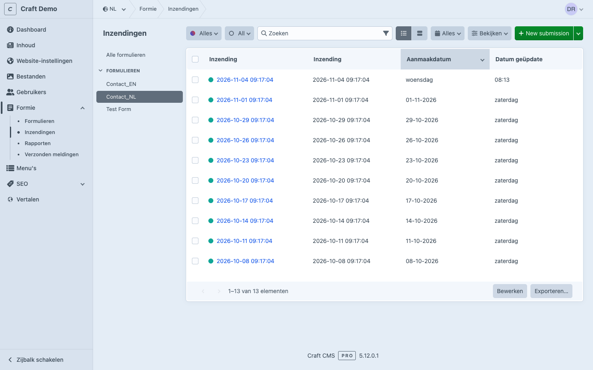
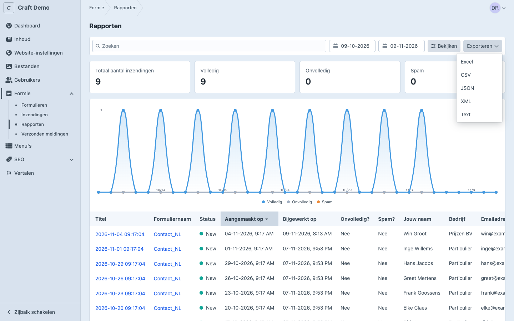
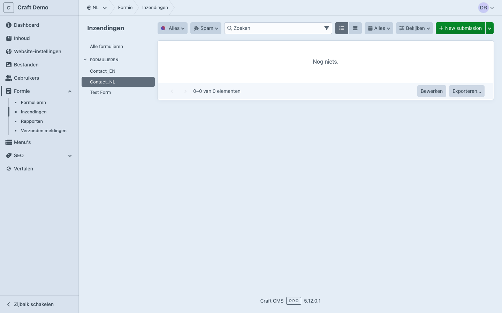

# Inzendingen bekijken, exporteren en spam

Elke keer iemand een formulier verstuurt, bewaart Formie een **inzending**. Hier lees je waar je ze vindt, hoe je ze exporteert, hoe spam werkt en hoe lang inzendingen bewaard blijven.

## Inzendingen bekijken

1. Klik in de zijbalk op **Formie** en dan op **Inzendingen**.
2. Kies links het formulier. Je ziet alle inzendingen, de nieuwste eerst.
3. Klik op een inzending om alle antwoorden te zien.

<!-- screenshot: Formie, Inzendingen, Contact_NL geselecteerd, lijst met demo-inzendingen (de spaminzending bovenaan met een kevertje) -->

Elke inzending die de server bereikte, staat hier, ook als de mail niet aankwam (een verkeerd adres, een mail in spam). Twijfel je of iemand iets stuurde, kijk dan eerst hier. Staat het hier niet, dan liep er iets mis tussen het versturen en de site. Laat het ons dan weten.

## Exporteren

Exporteren doe je via **Rapporten**: een overzicht van de inzendingen van al je formulieren samen.

1. Klik in de zijbalk op **Formie** en dan op **Rapporten**. Het rapport opent meteen, met de inzendingen van de voorbije maand tot vandaag. Spam zit er niet in.
2. Kies bovenaan de periode: klik op de begindatum of de einddatum en kies een dag in de kalender. De tellers, de grafiek en de lijst passen zich meteen aan. Met **Reset** ga je terug naar de standaardperiode.
3. Klik op **Exporteren** en kies een formaat: **Excel** of **CSV** voor een rekenblad, of **JSON**, **XML** of **Text**. Het bestand komt bij je downloads terecht.

Via **Bekijken** kies je welke kolommen je ziet en hoe de lijst gesorteerd is. Elke vraag uit je formulieren krijgt een eigen kolom. Handig om inschrijvingen te tellen of antwoorden te verwerken. Een rapport aanmaken of aanpassen kan je zelf niet. Heb je een ander rapport nodig, bijvoorbeeld voor één formulier, vraag het ons gerust.

<!-- screenshot: Formie, Rapporten, rapport "Alle inzendingen" met standaardperiode; menu Exporteren open (Excel, CSV, JSON, XML, Text) -->

> **Let op:** een export bevat persoonsgegevens. Bewaar het bestand veilig en verwijder het als je het niet meer nodig hebt.

## Spam

Formie controleert elke inzending op de achtergrond. Op de meeste sites draait ook een onzichtbare captcha: bezoekers hoeven geen puzzeltjes op te lossen. Wat verdacht lijkt, krijgt de markering **Spam**: het staat apart, en er vertrekt geen mail voor.

- In de lijst staat spam gewoon tussen de rest, met een kevertje voor de titel. Wil je enkel de spam zien, kies dan in het statusfilter bovenaan (**All**) de optie **Spam**.
- Mist er een inzending, kijk dan bij de spam. Staat er een echte vraag tussen, open ze, zet rechts **Markeer als spam** uit en klik op **Opslaan**. Laat **Meldingen verzenden** uit, tenzij de mail alsnog moet vertrekken.
- Glipt er toch spam door, open de inzending en zet **Markeer als spam** aan. Krijg je er veel, laat het ons weten: dan kijken we de bescherming na.

<!-- screenshot: lijst gefilterd op Spam (statusfilter), één demo-inzending zichtbaar -->

## Hoe lang worden inzendingen bewaard?

Formie verwijdert inzendingen **na één jaar automatisch**. Dat staat zo ingesteld in elk formulier dat van ons sjabloon vertrekt (tab **Instellingen**, **Gegevensbewaring** en **Duur gegevensbewaring**). De reden is de privacywetgeving (GDPR): je bewaart persoonsgegevens niet langer dan nodig.

- Moet je gegevens langer bijhouden, bijvoorbeeld voor een jaarverslag, exporteer ze dan op tijd.
- Een andere bewaartermijn voor een formulier? Bespreek het eerst intern, en hou het zo kort als het kan. Langer dan twee jaar raden we af.

## Inzendingen verwijderen

Wil je inzendingen sneller verwijderen, bijvoorbeeld na een afgelopen inschrijving, vink ze aan en kies **Verwijderen** in het actiemenu.

## Veelgestelde vragen

- **Kan ik een inzending kwijtraken?** Niet zolang ze minder dan een jaar oud is en je ze niet zelf verwijdert. Kijk ook bij de spam.
- **Bij mijn vorige werkgever kregen we heel veel spam van bots. Hoe zit dat hier?** Formie doet onzichtbare controles en zet verdachte inzendingen apart. Krijg je toch veel spam, laat het ons weten.
- **Krijg ik een mail van spaminzendingen?** Nee, daarvoor vertrekt er geen melding.

## Zie ook

- Een formulier aanpassen en instellen wie een mail krijgt
- De verplichte pagina's (privacybeleid)
