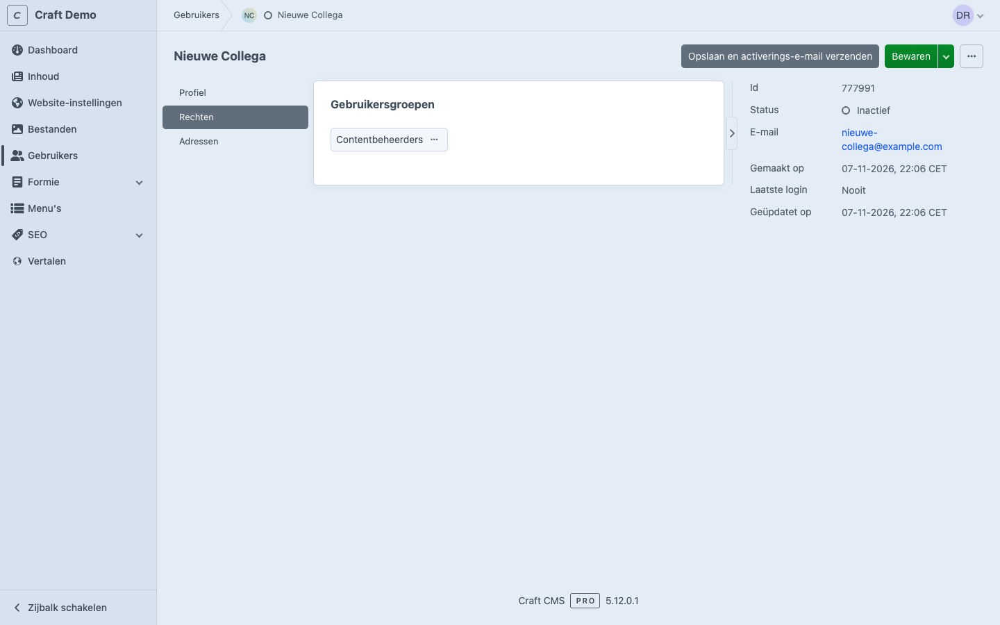

# Een collega toegang geven

Werkt er een nieuwe collega mee aan de site, dan maak je zelf een account aan. Het belangrijkste daarbij is de **groep**: die bepaalt wat iemand mag.

## Een account maken

1. Klik in de zijbalk op **Gebruikers**.
2. Klik op **Nieuwe gebruiker**.
3. Vul het **E-mail**adres in. Dat is meteen de login. Vul ook de **Volledige naam** in, zodat je de persoon herkent in de lijst en bij de auteur van pagina's. De andere velden mogen leeg blijven.
4. Klik op **Rechten maken en instellen**.
5. Klik in het scherm **Rechten**, bij **Gebruikersgroepen**, op **Kiezen** en kies de groep, meestal **Contentbeheerders**.
6. Klik op **Opslaan en activerings-e-mail verzenden**.

<!-- screenshot: nieuwe gebruiker, scherm Rechten, Contentbeheerders gekozen bij Gebruikersgroepen en de knop Opslaan en activerings-e-mail verzenden gemarkeerd -->

Je collega krijgt een mail met een link. Wie erop klikt, kiest zelf een wachtwoord en kan daarna inloggen. Jij kent dat wachtwoord nooit, en dat is ook de bedoeling. Tot dan staat het account op **Wachtend**. De link in de mail blijft drie weken geldig.

## Waarom de groep zo belangrijk is

Rechten hangen aan de groep, niet aan de persoon. Een account zonder groep kan inloggen, maar ziet en mag niets. Zit je collega in **Contentbeheerders**, dan heeft die dezelfde rechten als jij.

> **Let op:** vergeet je de groep, dan belt je collega je straks met "ik zie niets". Open dan het account, ga naar **Rechten** en kies de groep alsnog bij **Gebruikersgroepen**.

## Andere groepen

Op sommige sites zie je nog andere groepen, zoals leden, partners of een community. Dat zijn meestal mensen met een login op de **website zelf**, bijvoorbeeld om een profiel bij te houden of iets in te dienen. Zij komen niet in het control panel. Zet een collega dus niet in zo'n groep, en een lid niet in **Contentbeheerders**.

## Minder rechten

Moet iemand maar een deel beheren, bijvoorbeeld een stagiair die enkel nieuws plaatst, of een collega die enkel de formulieren opvolgt? Laat het ons weten. We maken dan een aparte groep met precies die rechten.

## Veelgestelde vragen

- **Contentbeheerders, zijn dat mensen in het control panel of gebruikers van de site?** Contentbeheerders zijn jullie, de mensen die de site beheren. Andere groepen zijn gebruikers van de website zelf.
- **Moet ik een gebruikersnaam kiezen?** Nee, het e-mailadres is de login.
- **Ik zie de knop Nieuwe gebruiker niet.** Dan heeft je eigen account dat recht niet. Vraag het ons.

## Zie ook

- Een account beheren
- Inloggen en je weg vinden in het control panel
